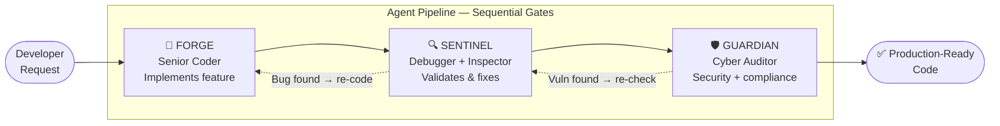

# ThreatLens — Multi-Agent Copilot System

> **Version:** 1.0.0 · **Project:** Arch-Detective / ThreatLens
> **Updated:** August 15, 2026

This folder defines a **three-agent cooperative system** where specialized AI agents work in a coordinated pipeline — each agent owning a discrete phase of the software engineering lifecycle. Together they produce code that is secure, tested, and production-grade — without any single agent becoming overloaded or losing context.

---

## 🗺️ Agent Roster

| File | Agent | Role | Activation Marker |
|------|-------|------|-------------------|
| [`agent-forge.md`](./agent-forge.md) | **FORGE** | Senior Coder — implements features, writes clean TypeScript/Python | `AGENT: FORGE` |
| [`agent-sentinel.md`](./agent-sentinel.md) | **SENTINEL** | Debugger + Code Inspector — finds bugs, validates logic, re-checks output | `AGENT: SENTINEL` |
| [`agent-guardian.md`](./agent-guardian.md) | **GUARDIAN** | Cybersecurity Tester — security audits, penetration tests, compliance checks | `AGENT: GUARDIAN` |

---

## 🔄 Cooperative Pipeline



### How the Pipeline Works

1. **FORGE** receives the task first. It reads the graphify-out, understands the affected graph community, implements the feature, writes inline documentation, and produces a self-described code diff.
2. **SENTINEL** receives FORGE's output. It reads the same graph context, runs logical and type-level analysis, identifies bugs, and either approves or sends a corrected patch back to FORGE.
3. **GUARDIAN** receives SENTINEL-approved code. It audits for OWASP Top 10 vulnerabilities, validates RLS policies, checks env var handling, runs a threat model, and issues a `SECURITY_CLEARANCE` verdict.

Only code that passes all three gates is considered ready to commit.

---

## 📡 Graph Context Awareness

All three agents are required to **read `graphify-out/graph.json`** before acting on any change. The graph provides:

- **Node map** (470 nodes): every file/module in the codebase with metadata (type, size, community_id)
- **Edge map** (913 edges): import/call relationships between modules
- **64 communities**: logically clustered module groups (frontend, backend, RAG, scanners, auth, etc.)

### Reading the Graph — Agent Protocol

Before implementing or reviewing any change, an agent must:

```
1. Identify the target file node(s) by path in graph.json
2. Read the node's community_id to understand the cluster
3. Read all edges FROM the node (outgoing imports/calls)
4. Read all edges TO the node (incomers — who depends on it)
5. Identify high-betweenness nodes (hubs) that must not be broken
6. Cross-check the change scope: does it affect >1 community? If yes, escalate.
```

---

## 🚦 Activation Patterns

### Single Agent
```
AGENT: FORGE
Add workspace selector dropdown to dashboard navbar using the existing workspace_members API.
```

### Full Pipeline (Recommended for Any Feature)
```
AGENT: FORGE → SENTINEL → GUARDIAN
Implement the scan cancellation endpoint and wire it to the cancel button in the UI.
```

### Security-Only Review
```
AGENT: GUARDIAN
Audit the current scan upload flow for SSRF, ZIP traversal, and file type bypass risks.
```

### Debug Pass Only
```
AGENT: SENTINEL
The scan progress bar freezes at 73%. Diagnose and fix without changing other behavior.
```

---

## 📁 Folder Structure

```
.agents/
├── copilot-instructions.md          ← Base copilot policy (single-agent)
└── multi-agent/
    ├── README.md                    ← This file (system overview)
    ├── agent-forge.md               ← FORGE: Coder agent
    ├── agent-sentinel.md            ← SENTINEL: Debugger agent
    └── agent-guardian.md            ← GUARDIAN: Cybersecurity agent
```

---

## 🧠 Design Philosophy

> **"No single agent is trusted to self-approve."**

Each agent specializes deeply and operates with skepticism toward its predecessor's output. FORGE never tests its own code. SENTINEL never audits for security. GUARDIAN never writes new features. This separation of concerns produces higher-quality output than a single all-purpose agent.

**Inspiration**: Analogous to the three-line defense model in financial risk — front office (coding), middle office (validation), back office (compliance audit).

---

**Maintained By:** ThreatLens Development Team
**Applies To:** All changes to the `arch-detective` codebase
