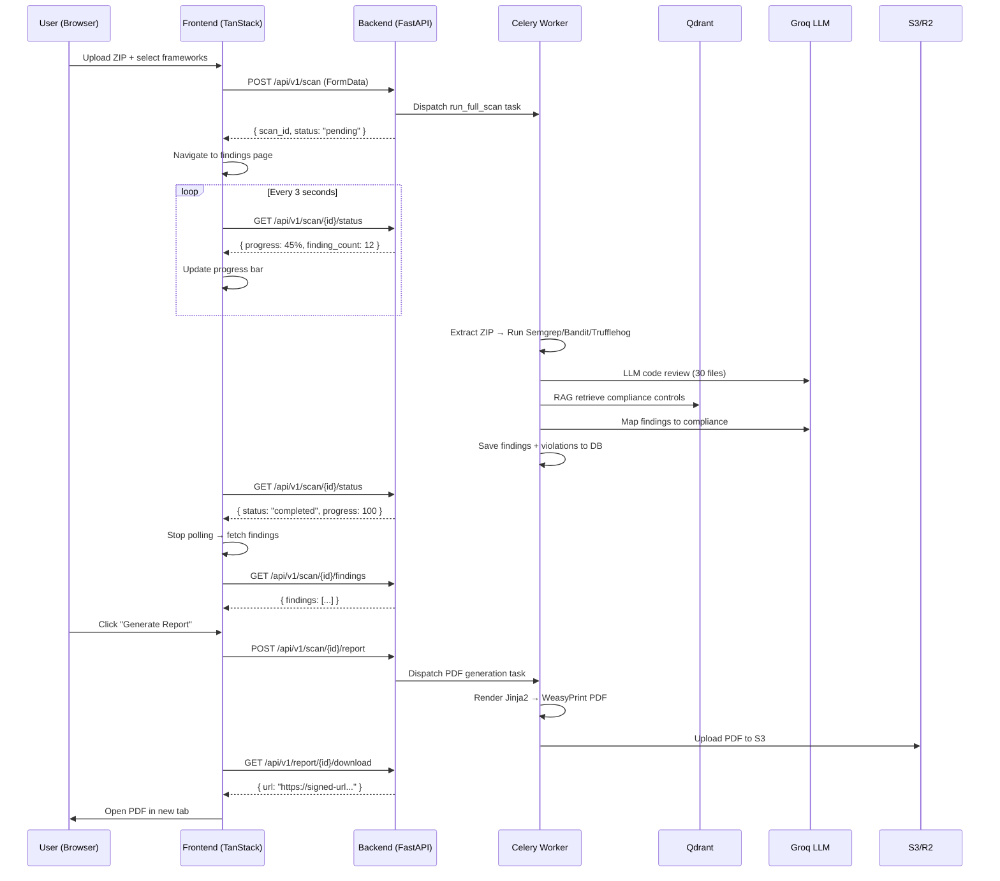
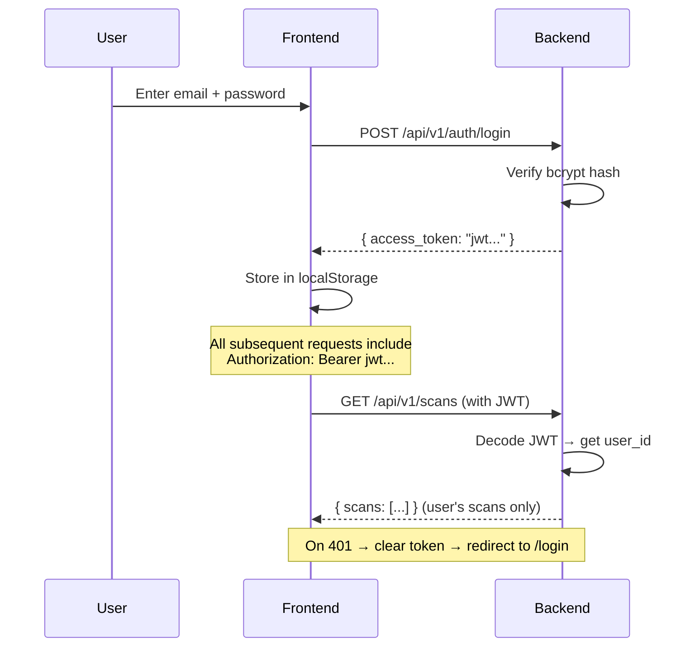

# Backend ↔ Frontend Connection Guide

> Historical implementation design, not a current executable-file inventory. The unused `useScanProgress`, `useFrameworks`, `useFindings`, `DataTable` and `PipelineStep` modules were removed after reference and build checks. Current saved-audit UI uses `src/components/audit-workbench`, `src/lib/api/workbench.ts` and the page-specific queries in `src/routes/_app`. Examples below are retained as design history; see `README.md` and `.github/maintenance/CLEANUP_REPORT.md` for current setup and verification.

> **Purpose:** Single-source reference for connecting every ThreatLens backend service to the existing TanStack Start frontend.  
> **Why this file exists:** The 8 Part files describe *what* to build on each side. This file describes *how* to wire them together — the exact data contracts, file changes, component modifications, and testing steps needed to replace mock data with live API calls.

---

## Table of Contents

1. [Why This File Is Needed](#1-why-this-file-is-needed)
2. [Current Frontend State (Before Backend)](#2-current-frontend-state-before-backend)
3. [Files to Create (New)](#3-files-to-create-new)
4. [Files to Modify (Existing)](#4-files-to-modify-existing)
5. [Part 1 Connection: Foundation → Health + API Client](#5-part-1-connection-foundation--health--api-client)
6. [Part 2 Connection: RAG → Framework Selector](#6-part-2-connection-rag--framework-selector)
7. [Part 3 Connection: Ingestion → File Upload & Git Input](#7-part-3-connection-ingestion--file-upload--git-input)
8. [Part 4 Connection: Scanners → Findings Table & Progress](#8-part-4-connection-scanners--findings-table--progress)
9. [Part 5 Connection: Agent Chains → Compliance View & CVSS](#9-part-5-connection-agent-chains--compliance-view--cvss)
10. [Part 6 Connection: Reports → PDF Download & CSV Export](#10-part-6-connection-reports--pdf-download--csv-export)
11. [Part 7 Connection: Celery → Real-Time Progress Bar](#11-part-7-connection-celery--real-time-progress-bar)
12. [Part 8 Connection: Auth → Login/Register & Protected Routes](#12-part-8-connection-auth--loginregister--protected-routes)
13. [Complete TypeScript Type Definitions](#13-complete-typescript-type-definitions)
14. [Data Flow Diagrams](#14-data-flow-diagrams)
15. [Mock → Live Migration Checklist](#15-mock--live-migration-checklist)

---

## 1. Why This File Is Needed

### The Problem

The 8 Part MD files each have a small "Frontend Connection Points" section, but they are:
- **Scattered** — you must read 8 different files to understand the full integration
- **Incomplete** — they show *what* endpoints to call, but not *which existing component code to change*
- **Missing context** — the frontend already has mock data, UI components, and route structure; the Part files don't reference these

### What This File Solves

| Without this file | With this file |
|---|---|
| Frontend connection steps are scattered across 8 Part files | All connection logic in one place |
| No reference to existing frontend code (`mock-data.ts`, current components) | Maps every mock data import to its API replacement |
| No clear migration path from mock → live | Step-by-step: create API client → create hooks → swap imports |
| TypeScript types duplicated/inconsistent across Parts | Single canonical type definition file |
| No data flow diagrams showing request/response lifecycle | Visual diagrams for every major flow |

### When To Use This File

- **After completing each Part's backend code**, open this file and follow the corresponding "Part N Connection" section
- **During Part 1**, create the shared API client and types — these are reused by every subsequent Part
- **During frontend development**, use this as the contract between backend and frontend

---

## 2. Current Frontend State (Before Backend)

### Existing Route Pages

| Route File | URL Path | Current Data Source |
|---|---|---|
| `src/routes/index.tsx` | `/` | Static (landing page) |
| `src/routes/_app/dashboard.tsx` | `/dashboard` | `mock-data.ts` → `FINDINGS`, `SCANS`, `COVERAGE`, `FRAMEWORKS` |
| `src/routes/_app/new-scan.tsx` | `/new-scan` | `mock-data.ts` → `FRAMEWORKS`; local state only |
| `src/routes/_app/findings.tsx` | `/findings` | `mock-data.ts` → `FINDINGS` |
| `src/routes/_app/reports.tsx` | `/reports` | `mock-data.ts` → `REPORTS`, `SCANS` |
| `src/routes/_app/reports.$reportId.tsx` | `/reports/:reportId` | `mock-data.ts` → `REPORTS`, `FINDINGS` |

### Existing Mock Data (to be replaced)

```
src/lib/mock-data.ts exports:
├── FRAMEWORKS[]    → Replace with GET /api/v1/frameworks
├── FINDINGS[]      → Replace with GET /api/v1/scan/{id}/findings
├── SCANS[]         → Replace with GET /api/v1/scans
├── REPORTS[]       → Replace with GET /api/v1/scans (filter by has_report)
├── COVERAGE[]      → Replace with computed framework scores from API
├── Severity type   → Keep (matches backend enum)
├── Finding type    → Extend with backend ComplianceViolation fields
└── Stride type     → Keep (frontend-only STRIDE categorization)
```

### Existing Components (reusable, no changes needed)

| Component | Path | Used For |
|---|---|---|
| `AppShell` | `src/components/brutal/AppShell.tsx` | Page layout wrapper |
| `BrutalButton` | `src/components/brutal/BrutalButton.tsx` | Action buttons |
| `BrutalBadge` | `src/components/brutal/BrutalBadge.tsx` | Status/tag badges |
| `SeverityBadge` | `src/components/ui/severity-badge.tsx` | Finding severity display |
| `DataTable` | `src/components/ui/data-table.tsx` | Findings/scans tables |
| `SectionCard` | `src/components/ui/section-card.tsx` | Dashboard sections |
| `StatTile` | `src/components/ui/stat-tile.tsx` | Dashboard stat cards |
| `CoverageBar` | `src/components/ui/coverage-bar.tsx` | Framework compliance bars |
| `CodePanel` | `src/components/ui/code-panel.tsx` | Code snippet display |
| `PipelineStep` | `src/components/ui/pipeline-step.tsx` | Scan progress steps |
| `Progress` | `src/components/ui/progress.tsx` | Progress bar |

### Existing Hooks

| Hook | Path | Purpose |
|---|---|---|
| `use-mobile` | `src/hooks/use-mobile.tsx` | Responsive detection |

### Key Observation: TanStack Start `createServerFn`

The project uses TanStack Start, which provides `createServerFn` for server-side RPC calls:

```typescript
// src/lib/api/example.functions.ts — already exists
import { createServerFn } from "@tanstack/react-start";
```

> **Decision:** For the ThreatLens backend (a separate FastAPI service), we use direct `fetch()` calls wrapped in a typed API client, NOT `createServerFn`. The `createServerFn` pattern is for TanStack Start's own Node server, not external APIs.

---

## 3. Files to Create (New)

### API Layer (create in `src/lib/api/`)

| File | Purpose | Created During |
|---|---|---|
| `src/lib/api/client.ts` | Base fetch wrapper with auth headers, error handling | Part 1 |
| `src/lib/api/types.ts` | All TypeScript interfaces matching backend Pydantic schemas | Part 1 |
| `src/lib/api/auth.ts` | `login()`, `register()`, `refreshToken()`, `getMe()` | Part 8 |
| `src/lib/api/scans.ts` | `createScan()`, `fetchScans()`, `fetchScanStatus()`, `deleteScan()` | Part 3 |
| `src/lib/api/findings.ts` | `fetchFindings()`, `fetchFindingDetail()` | Part 4 |
| `src/lib/api/frameworks.ts` | `fetchFrameworks()` | Part 2 |
| `src/lib/api/reports.ts` | `generateReport()`, `downloadReport()`, `exportCSV()`, `exportJSON()` | Part 6 |

### Hooks (create in `src/hooks/`)

| File | Purpose | Created During |
|---|---|---|
| `src/hooks/useAuth.ts` | Auth state, login/logout, token management | Part 8 |
| `src/hooks/useScanProgress.ts` | TanStack Query polling for scan status | Part 4 |
| `src/hooks/useFindings.ts` | TanStack Query for findings with filters | Part 4 |
| `src/hooks/useScans.ts` | TanStack Query for scan list | Part 3 |
| `src/hooks/useFrameworks.ts` | TanStack Query for framework list | Part 2 |

---

## 4. Files to Modify (Existing)

### Route Pages

| File | What Changes | When |
|---|---|---|
| `src/routes/_app/dashboard.tsx` | Replace `FINDINGS`, `SCANS`, `COVERAGE`, `FRAMEWORKS` imports with API hooks | Part 1 (health), Part 4 (findings), Part 6 (coverage) |
| `src/routes/_app/new-scan.tsx` | Replace `FRAMEWORKS` import with API; add file upload handler; add Git URL input | Part 2 (frameworks), Part 3 (upload) |
| `src/routes/_app/findings.tsx` | Replace `FINDINGS` import with API hook; add scan_id routing | Part 4 |
| `src/routes/_app/reports.tsx` | Replace `REPORTS`, `SCANS` imports; add generate/download buttons | Part 6 |
| `src/routes/_app/reports.$reportId.tsx` | Replace mock data; add real PDF viewer/download | Part 6 |

### Config/Env

| File | What Changes | When |
|---|---|---|
| `.env` (frontend root) | Add `VITE_API_URL=http://localhost:8000` | Part 1 |
| `src/lib/mock-data.ts` | Gradually deprecated — keep types, remove mock arrays | Parts 1–8 |

---

## 5. Part 1 Connection: Foundation → Health + API Client

> **Backend Part:** Part-01-Foundation-Setup.md  
> **What connects:** FastAPI `/health` endpoint + CORS  
> **Frontend changes:** Create API client, add env variable, test CORS

### Step 1: Add Environment Variable

```env
# .env (in project root, same level as package.json)
VITE_API_URL=http://localhost:8000
```

### Step 2: Create Base API Client

```typescript
// src/lib/api/client.ts
const API_BASE = import.meta.env.VITE_API_URL || "http://localhost:8000";

export class ApiError extends Error {
  constructor(
    public status: number,
    public statusText: string,
    public body?: unknown
  ) {
    super(`API Error: ${status} ${statusText}`);
  }
}

export async function apiClient<T>(
  path: string,
  options: RequestInit = {}
): Promise<T> {
  const token = localStorage.getItem("auth_token");
  const headers: Record<string, string> = {};

  if (token) {
    headers["Authorization"] = `Bearer ${token}`;
  }

  // Don't set Content-Type for FormData (browser sets multipart boundary)
  if (!(options.body instanceof FormData)) {
    headers["Content-Type"] = "application/json";
  }

  const res = await fetch(`${API_BASE}${path}`, {
    ...options,
    headers: { ...headers, ...(options.headers as Record<string, string>) },
  });

  if (res.status === 401) {
    // Token expired — clear and redirect to login
    localStorage.removeItem("auth_token");
    window.location.href = "/login";
    throw new ApiError(401, "Unauthorized");
  }

  if (!res.ok) {
    const body = await res.json().catch(() => null);
    throw new ApiError(res.status, res.statusText, body);
  }

  // Handle empty responses (204 No Content)
  if (res.status === 204) return undefined as T;
  return res.json();
}

// Convenience methods
export const api = {
  get: <T>(path: string) => apiClient<T>(path),
  post: <T>(path: string, body?: unknown) =>
    apiClient<T>(path, {
      method: "POST",
      body: body instanceof FormData ? body : JSON.stringify(body),
    }),
  delete: <T>(path: string) => apiClient<T>(path, { method: "DELETE" }),
};
```

### Step 3: Create TypeScript Types

```typescript
// src/lib/api/types.ts
// See Section 13 for the complete type definitions file
```

### Step 4: Verify CORS

```typescript
// Quick test in browser console after both servers are running:
fetch("http://localhost:8000/health")
  .then(r => r.json())
  .then(d => console.log("CORS OK:", d))
  .catch(e => console.error("CORS FAIL:", e));

// Expected: { status: "healthy", service: "threatlens" }
```

### Dashboard — Health Indicator (Optional)

```typescript
// In src/routes/_app/dashboard.tsx, add a small health dot:
import { useQuery } from "@tanstack/react-query";
import { api } from "@/lib/api/client";

const { data: health } = useQuery({
  queryKey: ["health"],
  queryFn: () => api.get<{ status: string }>("/health"),
  refetchInterval: 30000, // Check every 30 seconds
});

// Render: green dot if health?.status === "healthy", red otherwise
```

### Verification

- [ ] Backend running on `http://localhost:8000`
- [ ] Frontend running on `http://localhost:5173`
- [ ] `fetch("http://localhost:8000/health")` from browser console returns 200
- [ ] No CORS errors in browser console
- [ ] `src/lib/api/client.ts` created and importable

---

## 6. Part 2 Connection: RAG → Framework Selector

> **Backend Part:** Part-02-RAG-Knowledge-Base.md  
> **What connects:** `GET /api/v1/frameworks` → framework checkboxes on New Scan page  
> **Frontend changes:** Create frameworks API + hook, update new-scan page

### Step 1: Create Frameworks API

```typescript
// src/lib/api/frameworks.ts
import { api } from "./client";
import type { Framework } from "./types";

export async function fetchFrameworks(): Promise<Framework[]> {
  const res = await api.get<{ frameworks: Framework[] }>("/api/v1/frameworks");
  return res.frameworks;
}
```

### Step 2: Create Frameworks Hook

```typescript
// src/hooks/useFrameworks.ts
import { useQuery } from "@tanstack/react-query";
import { fetchFrameworks } from "@/lib/api/frameworks";

export function useFrameworks() {
  return useQuery({
    queryKey: ["frameworks"],
    queryFn: fetchFrameworks,
    staleTime: 5 * 60 * 1000, // Cache for 5 minutes (frameworks rarely change)
  });
}
```

### Step 3: Modify New Scan Page

```typescript
// src/routes/_app/new-scan.tsx
// BEFORE (mock):
import { FRAMEWORKS } from "@/lib/mock-data";

// AFTER (live):
import { useFrameworks } from "@/hooks/useFrameworks";

function NewScanPage() {
  const { data: frameworks, isLoading: frameworksLoading } = useFrameworks();
  // ...

  // Replace FRAMEWORKS references with frameworks ?? []
  // The checkbox loop:
  {(frameworks ?? []).map((fw) => (
    <button
      key={fw.id}
      onClick={() => toggle(fw.id)}
      className={/* existing classes */}
    >
      {fw.label} ({fw.controls} controls)
    </button>
  ))}
}
```

### Type Mapping

| Backend (Pydantic) | Frontend (TypeScript) |
|---|---|
| `framework.name` | `Framework.label` |
| `framework.id` | `Framework.id` |
| `framework.version` | `Framework.version` |
| `framework.chunks_indexed` | `Framework.controls` |

### Verification

- [ ] `GET /api/v1/frameworks` returns 5 frameworks with control counts
- [ ] New Scan page renders framework checkboxes from API data
- [ ] Framework checkboxes still toggle correctly
- [ ] Loading state shows skeleton while fetching

---

## 7. Part 3 Connection: Ingestion → File Upload & Git Input

> **Backend Part:** Part-03-Input-Ingestion-Layer.md  
> **What connects:** `POST /api/v1/scan` → file upload dropzone + Git URL input on New Scan page  
> **Frontend changes:** Create scans API + hook, add upload logic, navigate to progress page

### Step 1: Create Scans API

```typescript
// src/lib/api/scans.ts
import { api, apiClient } from "./client";
import type { Scan, ScanStatus, ScanCreate } from "./types";

export async function createScanWithFile(
  file: File,
  scanType: string,
  frameworks: string[]
): Promise<{ scan_id: string }> {
  const formData = new FormData();
  formData.append("file", file);
  formData.append("scan_type", scanType);
  frameworks.forEach((fw) => formData.append("frameworks", fw));

  return apiClient<{ scan_id: string }>("/api/v1/scan", {
    method: "POST",
    body: formData,
  });
}

export async function createScanWithGit(
  gitUrl: string,
  scanType: string,
  frameworks: string[]
): Promise<{ scan_id: string }> {
  return api.post<{ scan_id: string }>("/api/v1/scan", {
    scan_type: scanType,
    git_url: gitUrl,
    frameworks,
  });
}

export async function fetchScans(): Promise<Scan[]> {
  const res = await api.get<{ scans: Scan[] }>("/api/v1/scans");
  return res.scans;
}

export async function fetchScanStatus(scanId: string): Promise<ScanStatus> {
  return api.get<ScanStatus>(`/api/v1/scan/${scanId}/status`);
}

export async function deleteScan(scanId: string): Promise<void> {
  return api.delete(`/api/v1/scan/${scanId}`);
}
```

### Step 2: Create Scans Hook

```typescript
// src/hooks/useScans.ts
import { useQuery, useMutation, useQueryClient } from "@tanstack/react-query";
import { fetchScans, createScanWithFile, createScanWithGit } from "@/lib/api/scans";

export function useScans() {
  return useQuery({
    queryKey: ["scans"],
    queryFn: fetchScans,
  });
}

export function useCreateScan() {
  const queryClient = useQueryClient();
  
  return useMutation({
    mutationFn: async (params: {
      type: "file" | "git";
      file?: File;
      gitUrl?: string;
      scanType: string;
      frameworks: string[];
    }) => {
      if (params.type === "file" && params.file) {
        return createScanWithFile(params.file, params.scanType, params.frameworks);
      }
      if (params.type === "git" && params.gitUrl) {
        return createScanWithGit(params.gitUrl, params.scanType, params.frameworks);
      }
      throw new Error("Invalid scan parameters");
    },
    onSuccess: () => {
      queryClient.invalidateQueries({ queryKey: ["scans"] });
    },
  });
}
```

### Step 3: Modify New Scan Page — File Upload

```typescript
// src/routes/_app/new-scan.tsx
// Replace the mock "running" simulation with real API call:

import { useNavigate } from "@tanstack/react-router";
import { useCreateScan } from "@/hooks/useScans";

function NewScanPage() {
  const navigate = useNavigate();
  const createScan = useCreateScan();
  const [file, setFile] = useState<File | null>(null);
  const [gitUrl, setGitUrl] = useState("");
  
  const handleStartScan = async () => {
    const result = await createScan.mutateAsync({
      type: file ? "file" : "git",
      file: file ?? undefined,
      gitUrl: gitUrl || undefined,
      scanType: tab, // "diagram" | "describe" | "logs"
      frameworks: selected,
    });
    
    // Navigate to findings page with scan_id for progress tracking
    navigate({ to: "/findings", search: { scanId: result.scan_id } });
  };
}
```

### Step 4: Modify Dashboard — Scan List

```typescript
// src/routes/_app/dashboard.tsx
// BEFORE (mock):
import { SCANS } from "@/lib/mock-data";

// AFTER (live):
import { useScans } from "@/hooks/useScans";

function DashboardPage() {
  const { data: scans, isLoading } = useScans();
  // Replace SCANS references with scans ?? []
}
```

### Verification

- [ ] File upload via dropzone triggers `POST /api/v1/scan` with FormData
- [ ] Git URL input triggers `POST /api/v1/scan` with JSON body
- [ ] Response contains `scan_id` and `status: "pending"`
- [ ] Frontend navigates to findings/progress page after scan creation
- [ ] Dashboard scan list shows real scans from API
- [ ] File size validation rejects files > 50MB before upload

---

## 8. Part 4 Connection: Scanners → Findings Table & Progress

> **Backend Part:** Part-04-Scanners.md  
> **What connects:** `GET /api/v1/scan/{id}/findings` → findings table; `GET /api/v1/scan/{id}/status` → progress bar  
> **Frontend changes:** Create findings API + hooks, replace mock findings, add progress polling

### Step 1: Create Findings API

```typescript
// src/lib/api/findings.ts
import { api } from "./client";
import type { Finding, FindingDetail } from "./types";

export async function fetchFindings(
  scanId: string,
  filters?: { severity?: string; framework?: string; source?: string }
): Promise<Finding[]> {
  const params = new URLSearchParams();
  if (filters?.severity) params.set("severity", filters.severity);
  if (filters?.framework) params.set("framework", filters.framework);
  if (filters?.source) params.set("source", filters.source);

  const query = params.toString() ? `?${params}` : "";
  const res = await api.get<{ findings: Finding[] }>(
    `/api/v1/scan/${scanId}/findings${query}`
  );
  return res.findings;
}

export async function fetchFindingDetail(
  scanId: string,
  findingId: string
): Promise<FindingDetail> {
  return api.get<FindingDetail>(
    `/api/v1/scan/${scanId}/findings/${findingId}`
  );
}
```

### Step 2: Create Progress Hook

```typescript
// src/hooks/useScanProgress.ts
import { useQuery } from "@tanstack/react-query";
import { fetchScanStatus } from "@/lib/api/scans";
import type { ScanStatus } from "@/lib/api/types";

export function useScanProgress(scanId: string | null) {
  return useQuery<ScanStatus>({
    queryKey: ["scan-status", scanId],
    queryFn: () => fetchScanStatus(scanId!),
    enabled: !!scanId,
    refetchInterval: (query) => {
      const status = query.state.data?.status;
      if (status === "completed" || status === "failed") return false;
      return 3000; // Poll every 3 seconds while running
    },
  });
}
```

### Step 3: Create Findings Hook

```typescript
// src/hooks/useFindings.ts
import { useQuery } from "@tanstack/react-query";
import { fetchFindings } from "@/lib/api/findings";
import type { Finding } from "@/lib/api/types";

export function useFindings(
  scanId: string | null,
  filters?: { severity?: string; framework?: string }
) {
  return useQuery<Finding[]>({
    queryKey: ["findings", scanId, filters],
    queryFn: () => fetchFindings(scanId!, filters),
    enabled: !!scanId,
  });
}
```

### Step 4: Modify Findings Page

```typescript
// src/routes/_app/findings.tsx
// BEFORE (mock):
import { FINDINGS, type Finding, type Severity } from "@/lib/mock-data";

// AFTER (live):
import { useFindings } from "@/hooks/useFindings";
import { useScanProgress } from "@/hooks/useScanProgress";
import type { Finding, Severity } from "@/lib/api/types";
import { useSearch } from "@tanstack/react-router";

function FindingsPage() {
  const { scanId } = useSearch({ from: "/_app/findings" });
  const { data: findings, isLoading } = useFindings(scanId);
  const { data: scanStatus } = useScanProgress(scanId);

  // Replace FINDINGS references with findings ?? []
  const list = (findings ?? []).filter(
    (f) => severity === "all" || f.severity === severity
  );

  // Add progress bar at the top when scan is running:
  {scanStatus?.status === "running" && (
    <Progress value={scanStatus.progress} className="mb-4" />
  )}
}
```

### Component Mapping

| Backend Finding Field | Frontend Component | Existing? |
|---|---|---|
| `severity` | `<SeverityBadge />` | ✅ Yes |
| `title`, `description` | DataTable rows | ✅ Yes |
| `code_snippet` | `<CodePanel />` | ✅ Yes |
| `source` (semgrep/bandit/llm) | `<BrutalBadge />` | ✅ Yes |
| `file_path`, `line_number` | Text in finding detail | ✅ Exists |
| `cwe_id` | Badge/link | 🆕 New (simple text) |
| Progress % | `<Progress />` | ✅ Yes |

### Verification

- [ ] Findings page loads findings from `GET /api/v1/scan/{id}/findings`
- [ ] Severity filter works with API query parameters
- [ ] Progress bar shows during active scans
- [ ] Progress bar stops polling when scan completes
- [ ] Finding detail panel opens with full data
- [ ] Code snippets render in `<CodePanel />`
- [ ] Empty state shown when no findings

---

## 9. Part 5 Connection: Agent Chains → Compliance View & CVSS

> **Backend Part:** Part-05-LangChain-Agent-Chains.md  
> **What connects:** Compliance violations per finding; CVSS scores; remediation steps  
> **Frontend changes:** Extend finding detail with compliance tab, CVSS display, remediation accordion

### Step 1: Extend Finding Detail View

The existing findings page has a detail panel. Add three new sections:

```typescript
// Inside the finding detail panel in findings.tsx:

{/* 1. Compliance Violations Tab */}
<div className="space-y-2">
  <h3>Compliance Violations</h3>
  {finding.violations?.map((v) => (
    <div key={`${v.framework}-${v.control_id}`} className="border p-3 rounded">
      <BrutalBadge>{v.framework}</BrutalBadge>
      <span className="font-mono ml-2">{v.control_id}</span>
      <span className="ml-2">{v.control_title}</span>
      <p className="text-sm mt-1 text-muted-foreground">
        {v.violation_description}
      </p>
    </div>
  ))}
</div>

{/* 2. CVSS Score Gauge */}
<div>
  <h3>CVSS Score</h3>
  <div className="flex items-center gap-3">
    <span className={cn(
      "text-3xl font-bold",
      finding.cvss_score >= 9 ? "text-red-500" :
      finding.cvss_score >= 7 ? "text-orange-500" :
      finding.cvss_score >= 4 ? "text-yellow-500" : "text-green-500"
    )}>
      {finding.cvss_score?.toFixed(1)}
    </span>
    <span className="text-xs font-mono text-muted-foreground">
      {finding.cvss_vector}
    </span>
  </div>
</div>

{/* 3. Remediation Steps */}
<div>
  <h3>Remediation</h3>
  <ol className="list-decimal pl-5 space-y-1">
    {finding.remediation_steps?.map((step, i) => (
      <li key={i} className="text-sm">{step}</li>
    ))}
  </ol>
  <BrutalBadge className="mt-2">
    Priority: {finding.remediation_priority}
  </BrutalBadge>
</div>
```

### Step 2: Dashboard Compliance Chart

```typescript
// src/routes/_app/dashboard.tsx — replace COVERAGE import with live data

// BEFORE (mock):
import { COVERAGE } from "@/lib/mock-data";

// AFTER (live):
// Derive from scan findings data
const frameworkScores = useMemo(() => {
  if (!scans?.length) return [];
  const latestScan = scans[0];
  return Object.entries(latestScan.framework_scores ?? {}).map(([fw, score]) => ({
    framework: fw,
    pct: score,
  }));
}, [scans]);

// Render with existing <CoverageBar /> component:
{frameworkScores.map((fw) => (
  <CoverageBar key={fw.framework} label={fw.framework} pct={fw.pct} />
))}
```

### Verification

- [ ] Finding detail shows compliance violations grouped by framework
- [ ] CVSS score displays with color coding (red > orange > yellow > green)
- [ ] CVSS vector string displays in monospace
- [ ] Remediation steps render as ordered list
- [ ] Priority badge shows correct urgency (immediate/short-term/long-term)
- [ ] Dashboard compliance bars show real framework scores

---

## 10. Part 6 Connection: Reports → PDF Download & CSV Export

> **Backend Part:** Part-06-Report-Generator.md  
> **What connects:** `POST /scan/{id}/report` + `GET /report/{id}/download` + export endpoints  
> **Frontend changes:** Create reports API, add generate/download/export buttons

### Step 1: Create Reports API

```typescript
// src/lib/api/reports.ts
import { api } from "./client";

export async function generateReport(
  scanId: string
): Promise<{ task_id: string }> {
  return api.post<{ task_id: string }>(`/api/v1/scan/${scanId}/report`);
}

export async function getReportDownloadUrl(
  scanId: string
): Promise<{ url: string; expires_in: number }> {
  return api.get<{ url: string; expires_in: number }>(
    `/api/v1/report/${scanId}/download`
  );
}

export async function exportFindingsCSV(scanId: string): Promise<Blob> {
  const API_BASE = import.meta.env.VITE_API_URL || "http://localhost:8000";
  const token = localStorage.getItem("auth_token");
  const res = await fetch(`${API_BASE}/api/v1/scan/${scanId}/export/csv`, {
    headers: token ? { Authorization: `Bearer ${token}` } : {},
  });
  return res.blob();
}

export async function exportFindingsJSON(scanId: string): Promise<Blob> {
  const API_BASE = import.meta.env.VITE_API_URL || "http://localhost:8000";
  const token = localStorage.getItem("auth_token");
  const res = await fetch(`${API_BASE}/api/v1/scan/${scanId}/export/json`, {
    headers: token ? { Authorization: `Bearer ${token}` } : {},
  });
  return res.blob();
}
```

### Step 2: Modify Reports Page

```typescript
// src/routes/_app/reports.tsx
import { generateReport, getReportDownloadUrl, exportFindingsCSV } from "@/lib/api/reports";

// "Generate Report" button:
const handleGenerate = async (scanId: string) => {
  setGenerating(true);
  try {
    await generateReport(scanId);
    // Poll for completion, then enable download
    const interval = setInterval(async () => {
      try {
        const { url } = await getReportDownloadUrl(scanId);
        if (url) {
          clearInterval(interval);
          setGenerating(false);
          window.open(url, "_blank");
        }
      } catch { /* still generating */ }
    }, 3000);
  } catch (error) {
    setGenerating(false);
  }
};

// "Export CSV" button:
const handleExportCSV = async (scanId: string) => {
  const blob = await exportFindingsCSV(scanId);
  const url = URL.createObjectURL(blob);
  const a = document.createElement("a");
  a.href = url;
  a.download = `findings-${scanId}.csv`;
  a.click();
  URL.revokeObjectURL(url);
};
```

### Verification

- [ ] "Generate Report" button triggers PDF generation
- [ ] Loading spinner shows during generation
- [ ] "Download PDF" opens signed URL in new tab
- [ ] "Export CSV" triggers browser file download
- [ ] CSV file opens correctly in Excel/LibreOffice
- [ ] Reports list shows all generated reports

---

## 11. Part 7 Connection: Celery → Real-Time Progress Bar

> **Backend Part:** Part-07-Celery-Task-Queue.md  
> **What connects:** Scan progress (0–100%) + status → progress bar + step indicators  
> **Frontend changes:** Wire `useScanProgress` hook to progress UI, add WebSocket upgrade path

### Progress Bar Integration

```typescript
// In findings.tsx — already connected in Part 4, but now enhanced:

function ScanProgressBar({ scanId }: { scanId: string }) {
  const { data: status } = useScanProgress(scanId);

  if (!status || status.status === "completed") return null;

  const phases = [
    { label: "Extracting code", range: [0, 15] },
    { label: "Static analysis", range: [15, 50] },
    { label: "LLM review", range: [50, 70] },
    { label: "Compliance mapping", range: [70, 95] },
    { label: "Finalizing", range: [95, 100] },
  ];

  const currentPhase = phases.find(
    (p) => status.progress >= p.range[0] && status.progress < p.range[1]
  );

  return (
    <div className="space-y-2">
      <div className="flex justify-between text-sm">
        <span>{currentPhase?.label ?? "Processing..."}</span>
        <span>{status.progress}%</span>
      </div>
      <Progress value={status.progress} />
      {status.finding_count > 0 && (
        <p className="text-xs text-muted-foreground">
          {status.finding_count} findings detected so far
        </p>
      )}
    </div>
  );
}
```

### WebSocket Upgrade (Part 8 Enhancement)

```typescript
// src/hooks/useScanProgressWS.ts — optional upgrade from polling to WebSocket

export function useScanProgressWS(scanId: string | null) {
  const [status, setStatus] = useState<ScanStatus | null>(null);

  useEffect(() => {
    if (!scanId) return;
    const ws = new WebSocket(
      `ws://localhost:8000/ws/scan/${scanId}`
    );

    ws.onmessage = (event) => {
      const data = JSON.parse(event.data);
      setStatus(data);
    };

    ws.onerror = () => {
      // Fall back to polling
      console.warn("WebSocket failed, falling back to polling");
    };

    return () => ws.close();
  }, [scanId]);

  return { data: status };
}
```

### Verification

- [ ] Progress bar animates from 0–100% during scan
- [ ] Phase label updates as progress advances
- [ ] Live finding count shows during scan
- [ ] Progress stops polling when scan completes
- [ ] "Failed" status shows error message + retry button

---

## 12. Part 8 Connection: Auth → Login/Register & Protected Routes

> **Backend Part:** Part-08-API-Endpoints-Frontend-Integration.md  
> **What connects:** JWT auth → login/register forms, token management, route protection  
> **Frontend changes:** Create auth API, auth hook, login/register pages, route guards

### Step 1: Create Auth API

```typescript
// src/lib/api/auth.ts
import { api } from "./client";

export interface LoginRequest {
  email: string;
  password: string;
}

export interface RegisterRequest {
  email: string;
  password: string;
  name: string;
}

export interface AuthResponse {
  access_token: string;
  token_type: string;
  user: { id: string; email: string; name: string };
}

export async function login(data: LoginRequest): Promise<AuthResponse> {
  const res = await api.post<AuthResponse>("/api/v1/auth/login", data);
  localStorage.setItem("auth_token", res.access_token);
  return res;
}

export async function register(data: RegisterRequest): Promise<AuthResponse> {
  const res = await api.post<AuthResponse>("/api/v1/auth/register", data);
  localStorage.setItem("auth_token", res.access_token);
  return res;
}

export async function getMe(): Promise<AuthResponse["user"]> {
  return api.get("/api/v1/auth/me");
}

export function logout() {
  localStorage.removeItem("auth_token");
  window.location.href = "/";
}

export function isAuthenticated(): boolean {
  return !!localStorage.getItem("auth_token");
}
```

### Step 2: Create Auth Hook

```typescript
// src/hooks/useAuth.ts
import { useQuery, useMutation, useQueryClient } from "@tanstack/react-query";
import { login, register, getMe, logout, type LoginRequest, type RegisterRequest } from "@/lib/api/auth";

export function useAuth() {
  const queryClient = useQueryClient();

  const user = useQuery({
    queryKey: ["auth", "me"],
    queryFn: getMe,
    retry: false,
    enabled: !!localStorage.getItem("auth_token"),
  });

  const loginMutation = useMutation({
    mutationFn: (data: LoginRequest) => login(data),
    onSuccess: () => queryClient.invalidateQueries({ queryKey: ["auth"] }),
  });

  const registerMutation = useMutation({
    mutationFn: (data: RegisterRequest) => register(data),
    onSuccess: () => queryClient.invalidateQueries({ queryKey: ["auth"] }),
  });

  return {
    user: user.data,
    isAuthenticated: user.isSuccess,
    isLoading: user.isLoading,
    login: loginMutation,
    register: registerMutation,
    logout,
  };
}
```

### Step 3: Create Login/Register Pages

Create new route files:
- `src/routes/login.tsx` — Login form
- `src/routes/register.tsx` — Registration form

### Step 4: Route Protection

```typescript
// src/routes/_app.tsx — protect all app routes
import { createFileRoute, redirect } from "@tanstack/react-router";

export const Route = createFileRoute("/_app")({
  beforeLoad: () => {
    if (!localStorage.getItem("auth_token")) {
      throw redirect({ to: "/login" });
    }
  },
  component: AppLayout,
});
```

### Verification

- [ ] Login form sends `POST /api/v1/auth/login` and stores JWT
- [ ] Register form sends `POST /api/v1/auth/register`
- [ ] All `/dashboard`, `/findings`, `/reports` routes require authentication
- [ ] Unauthenticated users redirect to `/login`
- [ ] JWT token included in all API requests (Authorization header)
- [ ] 401 response clears token and redirects to login
- [ ] Logout clears token and redirects to landing page

---

## 13. Complete TypeScript Type Definitions

```typescript
// src/lib/api/types.ts
// ═══════════════════════════════════════════════════
// This file mirrors every backend Pydantic schema.
// Keep in sync with threatlens/app/schemas/*.py
// ═══════════════════════════════════════════════════

// ── Enums ──

export type ScanStatus = "pending" | "running" | "completed" | "failed";
export type ScanType = "codebase" | "architecture" | "logs" | "full";
export type Severity = "critical" | "high" | "medium" | "low";
export type RemediationPriority = "immediate" | "short-term" | "long-term";
export type FindingSource =
  | "semgrep"
  | "bandit"
  | "trufflehog"
  | "pip-audit"
  | "npm-audit"
  | "log-anomaly"
  | "llm-review"
  | "architecture";

// ── Core Models ──

export interface Scan {
  id: string;
  user_id: string;
  scan_type: ScanType;
  target_name: string;
  status: ScanStatus;
  progress: number;
  finding_count: number;
  framework_scores: Record<string, number>; // { "GDPR": 72, "SOC2": 58, ... }
  created_at: string;
  completed_at: string | null;
}

export interface ScanStatusResponse {
  scan_id: string;
  status: ScanStatus;
  progress: number;
  finding_count: number;
  current_phase: string;
}

export interface Finding {
  id: string;
  scan_id: string;
  title: string;
  description: string;
  severity: Severity;
  cvss_score: number | null;
  cvss_vector: string | null;
  cwe_id: string | null;
  cve_id: string | null;
  file_path: string | null;
  line_number: number | null;
  code_snippet: string | null;
  source: FindingSource;
  remediation: string | null;
  created_at: string;
}

export interface FindingDetail extends Finding {
  violations: ComplianceViolation[];
  remediation_steps: string[];
  remediation_priority: RemediationPriority;
}

export interface ComplianceViolation {
  id: string;
  finding_id: string;
  framework: string;
  control_id: string;
  control_title: string;
  violation_description: string;
  evidence: string;
}

export interface Framework {
  id: string;
  label: string;
  version: string;
  controls: number;
  color?: string;
}

export interface Report {
  id: string;
  scan_id: string;
  pdf_url: string;
  signed_url: string;
  generated_at: string;
  expires_at: string;
}

// ── Auth ──

export interface User {
  id: string;
  email: string;
  name: string;
  created_at: string;
}

export interface AuthTokens {
  access_token: string;
  token_type: string;
}
```

---

## 14. Data Flow Diagrams

### Scan Lifecycle (End-to-End)



### Auth Flow



---

## 15. Mock → Live Migration Checklist

### Phase 1: After Part 1 (Foundation)

- [ ] Create `src/lib/api/client.ts`
- [ ] Create `src/lib/api/types.ts`
- [ ] Add `VITE_API_URL` to `.env`
- [ ] Test CORS: `fetch("/health")` from browser console

### Phase 2: After Part 2 (RAG)

- [ ] Create `src/lib/api/frameworks.ts`
- [ ] Create `src/hooks/useFrameworks.ts`
- [ ] In `new-scan.tsx`: replace `FRAMEWORKS` import with `useFrameworks()` hook
- [ ] Verify: framework checkboxes populate from API

### Phase 3: After Part 3 (Ingestion)

- [ ] Create `src/lib/api/scans.ts`
- [ ] Create `src/hooks/useScans.ts`
- [ ] In `new-scan.tsx`: wire file upload to `POST /api/v1/scan`
- [ ] In `dashboard.tsx`: replace `SCANS` import with `useScans()` hook
- [ ] Verify: scan submission works, dashboard shows real scans

### Phase 4: After Part 4 (Scanners)

- [ ] Create `src/lib/api/findings.ts`
- [ ] Create `src/hooks/useFindings.ts`
- [ ] Create `src/hooks/useScanProgress.ts`
- [ ] In `findings.tsx`: replace `FINDINGS` import with `useFindings()` hook
- [ ] Add progress bar using `useScanProgress()` hook
- [ ] Verify: findings page loads real data, progress bar works

### Phase 5: After Part 5 (Agent Chains)

- [ ] Extend `FindingDetail` type with compliance violation fields
- [ ] In `findings.tsx`: add compliance tab, CVSS gauge, remediation steps
- [ ] In `dashboard.tsx`: replace `COVERAGE` import with computed framework scores
- [ ] Verify: compliance data shows in finding detail, dashboard chart works

### Phase 6: After Part 6 (Reports)

- [ ] Create `src/lib/api/reports.ts`
- [ ] In `reports.tsx`: replace `REPORTS` import; add generate/download buttons
- [ ] In `findings.tsx`: add "Export CSV" button
- [ ] Verify: PDF generates and downloads, CSV exports correctly

### Phase 7: After Part 7 (Celery)

- [ ] Enhance progress bar with phase labels and finding count
- [ ] Test full end-to-end: upload → scan → progress → findings → report
- [ ] Verify: progress is smooth, auto-transitions on completion

### Phase 8: After Part 8 (Auth + Integration)

- [ ] Create `src/lib/api/auth.ts`
- [ ] Create `src/hooks/useAuth.ts`
- [ ] Create `src/routes/login.tsx` and `src/routes/register.tsx`
- [ ] Add route protection to `_app.tsx`
- [ ] Remove all `mock-data.ts` imports (file can be deleted)
- [ ] Verify: full E2E flow with authentication works

### Final: Delete Mock Data

After all 8 phases are complete:
```bash
# mock-data.ts should have zero imports remaining
# Safe to delete:
rm src/lib/mock-data.ts
```

---

## Summary

This file provides the **complete bridge** between the 8 backend Parts and the existing frontend. For each Part:

1. **Which new files to create** (API functions + hooks)
2. **Which existing files to modify** (route pages + components)
3. **Exact code changes** (import swaps, hook wiring, component additions)
4. **Verification steps** (what to test after connecting)

Follow this file **in parallel** with the Part files: build the backend (Part N), then immediately connect it to the frontend (Section N of this file), then verify before moving to Part N+1.
