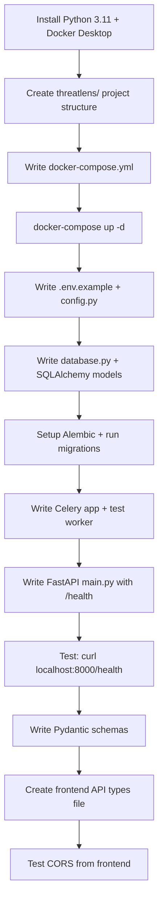

# Workflow 1 — Environment & Infrastructure Setup

> **Covers:** Part 1 (Foundation)  
> **Estimated Time:** 2–3 days  
> **Goal:** Everything boots, database is ready, APIs serve `/health`  

---

## Workflow Sequence



---

## Step-by-Step Commands

### Step 1: Create Project Scaffold

```bash
mkdir threatlens && cd threatlens
mkdir -p app/{models,schemas,api,ingestion,scanners,rag/chunkers,agent/prompts,report/templates,tasks}
mkdir -p scripts alembic/versions tests data
touch app/__init__.py app/models/__init__.py app/schemas/__init__.py
touch app/api/__init__.py app/ingestion/__init__.py app/scanners/__init__.py
touch app/rag/__init__.py app/rag/chunkers/__init__.py
touch app/agent/__init__.py app/agent/prompts/__init__.py
touch app/report/__init__.py app/tasks/__init__.py
```

### Step 2: Docker Services

```bash
# docker-compose.yml → PostgreSQL 15, Redis 7, Qdrant
docker-compose up -d
# Verify all 3 services are running:
docker ps
```

### Step 3: Database

```bash
# After writing models:
alembic init alembic
alembic revision --autogenerate -m "initial schema"
alembic upgrade head
# Verify tables: psql -h localhost -U threatlens -d threatlens_db -c "\dt"
```

### Step 4: Celery

```bash
# Terminal 2:
celery -A app.tasks.celery_app worker --loglevel=info
# Should show: "celery@hostname ready."
```

### Step 5: FastAPI

```bash
# Terminal 1:
uvicorn app.main:app --reload --port 8000
# Verify: curl http://localhost:8000/health
# Verify: open http://localhost:8000/docs
```

### Step 6: Frontend Connection

```bash
# In frontend project:
# Add VITE_API_URL=http://localhost:8000 to .env
# Start frontend: npm run dev
# Open browser console, check no CORS errors on fetch("/api/v1/health")
```

---

## Verification Criteria

| Check | Expected Result |
|-------|----------------|
| `docker ps` | 3 containers: postgres, redis, qdrant |
| `curl localhost:8000/health` | `{"status": "healthy"}` |
| `curl localhost:8000/docs` | Swagger UI renders |
| PostgreSQL tables | scans, findings, compliance_violations, reports |
| Celery worker log | "celery@hostname ready" |
| Qdrant dashboard | `http://localhost:6333/dashboard` loads |
| Frontend fetch | No CORS errors |

---

## Failure Recovery

| Issue | Fix |
|-------|-----|
| Port 5432 in use | `docker-compose down` then re-up, or change port mapping |
| Alembic migration fails | Check `DATABASE_URL` in `.env`, ensure PostgreSQL is running |
| Celery can't connect | Verify Redis is running on 6379, check `REDIS_URL` |
| CORS error on frontend | Add `http://localhost:5173` to `CORS_ORIGINS` in config |
| Qdrant won't start | Check Docker has enough memory (needs ~512MB) |
