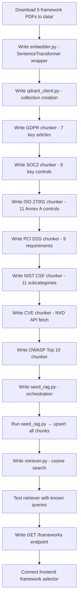

# Workflow 2 — RAG Pipeline Build & Seeding

> **Covers:** Part 2 (RAG Knowledge Base)  
> **Estimated Time:** 5–7 days  
> **Prerequisites:** Workflow 1 complete (Qdrant running)  
> **Goal:** Qdrant has 1,000+ compliance chunks, retriever returns relevant controls  

---

## Workflow Sequence



---

## Step-by-Step Implementation

### Step 1: Prepare Data Directory

```bash
mkdir -p threatlens/data
# Download or obtain PDFs:
# - GDPR regulation text (eur-lex.europa.eu)
# - SOC 2 Trust Services Criteria (aicpa.org)
# - ISO 27001:2022 Annex A (iso.org — must purchase)
# - PCI DSS v4.0 (pcisecuritystandards.org — free)
# - NIST CSF 2.0 (nist.gov — free)
# Add data/ to .gitignore
```

### Step 2: Build Embedder

```bash
# Write app/rag/embedder.py
# Test: python -c "from app.rag.embedder import encode_text; print(len(encode_text('test')))"
# Expected: 384
```

### Step 3: Build Chunkers (one per framework)

Build in order: GDPR → SOC2 → ISO → PCI → NIST → CVE → OWASP

Each chunker must return:
```python
[{
    "text": "Control text...",
    "metadata": {
        "framework": "GDPR",
        "control_id": "Art.32",
        "control_title": "Security of processing",
        "category": "Technical Measures",
        "severity_weight": 0.9
    }
}]
```

### Step 4: Seed Qdrant

```bash
python scripts/seed_rag.py
# Expected output: "Seeded 1,047 chunks into Qdrant."
# Verify on Qdrant dashboard: http://localhost:6333/dashboard
```

### Step 5: Test Retriever

```python
# scripts/test_rag.py
from app.rag.retriever import retrieve_relevant_controls

# Test 1: Hardcoded credentials
results = retrieve_relevant_controls("Hardcoded database password found in config.py")
assert any(r["control_id"] == "Art.32" for r in results), "Should find GDPR Art.32"
assert any(r["control_id"] == "A.8.5" for r in results), "Should find ISO A.8.5"

# Test 2: SQL injection
results = retrieve_relevant_controls("SQL injection vulnerability in user login query")
assert any(r["framework"] == "PCI_DSS" for r in results), "Should find PCI DSS"

# Test 3: Framework filter
results = retrieve_relevant_controls("Unencrypted data at rest", frameworks=["GDPR"])
assert all(r["framework"] == "GDPR" for r in results), "Should only return GDPR"

print("All RAG tests passed ✓")
```

### Step 6: Frontend Integration

```typescript
// Wire up GET /frameworks to the new-scan page framework selector
// The checkboxes should populate dynamically from the API
```

---

## Verification Criteria

| Check | Expected Result |
|-------|----------------|
| `python -c "from app.rag.embedder import encode_text; print(len(encode_text('test')))"` | `384` |
| Qdrant dashboard → compliance_knowledge collection | 1,000+ points |
| Retriever test: "hardcoded password" | Returns GDPR Art.32, ISO A.8.5, PCI Req.8.3.2 |
| Retriever test: "no encryption" | Returns GDPR Art.32, NIST PR.DS-01 |
| `GET /frameworks` endpoint | Returns 5 frameworks with chunk counts |
| Frontend framework selector | Renders checkboxes from API data |

---

## Failure Recovery

| Issue | Fix |
|-------|-----|
| SentenceTransformer download fails | Check internet connection; model is ~90MB |
| Qdrant upsert timeout | Reduce batch size from 100 to 50 |
| PDF parsing fails | Install PyPDF2; some PDFs may need OCR |
| Low retrieval quality | Increase `top_k` or adjust chunking granularity |
| NVD API rate limit | Use NVD API key (free registration) |
