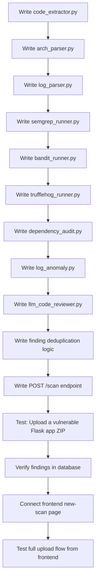

# Workflow 3 — Ingestion + Scanner Integration

> **Covers:** Part 3 (Ingestion) + Part 4 (Scanners)  
> **Estimated Time:** 7–10 days  
> **Prerequisites:** Workflow 1 (FastAPI running), Workflow 2 (RAG ready)  
> **Goal:** Upload a codebase → get back vulnerability findings  

---

## Workflow Sequence



---

## Step-by-Step Implementation

### Phase A: Ingestion Layer (Days 1–2)

#### Step A1: Code Extractor
```bash
# Write app/ingestion/code_extractor.py
# Test ZIP extraction:
python -c "
from app.ingestion.code_extractor import extract_from_zip, collect_source_files
path = extract_from_zip('test-app.zip')
files = collect_source_files(path)
print(f'Found {len(files)} source files')
"
```

#### Step A2: Architecture Parser
```bash
# Write app/ingestion/arch_parser.py
# Test with a k8s YAML:
python -c "
from app.ingestion.arch_parser import parse_architecture
result = parse_architecture(open('test-k8s.yaml').read(), 'yaml')
print(result['services'])
"
```

#### Step A3: Log Parser
```bash
# Write app/ingestion/log_parser.py
# Test with sample Apache logs
```

### Phase B: Static Scanners (Days 3–5)

#### Step B1: Semgrep
```bash
# Install: pip install semgrep
# Write app/scanners/semgrep_runner.py
# Test:
python -c "
from app.scanners.semgrep_runner import run_semgrep
findings = run_semgrep('/path/to/test-app')
print(f'Semgrep found {len(findings)} issues')
for f in findings[:3]:
    print(f'  - {f.title} ({f.severity})')
"
```

#### Step B2: Bandit
```bash
# Install: pip install bandit
# Write app/scanners/bandit_runner.py
# Test on Python files
```

#### Step B3: Trufflehog
```bash
# Install trufflehog binary
# Write app/scanners/trufflehog_runner.py
# Test with a repo containing test secrets
```

#### Step B4: Dependency Audit
```bash
# pip install pip-audit
# Write app/scanners/dependency_audit.py
```

### Phase C: Advanced Scanners (Days 6–7)

#### Step C1: Log Anomaly Detector
```bash
# Write app/scanners/log_anomaly.py
# Test with sample logs containing:
#   - 100+ auth failures (should trigger brute-force alert)
#   - SQL injection patterns in URLs
#   - TRACE HTTP methods
```

#### Step C2: LLM Code Reviewer
```bash
# Requires GROQ_API_KEY in .env
# Write app/scanners/llm_code_reviewer.py
# Test with a single vulnerable file:
python -c "
from app.scanners.llm_code_reviewer import llm_review_file
findings = llm_review_file('auth.py', open('test-app/auth.py').read())
print(f'LLM found {len(findings)} issues')
"
```

### Phase D: Integration (Days 8–10)

#### Step D1: Wire Up POST /scan Endpoint
```bash
# Write app/api/scans.py with full endpoint
# Test:
curl -X POST http://localhost:8000/api/v1/scan \
  -F "scan_type=codebase" \
  -F "file=@test-app.zip" \
  -F "frameworks=GDPR" \
  -F "frameworks=PCI_DSS"
# Should return: {"scan_id": "...", "status": "pending"}
```

#### Step D2: Connect Frontend
```typescript
// Update src/routes/_app/new-scan.tsx:
// 1. Wire file upload dropzone to POST /scan
// 2. Wire Git URL input to POST /scan
// 3. On success, navigate to scan progress page
// 4. Show progress bar polling GET /scan/{id}/status
```

---

## Test Data: Create a Vulnerable Test App

Create `test-app/` with known vulnerabilities:

```python
# test-app/auth.py — Contains hardcoded JWT secret
SECRET_KEY = "super-secret-key-123"  # Trufflehog should catch this

# test-app/db.py — Contains SQL injection
query = f"SELECT * FROM users WHERE id = {user_input}"  # Semgrep/Bandit should catch

# test-app/requirements.txt — Contains vulnerable dependencies
flask==1.0.0  # pip-audit should flag CVEs
requests==2.20.0
```

---

## Verification Criteria

| Check | Expected Result |
|-------|----------------|
| ZIP extraction | Extracts to temp dir, finds .py/.js files |
| Semgrep on test app | Detects SQL injection, XSS patterns |
| Bandit on test app | Detects hardcoded passwords, eval() usage |
| Trufflehog on test app | Detects hardcoded JWT secret |
| Log anomaly on auth log | Flags brute-force (>50 failures) |
| LLM review on auth.py | Finds auth bypass, insecure session handling |
| POST /scan returns scan_id | `{"scan_id": "uuid", "status": "pending"}` |
| Frontend uploads file | Navigates to progress page after submit |
| Scan completes | Status → "completed", progress → 100 |
| Findings in DB | Multiple findings with different sources |

---

## Failure Recovery

| Issue | Fix |
|-------|-----|
| Semgrep not found | `pip install semgrep` or check PATH |
| Bandit timeout on large repo | Add `--skip .venv,node_modules` |
| Trufflehog binary missing | Install from GitHub releases |
| Groq API 429 | Implement exponential backoff; wait 60s |
| ZIP bomb detected | Reject files where extracted > 100x compressed size |
| Frontend upload fails | Check CORS, check file size < MAX_FILE_SIZE_MB |
