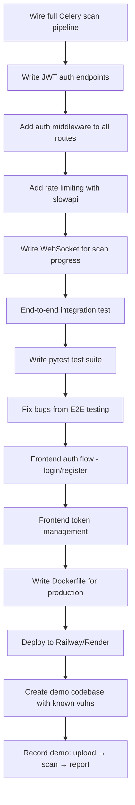

# Workflow 6 — Full Pipeline Integration + Auth + Polish

> **Covers:** Part 7 (Celery Pipeline) + Part 8 (API + Auth)  
> **Estimated Time:** 5–7 days  
> **Prerequisites:** All previous workflows complete  
> **Goal:** Complete end-to-end flow with JWT auth, rate limiting, WebSocket, and deployment readiness  

---

## Workflow Sequence



---

## Step-by-Step Implementation

### Phase A: Pipeline Wiring (Days 1–2)

#### Step A1: Complete Celery Task
```python
# app/tasks/scan_task.py
# Full pipeline: ingestion → scanners → dedup → compliance → scores
# Ensure all progress updates work
# Test end-to-end with a real ZIP upload
```

#### Step A2: Test Full Pipeline
```bash
# Create test app with known vulnerabilities
# Upload via API
# Monitor Celery worker logs
# Verify findings + violations in database
curl -X POST http://localhost:8000/api/v1/scan \
  -F "scan_type=codebase" \
  -F "file=@vulnerable-app.zip"

# Poll until complete:
watch -n 3 "curl -s http://localhost:8000/api/v1/scan/{scan_id}/status | python -m json.tool"
```

### Phase B: Authentication (Days 2–3)

#### Step B1: JWT Auth Endpoints
```python
# app/api/auth.py
# POST /auth/register → Create user → Return JWT
# POST /auth/login → Verify password → Return JWT
# POST /auth/refresh → Refresh expired token
# GET  /auth/me → Return current user info
```

#### Step B2: Protect Routes
```python
# All /scan and /report endpoints require authentication
# Add: user: str = Depends(get_current_user) to every route
```

#### Step B3: Frontend Auth
```typescript
// src/lib/api/auth.ts
// - Login form → POST /auth/login → Store JWT in localStorage
// - Register form → POST /auth/register
// - API client adds Authorization: Bearer header
// - Token refresh on 401 response
// - Redirect to login on expired token
```

### Phase C: Rate Limiting + WebSocket (Day 4)

#### Step C1: Rate Limiting
```python
# main.py
from slowapi import Limiter
limiter = Limiter(key_func=get_remote_address)
app.state.limiter = limiter

# Per-endpoint limits:
# POST /scan: 10/hour
# POST /report: 5/hour
# GET /findings: 100/minute
```

#### Step C2: WebSocket
```python
# app/api/ws.py
@router.websocket("/ws/scan/{scan_id}")
async def scan_progress(websocket: WebSocket, scan_id: str):
    await websocket.accept()
    while True:
        status = get_scan_status(scan_id)
        await websocket.send_json(status)
        if status["status"] in ("completed", "failed"):
            break
        await asyncio.sleep(2)
    await websocket.close()
```

### Phase D: Testing + Deployment (Days 5–7)

#### Step D1: Test Suite
```bash
# tests/test_scanners.py — Unit tests for each scanner
# tests/test_rag.py — RAG retrieval accuracy tests
# tests/test_agent.py — LLM chain output validation
# tests/test_report.py — PDF generation tests
# tests/test_api.py — API endpoint integration tests

pytest tests/ -v --tb=short
```

#### Step D2: Deployment
```bash
# Option A: Railway
npm install -g @railway/cli
railway login
railway init
railway add postgresql redis
railway up

# Option B: Render
# Push to GitHub → Create Render Web Service → Deploy
```

#### Step D3: Demo Preparation
```bash
# Create a demo repo with 10+ known vulnerabilities:
# - Hardcoded secrets
# - SQL injection
# - XSS
# - Outdated dependencies
# - Missing authentication
# Record: upload → scan progress → findings → PDF report
```

---

## Verification Criteria

| Check | Expected Result |
|-------|----------------|
| Full pipeline E2E | Upload ZIP → scan → findings → compliance → PDF |
| JWT auth | Login returns valid JWT; protected routes require it |
| Rate limiting | 11th scan in 1 hour returns 429 |
| WebSocket | Frontend receives real-time progress |
| Test suite | All tests pass |
| Docker build | Container builds successfully |
| Deployment | Live URL accessible |
| Demo | Complete scan to PDF in <5 minutes |

---

## Failure Recovery

| Issue | Fix |
|-------|-----|
| JWT decode fails | Check SECRET_KEY matches between encode/decode |
| Rate limiter blocks dev | Increase limits in development mode |
| WebSocket disconnects | Add reconnection logic in frontend |
| Deploy fails on Railway | Check environment variables are set |
| Test failures | Run tests individually to isolate failures |
