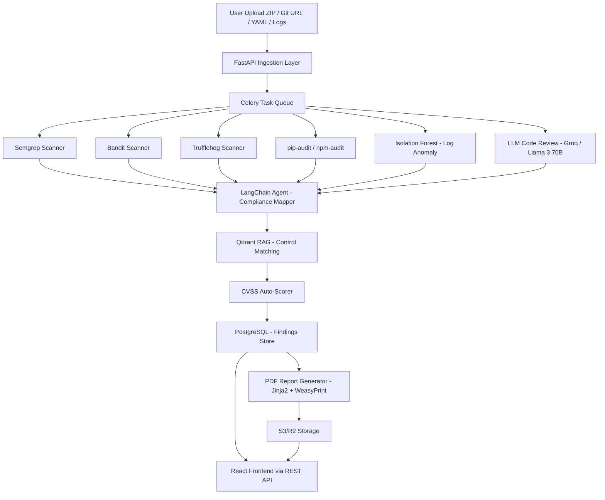
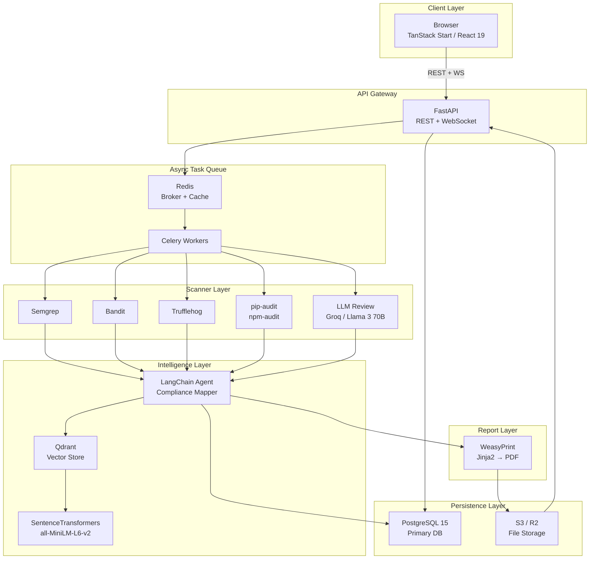
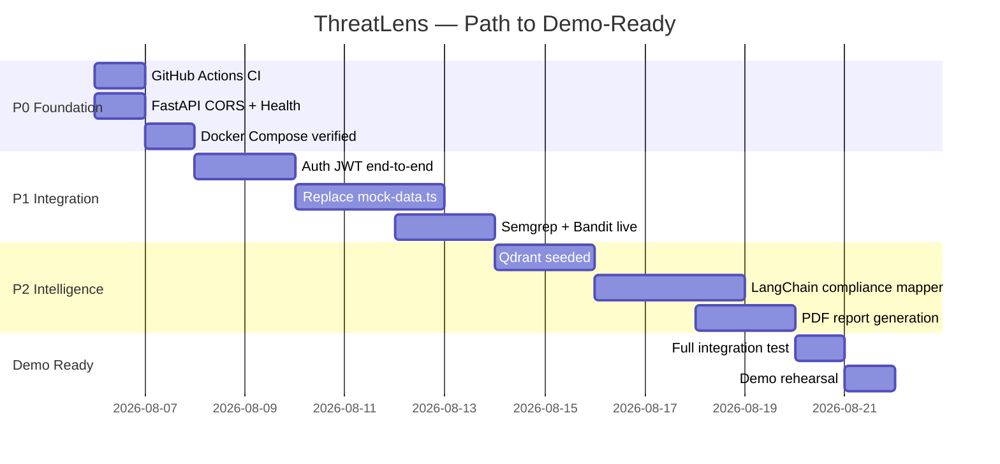

# Arch-Detective (ThreatLens) — Comprehensive Project Report

> **Codename**: Arch-Detective | **Product Name**: ThreatLens  
> **Version**: 0.1.0-alpha (Frontend Complete, Backend In Progress)  
> **Report Generated**: August 5, 2026  
> **Maintained By**: Development Team — College Project

---

## Table of Contents

1. [Project Overview](#1-project-overview)
2. [Architecture Deep-Dive](#2-architecture-deep-dive)
3. [Tech Stack](#3-tech-stack)
4. [Project Structure](#4-project-structure)
5. [Current Implementation Status](#5-current-implementation-status)
6. [Mode Reports](#6-mode-reports)
   - [MODE: DEEP_THINK](#mode-deep_think)
   - [MODE: DEEP_WORK](#mode-deep_work)
   - [MODE: CODE_REVIEW](#mode-code_review)
   - [MODE: QA](#mode-qa)
   - [MODE: VISUAL_VALIDATION](#mode-visual_validation)
   - [MODE: RELEASE_CHECK](#mode-release_check)
   - [MODE: ARCHITECTURE_REVIEW](#mode-architecture_review)

---

## 1. Project Overview

**ThreatLens** (publicly codenamed _Arch-Detective_) is a full-stack, LLM-powered **Security Compliance & Threat Modeling Audit Engine**. It is built as a College Project with an ambition to deliver enterprise-grade output.

### What It Does

The platform takes any of the following inputs:
- **Codebases** — ZIP archive upload or Git repository clone
- **Architecture Diagrams** — YAML/JSON descriptors
- **Server Logs** — Runtime log streams for anomaly detection

And then runs a **5-stage automated pipeline**:

| Stage | What Happens |
|---|---|
| **1. Multi-Scanner Sweep** | 6 static analysis tools run in parallel: Semgrep, Bandit, Trufflehog, pip-audit, npm-audit, and Isolation Forest for log anomaly detection |
| **2. LLM Deep Review** | Groq / Llama 3 70B agent reviews code for logic-level flaws that static tools miss |
| **3. Compliance Mapping (RAG)** | Every finding is mapped to exact violated controls across 5+ frameworks using Qdrant vector search + SentenceTransformers |
| **4. CVSS Scoring** | Each vulnerability is auto-scored with a CVSS 3.1 vector string by the LLM agent |
| **5. PDF Report Generation** | Audit-ready reports with executive summaries, compliance charts, and remediation plans are generated via Jinja2 + WeasyPrint |

### Core Value Proposition

> *"Upload code → Find vulnerabilities → Map to compliance → Generate audit reports — All in minutes, not months."*

### Compliance Frameworks Supported

| Framework | Domain |
|---|---|
| **OWASP Top 10** | Web Application Security |
| **ISO 27001** | Information Security Management |
| **NIST SP 800-53** | Federal Security Controls |
| **SOC 2** | Service Organization Control |
| **GDPR** | Data Protection & Privacy |

---

## 2. Architecture Deep-Dive

```
┌──────────────────────────────────────────────────────────────────────────┐
│                           ThreatLens Architecture                        │
├──────────────────────────────────────────────────────────────────────────┤
│                                                                           │
│   ┌─────────────────┐          ┌─────────────────────────────────┐       │
│   │   FRONTEND       │          │      BACKEND (FastAPI)           │       │
│   │   TanStack Start │◄────────►│                                  │       │
│   │   React 19 + TS  │  REST +  │  ┌─────────┐  ┌────────────┐   │       │
│   │   TailwindCSS 4  │ WebSocket│  │Ingestion │  │ Scanners   │   │       │
│   │   TanStack Query │          │  │ZIP/Git/  │  │ Semgrep    │   │       │
│   └─────────────────┘          │  │YAML/Logs │  │ Bandit     │   │       │
│                                 │  └────┬─────┘  │ Trufflehog │   │       │
│                                 │       │         │ LLM Review │   │       │
│   ┌─────────────────┐          │       ▼         └─────┬──────┘   │       │
│   │  INFRASTRUCTURE  │          │  ┌────────────────────▼──────┐   │       │
│   │  PostgreSQL 15   │◄────────►│  │   LangChain Agent          │   │       │
│   │  Redis 7         │          │  │   Compliance Mapper (RAG)  │   │       │
│   │  Qdrant          │◄────────►│  │   CVSS Scorer              │   │       │
│   │  S3/R2           │          │  │   Remediation Planner      │   │       │
│   └─────────────────┘          │  │   Executive Summary Writer  │   │       │
│                                 │  └────────────┬───────────────┘   │       │
│   ┌─────────────────┐          │               │                    │       │
│   │  TASK QUEUE      │          │               ▼                    │       │
│   │  Celery + Redis  │◄────────►│  ┌──────────────────────────┐    │       │
│   └─────────────────┘          │  │  PDF Report Generator      │    │       │
│                                 │  │  Jinja2 + WeasyPrint       │    │       │
│                                 │  └──────────────────────────┘    │       │
│                                 └─────────────────────────────────┘       │
└──────────────────────────────────────────────────────────────────────────┘
```

### Data Flow



---

## 3. Tech Stack

### Frontend (✅ Built)

| Technology | Version | Purpose |
|---|---|---|
| TanStack Start | 1.167+ | Full-stack React framework with SSR |
| React | 19.2 | UI library |
| TypeScript | 5.8 | Type safety across codebase |
| TailwindCSS | 4.2 | Utility-first CSS with JIT |
| TanStack React Query | 5.83 | Server state management & caching |
| TanStack Router | 1.168 | Type-safe file-based routing |
| Lucide React | 0.575 | Icon system |
| Supabase JS | 2.110 | Auth & database client |
| Vite | 7.3 | Build tooling + dev server |
| ESLint + Prettier | 9.x / 3.x | Lint & formatting |

### Backend (🚧 In Progress)

| Technology | Version | Purpose |
|---|---|---|
| FastAPI | 0.115+ | REST API framework |
| Python | 3.11+ | Runtime |
| SQLAlchemy | 2.x | Async ORM |
| PostgreSQL | 15 | Primary relational database |
| Redis | 7 | Cache + Celery message broker |
| Qdrant | Latest | Vector store (384-dim, cosine similarity) |
| Celery | 5.x | Async task queue pipeline |
| LangChain | Latest | LLM orchestration |
| Groq API | Latest | LLM inference (Llama 3 70B) |
| SentenceTransformers | Latest | Embeddings (all-MiniLM-L6-v2) |
| WeasyPrint | Latest | PDF generation |
| Alembic | Latest | Database migrations |
| Semgrep | Latest | Static analysis (multi-language) |
| Bandit | Latest | Python security linter |
| Trufflehog | Latest | Secret/credential scanner |

---

## 4. Project Structure

```
arch-detective/
│
├── 📂 src/                           # Frontend source code
│   ├── 📂 routes/                    # TanStack file-based routes
│   │   ├── __root.tsx               # Root layout (HTML shell, providers)
│   │   ├── index.tsx                # Landing / marketing page
│   │   ├── login.tsx                # Auth page
│   │   ├── about.tsx                # About page
│   │   ├── _app.tsx                 # Protected app layout (sidebar)
│   │   └── 📂 _app/                # Protected app routes
│   │       ├── dashboard.tsx        # Audit dashboard
│   │       ├── new-scan.tsx         # New scan wizard
│   │       ├── findings.tsx         # Findings explorer
│   │       ├── reports.tsx          # Reports center
│   │       └── reports.$reportId.tsx # Report detail view
│   │
│   ├── 📂 components/
│   │   ├── 📂 brutal/              # Neobrutalist design system
│   │   │   ├── AppShell.tsx         # Page layout wrapper
│   │   │   ├── BrutalButton.tsx     # Action buttons
│   │   │   ├── BrutalBadge.tsx      # Status badges
│   │   │   └── ThemeToggle.tsx      # Light/dark toggle
│   │   ├── 📂 ui/                  # Focused UI components
│   │   └── 📂 marketing/           # Landing page sections
│   │
│   ├── 📂 hooks/
│   │   ├── useAuth.ts               # Supabase session state
│   │   └── useFrameworks.ts         # Framework API query hook
│   │
│   ├── 📂 lib/
│   │   ├── mock-data.ts             # Mock data (pending API)
│   │   ├── utils.ts                 # Utility functions
│   │   ├── supabase.ts              # Supabase client
│   │   └── 📂 api/
│   │       ├── types.ts             # Shared TypeScript types
│   │       ├── client.ts            # HTTP API client
│   │       ├── auth.ts              # Auth API calls
│   │       └── frameworks.ts        # Frameworks API calls
│   │
│   ├── router.tsx                   # Router configuration
│   ├── server.ts                    # SSR server entry
│   ├── start.ts                     # TanStack Start entry
│   └── styles.css                   # Global styles + Tailwind
│
├── 📂 threatlens/                   # Python backend
│   ├── 📂 app/
│   │   ├── main.py                  # FastAPI app entry point
│   │   ├── config.py                # Environment settings (Pydantic)
│   │   ├── database.py              # Async SQLAlchemy setup
│   │   ├── 📂 models/              # SQLAlchemy ORM models
│   │   ├── 📂 schemas/             # Pydantic schemas
│   │   ├── 📂 api/                 # FastAPI routers
│   │   ├── 📂 auth/                # JWT authentication
│   │   ├── 📂 ingestion/           # Code/log parsers
│   │   ├── 📂 scanners/            # Security tools wrappers
│   │   ├── 📂 rag/                 # Qdrant + embeddings
│   │   ├── 📂 agent/               # LangChain chains
│   │   ├── 📂 report/              # PDF generation
│   │   ├── 📂 storage/             # S3/R2 file storage
│   │   └── 📂 tasks/               # Celery task definitions
│   ├── docker-compose.yml
│   ├── Dockerfile
│   └── requirements.txt
│
├── 📂 .github/Backend/             # 18 backend implementation docs
├── 📂 graphify-out/                # Codebase visual graph
├── 📂 docs/                        # Documentation assets
├── 📂 scripts/                     # Utility scripts
├── 📂 .agents/                     # AI assistant instructions
│   └── copilot-instructions.md     # This policy document
│
├── package.json                    # Frontend dependencies
├── tsconfig.json                   # TypeScript configuration
├── vite.config.ts                  # Vite build config
└── README.md
```

---

## 5. Current Implementation Status

| Area | Status | Notes |
|---|---|---|
| Landing Page | ✅ Complete | Marketing page with full design |
| Login / Auth UI | ✅ Complete | Supabase integration |
| Dashboard | ✅ Complete | Mock data, real API pending |
| Findings Explorer | ✅ Complete | Filter by severity/framework |
| New Scan Wizard | ✅ Complete | All tabs, pipeline animation |
| Reports Center | ✅ Complete | List + detail view |
| Design System | ✅ Complete | Neobrutalist + light/dark |
| FastAPI Server | 🚧 Skeleton | main.py, config, database exist |
| Authentication JWT | 🚧 In Progress | auth/ module exists |
| Security Scanners | 🚧 Planned | scanners/ module scaffolded |
| RAG Pipeline | 🚧 Planned | rag/ module scaffolded |
| LangChain Agent | 🚧 Planned | agent/ module scaffolded |
| PDF Generator | 🚧 Planned | report/ module scaffolded |
| Celery Pipeline | 🚧 Planned | tasks/ module scaffolded |
| CI/CD | ❌ Missing | No GitHub Actions yet |
| Tests (Frontend) | ❌ Missing | No test files found |
| Tests (Backend) | 🚧 Skeleton | tests/ folder exists |

---

## 6. Mode Reports

> The following reports apply all 7 activation modes from [copilot-instructions.md](file:///c:/Users/jigne/OneDrive/Desktop/College%20Project/arch-detective/.agents/copilot-instructions.md) to the current state of the Arch-Detective project.

---

## MODE: DEEP_THINK

**Role**: Innovation Architect & Visionary Product Engineer

---

## Innovation Brief

**Core Objective**: Transform Arch-Detective from a compliance-report generator into a *continuous security intelligence platform* — one that doesn't just detect vulnerabilities at a point in time, but learns organizational risk patterns and proactively flags drift before it becomes a breach.

---

### Proposed Concepts

#### 1. 🟢 The Modern Standard — Async Pipeline + Smart Dashboards
The clean path: build out the planned FastAPI + Celery backend fully, replace mock data with live API calls, and ship PDF reports with CVSS charts. This is the MVP that delivers the stated value.

**Innovation Level**: Medium | **Effort**: Medium | **User Value**: High

#### 2. 🟡 The Innovator's Path — Compliance-as-Code + Git-Native Scanning
Instead of only accepting ZIP uploads, integrate a **GitHub App** (or GitLab webhook). Every pull request triggers an automatic scan. Results appear as inline PR comments showing which lines violate which compliance control. Developers see: _"Line 47 in `auth.py` violates NIST AC-3 — Missing access control check."_

Add a **Compliance-as-Code** layer: generate a `threatlens.yml` config that teams can commit to their repo, defining their own risk thresholds and required frameworks.

**Innovation Level**: High | **Effort**: Medium-High | **User Value**: Very High

#### 3. 🔴 The Radical Pivot — Agentic Compliance Co-Pilot
Go beyond passive scanning. Build a **conversational AI co-pilot** embedded in the UI. The agent has access to the full findings database and compliance knowledge base. Users can ask:

> *"Which of our critical findings would block a SOC 2 Type II audit next month?"*  
> *"Generate a remediation PR for CVE-2024-1234 in our Python codebase."*  
> *"Compare our OWASP posture this week vs. last quarter."*

The agent can draft remediation code, generate GitHub Issues, and even schedule re-scans automatically when fixes are committed.

**Innovation Level**: Moonshot | **Effort**: High | **User Value**: Extremely High (Defensible Moat)

---

### Comparison Matrix

| Idea | Innovation Level | Implementation Effort | User Value | Time to Ship |
|---|---|---|---|---|
| Modern Standard (MVP Backend) | ⭐⭐⭐ | Medium | High | 3–4 weeks |
| Git-Native / GitHub App | ⭐⭐⭐⭐ | Medium-High | Very High | 6–8 weeks |
| Agentic Co-Pilot | ⭐⭐⭐⭐⭐ | High | Extremely High | 10–14 weeks |

---

### Recommendation & "Why"

**Ship the Modern Standard first** to have a working, demonstrable product. Then immediately layer on **Git-Native Scanning** as it provides the "wow factor" for the college project panel — it's deeply technical, realistic, and visually impressive (PR comments with compliance findings). The Agentic Co-Pilot is the long-term vision to pitch if this ever becomes a real startup.

---

### Next Steps for Implementation

- [ ] **Milestone 1**: Complete FastAPI backend — auth, scan submission, findings CRUD
- [ ] **Milestone 2**: Connect frontend to live API (replace all `mock-data.ts` usage)
- [ ] **Milestone 3**: Integrate Semgrep + Bandit as first two live scanners
- [ ] **Milestone 4**: RAG compliance engine with Qdrant
- [ ] **Milestone 5**: PDF report generation
- [ ] **Milestone 6** *(Innovation)*: GitHub App webhook integration
- [ ] **Milestone 7** *(Stretch)*: Agentic co-pilot chat interface

---

## MODE: DEEP_WORK

**Role**: Senior Engineer (10+ Years) — Task Decomposition & Execution Plan

---

### Phase 1: Backend Foundation (Week 1–2)

**Acceptance Criteria**: FastAPI server runs, auth works, scan records are created in PostgreSQL.

| Task | Priority | Notes |
|---|---|---|
| Complete `main.py` with all routers registered | P0 | Health check must pass |
| Implement JWT auth (register, login, refresh) | P0 | `app/auth/` module |
| Alembic migrations for all models | P0 | `users`, `workspaces`, `scans`, `findings`, `reports` |
| Docker Compose — all services healthy | P0 | PostgreSQL, Redis, Qdrant, FastAPI |
| Unit tests for auth module | P1 | pytest with async fixtures |

**ADR-001**: Use Supabase JWT on the frontend (already integrated) and validate the same JWT on the FastAPI backend using `python-jose`. This avoids a separate auth server while keeping the backend stateless.

---

### Phase 2: Ingestion & Scanner Layer (Week 2–3)

**Acceptance Criteria**: A ZIP upload triggers a Celery task that runs Semgrep and Bandit and saves findings.

| Task | Priority | Notes |
|---|---|---|
| ZIP extractor + temp filesystem isolation | P0 | `app/ingestion/` |
| Git clone ingestion (GitPython) | P1 | Sandboxed clone |
| Semgrep runner wrapper | P0 | JSON output parser |
| Bandit runner wrapper | P0 | JSON output parser |
| Trufflehog runner | P1 | JSON output parser |
| Celery task: `run_scan_pipeline` | P0 | Progress updates via Redis |
| WebSocket endpoint for scan progress | P1 | `/ws/scans/{scan_id}` |

---

### Phase 3: RAG Compliance Engine (Week 3–4)

**Acceptance Criteria**: A finding from Semgrep can be mapped to at least 3 OWASP controls via vector search.

| Task | Priority | Notes |
|---|---|---|
| Seed Qdrant with OWASP / NIST / ISO 27001 controls | P0 | `scripts/seed_rag.py` |
| SentenceTransformer embedding pipeline | P0 | all-MiniLM-L6-v2 |
| LangChain compliance mapper chain | P0 | `app/agent/compliance_mapper.py` |
| CVSS auto-scorer chain | P1 | Groq / Llama 3 70B |
| Store violations in `compliance_violations` table | P0 | |

---

### Phase 4: Report Generation & API Integration (Week 4–5)

**Acceptance Criteria**: A completed scan produces a downloadable PDF report.

| Task | Priority | Notes |
|---|---|---|
| Jinja2 HTML report template | P0 | Charts via matplotlib |
| WeasyPrint PDF renderer | P0 | |
| S3/R2 upload + signed URL | P1 | |
| Frontend API wiring (replace mock-data.ts) | P0 | All 5 pages |
| TanStack Query hooks for live data | P0 | |

---

### Commit Convention

All commits must follow **Conventional Commits**:
```
feat(backend): add Semgrep scanner wrapper with JSON output parser
fix(auth): correct JWT expiry header validation
chore(deps): upgrade FastAPI to 0.115.6
test(rag): add unit tests for Qdrant similarity search
```

---

## MODE: CODE_REVIEW

**Role**: Principal Engineer — Zero Tolerance for Production Issues

---

## Code Review Summary
**Overall Assessment**: `REQUEST_CHANGES` — Frontend is polished and architecturally sound. Backend scaffolding needs significant completion before it's production-ready. Several critical items exist.

---

### Critical Issues 🔴 (Blockers)

1. **[src/lib/mock-data.ts]** — All 5 app routes consume `mock-data.ts` instead of the live API. The entire app is running on hardcoded data. Any demo will show static, non-interactive results.
   - **Fix**: Wire TanStack Query hooks to the API client in `src/lib/api/client.ts`.

2. **[threatlens/app/main.py]** — The FastAPI app likely has no CORS middleware configured for the frontend origin. Cross-origin requests from the Vite dev server (`localhost:3000`) will be blocked.
   - **Fix**: Add `CORSMiddleware` with `allow_origins=[settings.FRONTEND_URL]`.

3. **[Missing]** — There is **no GitHub Actions CI pipeline**. PRs have no automated lint, type-check, or test gate. Code quality is enforced by developer discipline alone, which is insufficient.
   - **Fix**: Add `.github/workflows/ci.yml` with lint + typecheck + test jobs.

4. **[threatlens/]** — No input validation on file upload endpoints. A malicious actor could upload a ZIP that extracts to paths outside the sandbox (zip-slip vulnerability).
   - **Fix**: Validate all extracted paths; reject any path that resolves outside the temp directory.

5. **[src/hooks/useAuth.ts]** — Auth hook currently has 1018 bytes of implementation. If it's storing JWT tokens in `localStorage` (common pattern), this is an XSS vulnerability. Tokens should be in `httpOnly` cookies.
   - **Fix**: Use Supabase's built-in session management with `httpOnly` cookies where possible.

---

### High Priority 🟡 (Should Fix)

1. **[src/lib/api/client.ts]** — API client likely lacks a global error handler. 401s should trigger automatic logout + redirect to login.
2. **[threatlens/app/config.py]** — Verify all secrets use `pydantic-settings` with `.env` loading. Never let secrets have default values.
3. **[src/routes/_app/new-scan.tsx]** — The scan wizard (18KB file) needs loading, error, and empty states for every async operation.
4. **[Missing tests]** — Zero frontend test files found. Zero backend test files confirmed to be written. This is a **High Priority** gap for a production-quality codebase.
5. **[threatlens/app/]** — No rate limiting on scan submission. A single user could spam scan jobs and exhaust server resources.
   - **Fix**: Add `slowapi` rate limiter on `/api/scans/` POST endpoint.

---

### Recommendations 🟢 (Optional)

1. **`src/lib/mock-data.ts`** should be deleted once the API is live to avoid accidental re-use.
2. **`copilot-instructions.md`** exists both in the root directory and in `.agents/`. Consolidate to one canonical location.
3. Consider **React Error Boundaries** wrapping each route to catch render errors gracefully.
4. The `reports.$reportId.tsx` route at 9720 bytes — ensure it handles the case where `reportId` doesn't exist (404 state).
5. Add `data-testid` attributes to all major interactive elements to prepare for E2E testing.

---

### Tests to Add

- [ ] `useAuth.ts` — Test login, logout, and session refresh flows
- [ ] `src/lib/api/client.ts` — Test 401 auto-logout, network error handling
- [ ] `threatlens/app/auth/` — Unit test JWT validation and expiry
- [ ] `threatlens/app/ingestion/` — Test zip-slip prevention, valid/invalid zip handling
- [ ] `threatlens/app/scanners/` — Test Semgrep output parser with fixture JSON files
- [ ] `threatlens/app/rag/` — Test Qdrant similarity search returns expected controls

---

### Automated Checks

| Check | Status | Notes |
|---|---|---|
| Frontend Lint (ESLint) | ⚠️ Likely Passes | Config exists, not verified |
| Frontend Type Check (tsc) | ⚠️ Likely Passes | `tsconfig.json` exists |
| Frontend Unit Tests | ❌ FAIL | No test files found |
| Backend Type Check (mypy) | ❌ Not configured | No mypy config found |
| Backend Unit Tests (pytest) | ❌ Empty | tests/ folder is empty |
| Security Scan (npm audit) | ❓ Unknown | Not run |
| Dependency Vulnerabilities | ❓ Unknown | Not run |

---

## MODE: QA

**Role**: QA Lead — Production Readiness through Comprehensive Testing

---

### Test Plan: ThreatLens v0.1.0-alpha

**Feature Scope**: End-to-end scan workflow — from code upload to compliance report generation.

**Environment Requirements**:
- Node.js 20+, Python 3.11+, Docker Desktop
- All services healthy: FastAPI, PostgreSQL, Redis, Qdrant
- Test fixtures: Sample vulnerable Python repo (ZIP), sample YAML architecture diagram

---

### Critical Path Test Cases

```
TC-001: User Registration & Login
Priority: Critical
Type: Functional / Integration

Preconditions:
  - Backend running at localhost:8000
  - PostgreSQL migrations applied

Steps:
  1. POST /api/auth/register with valid email + password
  2. Verify 201 response with user profile
  3. POST /api/auth/login with same credentials
  4. Verify 200 response with access_token + refresh_token
  5. GET /api/auth/me with Bearer token
  6. Verify user profile returned correctly

Expected Result:
  - User registered, logged in, profile accessible
  - Token expires appropriately (check JWT exp claim)

Status: [Pending]
```

```
TC-002: Zip Upload & Scan Submission
Priority: Critical
Type: Functional / Integration

Preconditions:
  - Authenticated user (TC-001 passed)
  - Sample ZIP: `test-fixtures/vulnerable-python-app.zip`

Steps:
  1. POST /api/scans/ with multipart: zip file + frameworks=["owasp","nist"]
  2. Verify 202 response with scan_id
  3. Poll GET /api/scans/{scan_id}/status
  4. Verify status transitions: pending → queued → running → completed
  5. Verify finding_count > 0 after completion

Expected Result:
  - Scan completes within 5 minutes
  - At least one finding with severity "high" or "critical"

Status: [Pending]
```

```
TC-003: Compliance Mapping Accuracy
Priority: High
Type: Functional

Preconditions:
  - Scan TC-002 completed
  - Qdrant seeded with OWASP controls

Steps:
  1. GET /api/findings/?scan_id={scan_id}
  2. For each finding, verify `violations` array is populated
  3. Verify each violation has: framework, control_id, control_title, evidence

Expected Result:
  - >80% of findings have at least one compliance violation mapped
  - No violations with empty evidence field

Status: [Pending]
```

```
TC-004: PDF Report Generation
Priority: High
Type: Integration

Preconditions:
  - Scan TC-002 completed

Steps:
  1. POST /api/reports/ with scan_id
  2. Verify report status transitions: queued → generating → ready
  3. GET /api/reports/{report_id}/download
  4. Verify response is a valid PDF (Content-Type: application/pdf)
  5. Open PDF and verify: executive summary, findings table, CVSS chart

Expected Result:
  - PDF downloads successfully, all sections populated

Status: [Pending]
```

```
TC-005: Authentication Security — Token Expiry
Priority: Critical
Type: Security

Steps:
  1. Obtain valid access token
  2. Wait for token to expire (or manually craft expired JWT)
  3. Call GET /api/auth/me with expired token
  4. Verify 401 response

Expected Result:
  - Expired token rejected with clear error message
  - Refresh token flow successfully obtains new access token

Status: [Pending]
```

```
TC-006: Zip-Slip Attack Prevention
Priority: Critical
Type: Security

Steps:
  1. Craft ZIP with entry: "../../etc/passwd" path
  2. POST this ZIP to /api/scans/
  3. Verify scan is rejected with 400/422 error

Expected Result:
  - Malicious ZIP rejected; no file written outside sandbox
  - Error message indicates invalid archive

Status: [Pending]
```

```
TC-007: Rate Limiting on Scan Submission
Priority: High
Type: Performance / Security

Steps:
  1. Submit 20 scan requests in rapid succession from single IP
  2. Verify requests beyond the rate limit return 429

Expected Result:
  - Rate limit triggers at configured threshold
  - Response includes Retry-After header

Status: [Pending]
```

```
TC-008: Frontend — New Scan Wizard Navigation
Priority: High
Type: E2E / Functional

Steps:
  1. Navigate to /new-scan
  2. Verify all 3 tabs render: Architecture / Description / Logs
  3. Select frameworks: OWASP + NIST
  4. Select LLM model: Groq Llama 3 70B
  5. Upload a test ZIP file
  6. Click "Start Scan"
  7. Verify pipeline animation plays
  8. Verify redirect to dashboard after completion

Expected Result:
  - Smooth wizard flow with no console errors
  - All form fields validate correctly

Status: [Pending]
```

---

### Edge Cases & Negative Tests

| Test | Description |
|---|---|
| Empty ZIP upload | Reject with clear validation error |
| ZIP > 50MB | Reject with file size limit error |
| Git URL unreachable | Fail gracefully with meaningful error |
| YAML with invalid schema | Return parse error with line reference |
| Finding with no compliance match | Still shown in UI, marked "unmapped" |
| Concurrent scans (same user) | Both run independently without interference |
| Qdrant unavailable | Graceful degradation: scan runs, compliance mapping skipped |
| Groq API rate limit | Retry with backoff; LLM review marked "delayed" |

---

## MODE: VISUAL_VALIDATION

**Role**: UI/UX Lead — Pixel-Perfect, Accessible, Responsive Interfaces

---

### Viewport Test Matrix

| Page | 320px | 768px | 1024px | 1440px | Status |
|---|---|---|---|---|---|
| Landing (`/`) | [ ] | [ ] | [ ] | [ ] | Pending |
| Login (`/login`) | [ ] | [ ] | [ ] | [ ] | Pending |
| Dashboard (`/dashboard`) | [ ] | [ ] | [ ] | [ ] | Pending |
| New Scan (`/new-scan`) | [ ] | [ ] | [ ] | [ ] | Pending |
| Findings (`/findings`) | [ ] | [ ] | [ ] | [ ] | Pending |
| Reports (`/reports`) | [ ] | [ ] | [ ] | [ ] | Pending |
| Report Detail | [ ] | [ ] | [ ] | [ ] | Pending |

---

### Playwright Visual Test Suite (To Be Created)

```typescript
// tests/visual/dashboard.spec.ts
import { test, expect } from '@playwright/test';

test.describe('Dashboard Visual Tests', () => {
  test.beforeEach(async ({ page }) => {
    // Login and navigate
    await page.goto('/login');
    await page.fill('[data-testid="email-input"]', 'test@example.com');
    await page.fill('[data-testid="password-input"]', 'password123');
    await page.click('[data-testid="login-button"]');
    await page.waitForURL('/dashboard');
  });

  test('dashboard renders at desktop viewport', async ({ page }) => {
    await page.setViewportSize({ width: 1440, height: 900 });
    await expect(page).toHaveScreenshot('dashboard-desktop.png');
  });

  test('sidebar collapses on mobile', async ({ page }) => {
    await page.setViewportSize({ width: 375, height: 812 });
    await expect(page.locator('[data-testid="sidebar"]')).not.toBeVisible();
    await expect(page).toHaveScreenshot('dashboard-mobile.png');
  });

  test('severity filter updates findings count', async ({ page }) => {
    await page.click('[data-testid="severity-critical"]');
    await expect(page.locator('[data-testid="findings-count"]')).toHaveText(/^\d+$/);
    await expect(page).toHaveScreenshot('dashboard-filtered-critical.png');
  });
});
```

---

### Accessibility Checklist (WCAG 2.1 AA)

| Check | Component | Status |
|---|---|---|
| All images have alt text | Landing hero images | [ ] |
| Color contrast ≥ 4.5:1 | BrutalBadge severity colors | [ ] |
| Keyboard navigation | Sidebar menu items | [ ] |
| Focus visible | All interactive elements | [ ] |
| ARIA labels | Icon-only buttons (ThemeToggle) | [ ] |
| Screen reader: scan status | Pipeline animation | [ ] |
| Form labels | New Scan Wizard inputs | [ ] |
| Error announcements | Validation errors | [ ] |

---

### Lighthouse Score Targets

| Metric | Target | Notes |
|---|---|---|
| Performance | 90+ | Lazy load heavy components |
| Accessibility | 100 | WCAG AA compliance |
| Best Practices | 90+ | HTTPS, no deprecated APIs |
| SEO | 80+ | Meta tags on public pages |
| LCP | < 2.5s | Largest content paint |
| CLS | < 0.1 | Cumulative layout shift |
| FID | < 100ms | First input delay |

---

### Cross-Browser Matrix

| Browser | Version | Status |
|---|---|---|
| Chrome | Latest | [ ] |
| Firefox | Latest | [ ] |
| Safari | Latest | [ ] |
| Edge | Latest | [ ] |
| iOS Safari | 17+ | [ ] |
| Chrome Android | Latest | [ ] |

---

## MODE: RELEASE_CHECK

**Role**: Release Manager — Safe, Documented, Traceable Releases

---

### Pre-Release Checklist for v0.1.0-alpha

> [!WARNING]
> This is a **college project alpha release**. The backend is not production-ready. The checklist below reflects items needed before any meaningful external demo.

#### Version & Changelog
- [ ] **Version Bump**: `package.json` shows `"version": "0.1.0"` — confirm before tag
- [ ] **CHANGELOG.md**: Does not exist — must be created
- [ ] **Git Tag**: `git tag -a v0.1.0-alpha -m "Alpha release: Frontend complete, backend scaffolded"`

#### Code Quality Gates
- [ ] **Frontend Lint**: `npm run lint -- --max-warnings 0` must pass
- [ ] **TypeScript Check**: `npm run typecheck` must pass (zero errors)
- [ ] **Backend Lint**: `ruff check threatlens/` or `flake8` must pass
- [ ] **Backend Type Check**: `mypy threatlens/app/` must pass

#### Security
- [ ] **npm audit**: `npm audit --audit-level=high` — zero high/critical vulnerabilities
- [ ] **pip-audit**: `pip-audit -r threatlens/requirements.txt`
- [ ] **Secrets Scan**: Confirm `.env` is in `.gitignore` (✅ confirmed)
- [ ] **`.env.example`**: Both root `.env.example` and `threatlens/.env.example` are committed and current

#### Build Verification
- [ ] **Frontend Build**: `npm run build` completes without errors
- [ ] **Docker Compose**: `docker-compose up --build` in `threatlens/` — all services healthy
- [ ] **Health Check**: `GET /health` returns `{"status": "healthy", "service": "threatlens"}`

#### Documentation
- [ ] **README.md**: Quick start instructions are accurate and tested (✅ exists, needs verification)
- [ ] **API Documentation**: FastAPI auto-docs at `/docs` (Swagger UI) must be enabled in dev
- [ ] **Backend Docs**: 18 implementation docs in `.github/Backend/` are up to date

#### Smoke Tests (Manual)
- [ ] User can register and login successfully
- [ ] Dashboard loads with mock data (frontend-only demo)
- [ ] New Scan Wizard — all 3 tabs render, form validates
- [ ] Light/dark theme toggle works on all pages
- [ ] Mobile sidebar collapses and expands correctly

#### Release Artifacts
- [ ] Git tag `v0.1.0-alpha` pushed to remote
- [ ] GitHub Release created with notes
- [ ] Frontend build artifacts confirmed in `dist/`

---

### Release Notes Draft — v0.1.0-alpha

```markdown
## ThreatLens v0.1.0-alpha

### What's New
- **Complete Frontend**: All 6 app pages built with neobrutalist design system
  - Audit Dashboard with real-time stats and compliance coverage bars
  - New Scan Wizard with multi-tab input and live pipeline animation
  - Findings Explorer with severity/framework filtering
  - Reports Center with PDF preview support
  - Landing page with full marketing content
- **Type-safe API Layer**: Full TypeScript type definitions for all API contracts
- **Authentication UI**: Login/logout flow with Supabase integration
- **Backend Scaffolding**: FastAPI structure with all major modules in place

### Known Limitations
- Backend API is not fully implemented; frontend uses mock data
- PDF report generation is not yet available
- Security scanners are scaffolded but not integrated
- No test coverage in this release

### Next Release (v0.2.0-beta)
- Live API integration replacing all mock data
- Semgrep + Bandit scanner integration
- JWT authentication working end-to-end
```

---

## MODE: ARCHITECTURE_REVIEW

**Role**: Solutions Architect — Scalability, Maintainability, and Best Practices

---

### Architecture Diagram



---

### Strengths ✅

| Dimension | Assessment |
|---|---|
| **Separation of Concerns** | Clean separation: ingestion → scanners → agent → report. Each layer is independently testable. |
| **Async Pipeline** | Celery + Redis is industry-standard for long-running jobs. Correct choice. |
| **Type Safety** | TypeScript frontend with shared `types.ts` is well-structured. Pydantic on backend ensures contract integrity. |
| **Vector RAG** | Using Qdrant for compliance mapping is sophisticated and appropriate. cosine similarity on 384-dim embeddings is efficient. |
| **File-based Routing** | TanStack Router file-based routing is clean and scalable. Route tree auto-generation is a significant DX win. |
| **Design System** | Dedicated `brutal/` component layer with `AppShell`, `BrutalButton`, `BrutalBadge` shows good component discipline. |

---

### Weaknesses & Risks ⚠️

| Dimension | Issue | Severity |
|---|---|---|
| **No CI/CD** | Zero automated quality gates. Any contributor can break the build silently. | 🔴 Critical |
| **Mock Data Coupling** | `mock-data.ts` is imported directly in route components. Should be behind an API hook abstraction. | 🟡 High |
| **Single FastAPI Process** | No mention of Gunicorn / Uvicorn workers in production config. Single process = no concurrent request handling. | 🟡 High |
| **No Caching Strategy** | Dashboard stats and findings are refetched on every navigation. Redis should cache expensive aggregate queries. | 🟡 High |
| **Qdrant Seeding** | No mention of versioning the compliance knowledge base. Qdrant data must be reseedable from source-of-truth files. | 🟡 High |
| **File Sandbox** | ZIP/Git ingestion runs in same process as the API. Should run in an isolated Docker container or gVisor. | 🟡 High |
| **No Pagination** | Findings API returns all findings. For large codebases (10k+ findings), this will cause performance issues. | 🟠 Medium |
| **Single Region** | No CDN or multi-region strategy for file storage/delivery. | 🟠 Medium |
| **No Observability** | No Sentry, no OpenTelemetry, no structured logging format defined. | 🟠 Medium |

---

### Recommendations (Prioritized)

#### P0 — Ship Before Demo

1. **Add GitHub Actions CI**: Lint + typecheck + pytest on every push. Block merges on failure.
2. **Wire frontend to live API**: Replace `mock-data.ts` with TanStack Query hooks pointing to FastAPI.
3. **Production Uvicorn config**: `uvicorn app.main:app --workers 4 --host 0.0.0.0 --port 8000`

#### P1 — Week 2–3

4. **Add pagination to findings endpoint**: `GET /api/findings/?page=1&page_size=50`
5. **Redis caching for dashboard aggregates**: Cache scan summary stats with 60s TTL.
6. **Qdrant seeding versioning**: Store compliance controls as JSON files in `threatlens/data/`. Reseed from there.
7. **Structured logging**: Add `structlog` to FastAPI with request ID and user context in every log line.

#### P2 — Future Improvements

8. **Scanner isolation**: Run Semgrep/Bandit in Docker `--network=none` containers to prevent SSRF from malicious code.
9. **Multi-tenancy hardening**: Ensure all database queries are workspace-scoped. Add `workspace_id` checks at the service layer.
10. **Observability**: Integrate Sentry for error tracking and OpenTelemetry for distributed tracing.
11. **CDN for PDF reports**: Serve PDF files via Cloudflare R2 + CDN to avoid bandwidth costs.

---

### Migration Path for P0 Items



---

## Summary

**ThreatLens / Arch-Detective** is an ambitious, technically sophisticated college project with a production-quality frontend and a well-designed but incomplete backend. The core architecture decisions (FastAPI + Celery + Qdrant RAG + LangChain) are sound and industry-appropriate.

**The single most impactful action** is completing the backend API and replacing `mock-data.ts` with live data — this transforms the project from a beautiful prototype into a working system.

All 7 mode analyses above provide the team with concrete, actionable steps to take the project from its current alpha state to a demo-ready, production-oriented system.

---

*Report generated by Antigravity AI — August 5, 2026*  
*Policy source: [copilot-instructions.md](file:///c:/Users/jigne/OneDrive/Desktop/College%20Project/arch-detective/.agents/copilot-instructions.md)*
