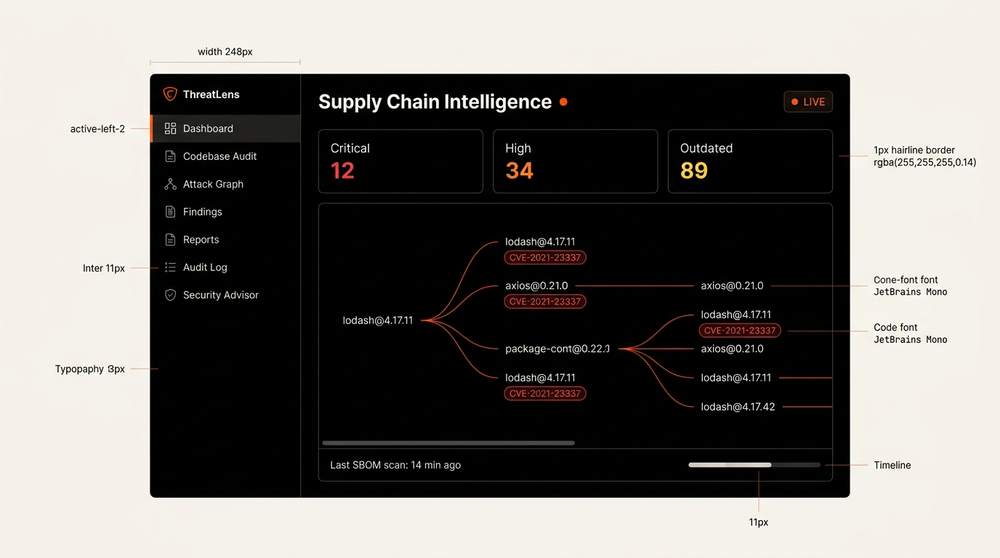
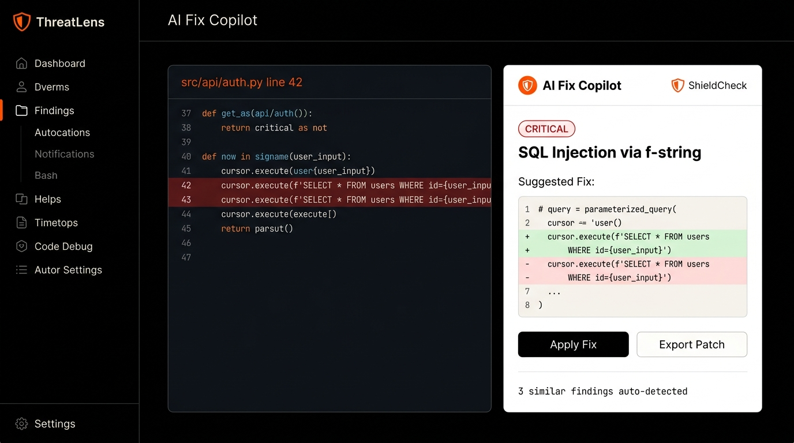
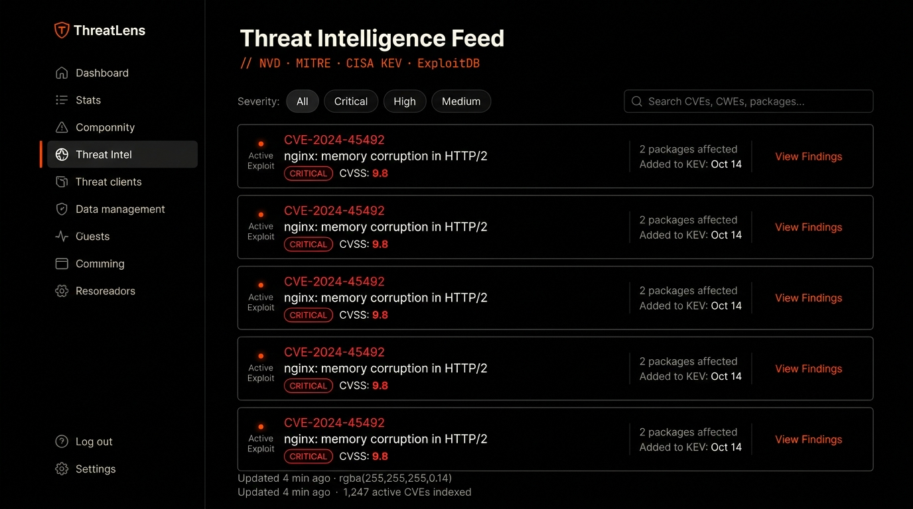
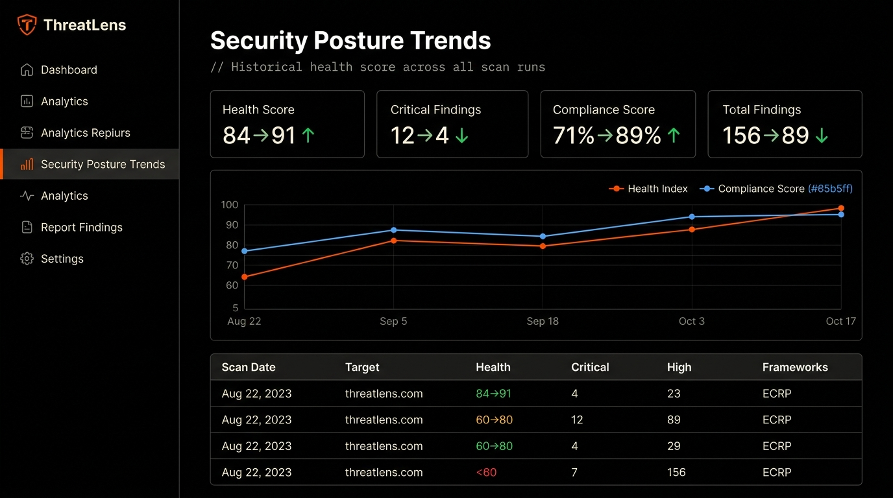
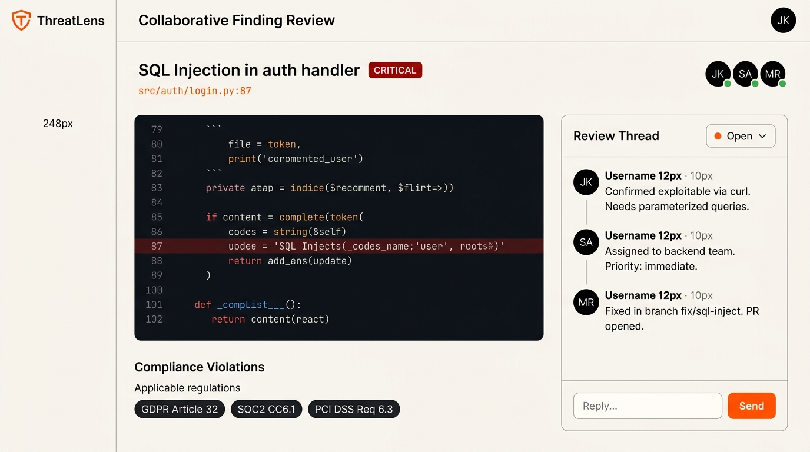
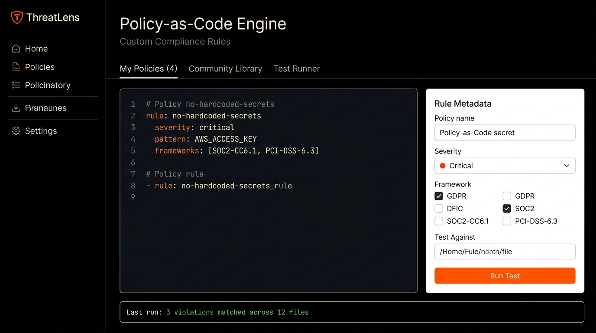

# ThreatLens — Modern Future Features Research Document 2026
### Research Mode · graphify-out Analysis · Aligned with Existing Architecture

> **Architecture fingerprint (from `graphify-out/graph.json`):**  
> 183 community clusters · 205 rationale nodes · ~280 source files  
> **Frontend:** React + TanStack Router + TanStack Query + Phosphor Icons + Archon Design System  
> **Backend:** FastAPI · Semgrep · Bandit · TruffleHog · pip-audit · LLM (Groq) · Qdrant RAG  
> **Database:** Supabase PostgreSQL · RLS via `private.workspace_role()` · hardened 2026-10-17

---

## Table of Contents

1. [Supply Chain & SBOM Intelligence](#1-supply-chain--sbom-intelligence)
2. [AI Fix Copilot — Code Remediation Engine](#2-ai-fix-copilot--code-remediation-engine)
3. [Live Threat Intelligence Feed](#3-live-threat-intelligence-feed)
4. [Security Posture Trends & Analytics](#4-security-posture-trends--analytics)
5. [Collaborative Finding Review](#5-collaborative-finding-review)
6. [Policy-as-Code Engine](#6-policy-as-code-engine)
7. [GitHub / GitLab Native Integration](#7-github--gitlab-native-integration)
8. [Container & IaC Security Scanning](#8-container--iac-security-scanning)

---

## 1. Supply Chain & SBOM Intelligence

### What it is
A dedicated **Software Bill of Materials (SBOM)** dashboard that automatically extracts all first- and third-party dependencies from uploaded archives, maps each package to its known CVE vulnerability record in the NVD/CISA KEV database, and renders an interactive dependency tree showing the blast radius of each vulnerable package.

SBOM generation is one of the fastest-growing regulatory mandates post the US Executive Order on Cybersecurity (EO-14028), NIST SP 800-218, and the EU Cyber Resilience Act (CRA). In 2026, any serious AppSec platform must produce SBOM output.

**Why this fits ThreatLens perfectly:**  
The project already runs `pip-audit` (`dependency_audit.py`) and `trufflehog_runner.py`. The RAG chunkers (`pci_chunker.py`, `soc2_chunker.py`, etc.) already embed compliance control context. SBOM is the natural extension of the existing dependency scanner into a visual, explorable graph.



---

### Database Schema

**New migration:** `supabase/migrations/20261022000001_sbom_tables.sql`

```sql
-- SBOM snapshot per scan
CREATE TABLE IF NOT EXISTS public.sbom_snapshots (
  id              uuid PRIMARY KEY DEFAULT gen_random_uuid(),
  scan_id         uuid NOT NULL REFERENCES public.scans(id) ON DELETE CASCADE,
  workspace_id    uuid NOT NULL REFERENCES public.workspaces(id) ON DELETE CASCADE,
  format          text NOT NULL DEFAULT 'cyclonedx-json',
  component_count integer NOT NULL DEFAULT 0,
  vuln_count      integer NOT NULL DEFAULT 0,
  generated_at    timestamptz NOT NULL DEFAULT now(),
  raw_sbom        jsonb NOT NULL DEFAULT '{}'
);
CREATE INDEX IF NOT EXISTS sbom_scan_idx      ON public.sbom_snapshots(scan_id);
CREATE INDEX IF NOT EXISTS sbom_workspace_idx ON public.sbom_snapshots(workspace_id);
ALTER TABLE public.sbom_snapshots ENABLE ROW LEVEL SECURITY;

-- Individual dependency components
CREATE TABLE IF NOT EXISTS public.sbom_components (
  id           uuid PRIMARY KEY DEFAULT gen_random_uuid(),
  snapshot_id  uuid NOT NULL REFERENCES public.sbom_snapshots(id) ON DELETE CASCADE,
  scan_id      uuid NOT NULL REFERENCES public.scans(id) ON DELETE CASCADE,
  name         text NOT NULL,
  version      text,
  purl         text,            -- pkg:pypi/requests@2.28.0
  license      text,
  is_direct    boolean NOT NULL DEFAULT true,
  depth        integer NOT NULL DEFAULT 0,
  parent_purl  text,
  cve_ids      text[] NOT NULL DEFAULT '{}',
  cvss_max     numeric(4,1),
  severity_max public.severity,
  created_at   timestamptz NOT NULL DEFAULT now()
);
CREATE INDEX IF NOT EXISTS sbom_component_snapshot_idx ON public.sbom_components(snapshot_id);
CREATE INDEX IF NOT EXISTS sbom_component_cve_idx      ON public.sbom_components USING gin(cve_ids);
ALTER TABLE public.sbom_components ENABLE ROW LEVEL SECURITY;
```

### RLS Policies (follow `private.workspace_role()` pattern)

```sql
GRANT SELECT ON public.sbom_snapshots, public.sbom_components TO authenticated;
GRANT INSERT  ON public.sbom_snapshots, public.sbom_components TO authenticated;

CREATE POLICY sbom_snapshots_read ON public.sbom_snapshots FOR SELECT TO authenticated
  USING (private.workspace_role(workspace_id) IS NOT NULL);

CREATE POLICY sbom_snapshots_create ON public.sbom_snapshots FOR INSERT TO authenticated
  WITH CHECK (private.workspace_role(workspace_id) IN ('owner','admin','analyst'));

CREATE POLICY sbom_components_read ON public.sbom_components FOR SELECT TO authenticated
  USING (EXISTS (
    SELECT 1 FROM public.sbom_snapshots s
    WHERE s.id = snapshot_id AND private.workspace_role(s.workspace_id) IS NOT NULL
  ));

CREATE POLICY sbom_components_create ON public.sbom_components FOR INSERT TO authenticated
  WITH CHECK (EXISTS (
    SELECT 1 FROM public.sbom_snapshots s
    WHERE s.id = snapshot_id
      AND private.workspace_role(s.workspace_id) IN ('owner','admin','analyst')
  ));
```

### Backend Scanner

**New file:** `backend-deploy/app/scanners/sbom_generator.py`

```python
import subprocess, json
from pathlib import Path

class SBOMGenerator:
    """Uses syft (Anchore) to generate CycloneDX SBOM from extracted archive."""

    def generate(self, project_dir: Path) -> dict:
        result = subprocess.run(
            ["syft", str(project_dir), "-o", "cyclonedx-json"],
            capture_output=True, text=True, timeout=120
        )
        return json.loads(result.stdout)

    def enrich_with_nvd(self, components: list[dict]) -> list[dict]:
        """Correlate pURL components against NVD API v2."""
        for comp in components:
            cves = self._nvd_lookup(comp["purl"])
            comp["cve_ids"] = [c["id"] for c in cves]
            comp["cvss_max"] = max((c["cvss"] for c in cves), default=None)
        return components
```

### Frontend Route

**New route:** `src/routes/_app/sbom.$scanId.tsx`

```
AppShell
  ├── SBOMHeader          (scan name, format badge, generated timestamp)
  ├── SBOMMetricsStrip    (component_count, vuln_count, critical_count cards)
  ├── DependencyTreeCanvas  ← SVG using .archon-flow-line CSS class
  │     ├── PackageNode   ← BrutalBadge severity tone
  │     └── CVEPill       ← severity-bg-critical/high utility class
  └── SBOMComponentTable  ← searchable table with purl, cvss, cve columns
```

---

## 2. AI Fix Copilot — Code Remediation Engine

### What it is
An inline, context-aware **code remediation assistant** that reads a vulnerability finding, uses the `code_snippet` already stored in `public.findings`, generates a secure replacement via the Groq LLM (already wired in `llm_code_reviewer.py`), and presents a git-style unified diff the user can copy or export as a `.patch` file.

This is distinct from the existing AI Security Advisor — it operates on a specific finding and produces concrete code, not a conversation.



---

### Additive DB Columns (non-breaking)

**New migration:** `supabase/migrations/20261022000002_findings_ai_fix.sql`

```sql
ALTER TABLE public.findings
  ADD COLUMN IF NOT EXISTS ai_fix_diff   text,
  ADD COLUMN IF NOT EXISTS ai_fix_status text CHECK (ai_fix_status IN ('pending','ready','failed')),
  ADD COLUMN IF NOT EXISTS ai_fix_model  text,
  ADD COLUMN IF NOT EXISTS ai_fix_at     timestamptz;

-- Extends existing GRANT UPDATE on public.findings from harden_workspace_rls.sql
GRANT UPDATE(ai_fix_diff, ai_fix_status, ai_fix_model, ai_fix_at)
  ON public.findings TO authenticated;
```

> No new RLS policies needed — the existing `findings_edit` policy guards by workspace role.

### Backend: API Endpoint

**Extend:** `backend-deploy/app/api/findings.py`

```python
# POST /api/findings/{finding_id}/ai-fix
@router.post("/{finding_id}/ai-fix")
async def generate_ai_fix(finding_id: UUID, user=Depends(require_analyst)):
    finding = await db.findings.get(finding_id)
    if not finding.code_snippet:
        raise HTTPException(422, "No code snippet available for this finding.")

    # Reuse existing RAG retriever (rag/retriever.py)
    rag_ctx = await retriever.get_remediation_context(
        cwe_id=finding.cwe_id, severity=finding.severity
    )

    diff = await groq_client.chat(
        model=settings.LLM_MODEL,
        prompt=AI_FIX_PROMPT.format(
            title=finding.title,
            code=finding.code_snippet,
            file_path=finding.file_path,
            cwe=finding.cwe_id,
            rag_context=rag_ctx
        )
    )

    await db.findings.update(finding_id, {
        "ai_fix_diff": diff, "ai_fix_status": "ready",
        "ai_fix_model": settings.LLM_MODEL, "ai_fix_at": datetime.utcnow()
    })
    return {"diff": diff}
```

**New prompt:** `backend-deploy/app/agent/prompts/ai_fix.py`

```python
AI_FIX_PROMPT = """
You are a secure code remediation engine. Given the vulnerable code below,
produce ONLY a unified diff that resolves the security issue. No explanation.

Finding: {title} | CWE: {cwe} | File: {file_path}

Vulnerable Code:
{code}

RAG Security Context:
{rag_context}

Output format (unified diff only):
--- a/{file_path}
+++ b/{file_path}
@@ ... @@
 context line
-vulnerable line
+secure replacement
"""
```

### Frontend Component

**New file:** `src/components/ui/AiFixPanel.tsx`

```tsx
import { Sparkle, Copy, DownloadSimple } from "@phosphor-icons/react";
import { BrutalButton } from "@/components/brutal/BrutalButton";
import { cn } from "@/lib/utils";

export function AiFixPanel({ finding }: { finding: Finding }) {
  const [diff, setDiff] = useState(finding.ai_fix_diff ?? null);
  const [loading, setLoading] = useState(false);

  return (
    <div className="rounded-sm border border-border bg-card p-5 space-y-4">
      <div className="flex items-center gap-2">
        <Sparkle size={16} weight="duotone" className="text-accent" />
        <span className="font-mono text-[10px] font-bold uppercase text-accent">
          AI Fix Copilot
        </span>
      </div>

      {diff ? (
        <pre className="overflow-x-auto rounded-sm bg-[#0d1117] p-4 font-mono text-[11px] leading-5">
          {diff.split('\n').map((line, i) => (
            <span key={i} className={cn("block",
              line.startsWith('+') && "bg-success/10 text-success",
              line.startsWith('-') && "bg-destructive/10 text-destructive",
            )}>{line}</span>
          ))}
        </pre>
      ) : (
        <BrutalButton variant="utility" onClick={generateFix} disabled={loading} size="sm">
          {loading ? <CircleNotch size={14} className="animate-spin" /> : <Sparkle size={14} />}
          Generate Secure Fix
        </BrutalButton>
      )}

      {diff && (
        <div className="flex gap-2">
          <BrutalButton variant="secondary" size="sm" onClick={copyDiff}>
            <Copy size={13} /> Copy Diff
          </BrutalButton>
          <BrutalButton variant="ghost" size="sm" onClick={downloadPatch}>
            <DownloadSimple size={13} /> Export .patch
          </BrutalButton>
        </div>
      )}
    </div>
  );
}
```

---

## 3. Live Threat Intelligence Feed

### What it is
A **real-time CVE intelligence stream** that continuously indexes the NIST NVD API v2, CISA Known Exploited Vulnerabilities (KEV) catalog, and MITRE ATT&CK data, cross-references these against every package in the user's SBOM snapshots, and fires workspace notifications when a new critical CVE affects a previously scanned dependency.

This converts ThreatLens from a "one-time scan" tool into a **continuous monitoring platform** — the key differentiator vs Snyk, Dependabot, and GitLab Ultimate.



---

### Database Schema

**New migration:** `supabase/migrations/20261022000003_threat_intel.sql`

```sql
-- Live CVE records (background-synced from NVD + KEV)
CREATE TABLE IF NOT EXISTS public.cve_records (
  id             uuid PRIMARY KEY DEFAULT gen_random_uuid(),
  cve_id         text NOT NULL UNIQUE,
  title          text NOT NULL,
  description    text NOT NULL DEFAULT '',
  cvss_score     numeric(4,1),
  severity       public.severity,
  published_at   timestamptz,
  is_kev         boolean NOT NULL DEFAULT false,
  kev_added_at   timestamptz,
  affected_purls text[] NOT NULL DEFAULT '{}',
  source         text NOT NULL DEFAULT 'nvd',
  raw_data       jsonb NOT NULL DEFAULT '{}',
  created_at     timestamptz NOT NULL DEFAULT now(),
  updated_at     timestamptz NOT NULL DEFAULT now()
);
CREATE INDEX IF NOT EXISTS cve_cve_id_idx   ON public.cve_records(cve_id);
CREATE INDEX IF NOT EXISTS cve_severity_idx ON public.cve_records(severity);
CREATE INDEX IF NOT EXISTS cve_kev_idx      ON public.cve_records(is_kev) WHERE is_kev = true;
CREATE INDEX IF NOT EXISTS cve_purls_idx    ON public.cve_records USING gin(affected_purls);
ALTER TABLE public.cve_records ENABLE ROW LEVEL SECURITY;

-- Cross-ref: which workspace findings are affected by a CVE
CREATE TABLE IF NOT EXISTS public.cve_finding_refs (
  cve_id       text NOT NULL REFERENCES public.cve_records(cve_id),
  finding_id   uuid NOT NULL REFERENCES public.findings(id) ON DELETE CASCADE,
  workspace_id uuid NOT NULL REFERENCES public.workspaces(id) ON DELETE CASCADE,
  matched_at   timestamptz NOT NULL DEFAULT now(),
  PRIMARY KEY (cve_id, finding_id)
);
ALTER TABLE public.cve_finding_refs ENABLE ROW LEVEL SECURITY;
```

### RLS Policies

```sql
-- CVE records: public intel, any authenticated user can read
GRANT SELECT ON public.cve_records TO authenticated;
CREATE POLICY cve_records_read ON public.cve_records FOR SELECT TO authenticated
  USING ((SELECT auth.uid()) IS NOT NULL);

-- CVE finding refs: workspace-scoped
GRANT SELECT, INSERT ON public.cve_finding_refs TO authenticated;

CREATE POLICY cve_refs_read ON public.cve_finding_refs FOR SELECT TO authenticated
  USING (private.workspace_role(workspace_id) IS NOT NULL);

CREATE POLICY cve_refs_create ON public.cve_finding_refs FOR INSERT TO authenticated
  WITH CHECK (private.workspace_role(workspace_id) IN ('owner','admin','analyst'));
```

### Backend: Celery Sync Task

**New file:** `backend-deploy/app/tasks/threat_intel_sync.py`

```python
from celery import shared_task
import httpx

NVD_API = "https://services.nvd.nist.gov/rest/json/cves/2.0"
KEV_URL = "https://www.cisa.gov/sites/default/files/feeds/known_exploited_vulnerabilities.json"

@shared_task(name="threat_intel.sync_nvd")
def sync_nvd_cves():
    """Runs hourly. Fetches last 24h of NVD CVEs and cross-references SBOM components."""
    resp = httpx.get(NVD_API, params={
        "pubStartDate": yesterday_iso(), "resultsPerPage": 2000
    }, timeout=30)
    for vuln in resp.json()["vulnerabilities"]:
        upsert_cve_record(vuln)
        match_against_sbom_components(vuln)
    notify_affected_workspaces()

@shared_task(name="threat_intel.sync_kev")
def sync_kev_catalog():
    """Runs daily. Marks KEV entries."""
    resp = httpx.get(KEV_URL, timeout=30)
    kev_ids = {v["cveID"] for v in resp.json()["vulnerabilities"]}
    db.execute(
        "UPDATE public.cve_records SET is_kev=true, kev_added_at=now()"
        " WHERE cve_id = ANY(:ids)",
        {"ids": list(kev_ids)}
    )
```

### Frontend Route

**New route:** `src/routes/_app/threat-intel.tsx`

```tsx
// New nav item in AppShell.tsx NAV array:
{ to: "/threat-intel", label: "Threat Intel", icon: Broadcast }

// Page structure:
<AppShell title="Threat Intelligence Feed"
  subtitle="// NVD · MITRE · CISA KEV · ExploitDB">
  <ThreatIntelFilters />       {/* severity pills + search input */}
  <CVEFeedList cves={cves} />  {/* virtualized, BrutalBadge severity */}
  <CVEDetailPanel />           {/* right slide-over: full CVE + affected findings */}
</AppShell>
```

---

## 4. Security Posture Trends & Analytics

### What it is
A **time-series analytics dashboard** tracking the `Codebase Health Index` and compliance scores across every scan run within a workspace. Teams visualize regression or improvement over time — health score delta, critical/high finding deltas, compliance score per framework, and "days to remediation".

Required by CISA SSDF and NIST SP 800-55 for continuous measurement evidence.



---

### Database View (no new tables)

**New migration:** `supabase/migrations/20261022000004_posture_trends_view.sql`

```sql
-- Aggregates existing scans table (zero new tables needed)
CREATE OR REPLACE VIEW public.workspace_posture_history AS
SELECT
  s.workspace_id,
  s.id            AS scan_id,
  s.target_name,
  s.completed_at,
  s.critical_count,
  s.high_count,
  s.finding_count,
  s.framework_scores,
  s.selected_frameworks,
  -- Mirrors calculateHealthScore() from src/lib/api/auditStorage.ts
  GREATEST(8, ROUND(
    100
    - (s.critical_count * 12)
    - (s.high_count     *  6)
    - (COALESCE((s.summary->>'medium_count')::int, 0) * 2)
    - (COALESCE((s.summary->>'low_count')::int,    0) * 0.5)
  )) AS health_score
FROM public.scans s
WHERE s.status = 'completed'
  AND s.scan_type = 'codebase';

ALTER VIEW public.workspace_posture_history SET (security_invoker = true);
REVOKE ALL ON public.workspace_posture_history FROM PUBLIC, anon;
GRANT SELECT ON public.workspace_posture_history TO authenticated;
-- RLS enforced by security_invoker + existing scans RLS
```

### Frontend: Recharts Integration

**New route:** `src/routes/_app/posture-trends.tsx`

```tsx
import {
  LineChart, Line, XAxis, YAxis,
  Tooltip, ResponsiveContainer, CartesianGrid
} from "recharts";

// Archon color tokens:
const HEALTH_COLOR     = "#ff5600";  // var(--color-accent)
const COMPLIANCE_COLOR = "#65b5ff";  // var(--color-report-blue)
const GRID_COLOR       = "rgba(255,255,255,0.06)";

function PostureTrendChart({ data }: { data: PostureDataPoint[] }) {
  return (
    <ResponsiveContainer width="100%" height={240}>
      <LineChart data={data}>
        <CartesianGrid stroke={GRID_COLOR} vertical={false} />
        <XAxis dataKey="date"
          tick={{ fontSize: 10, fill: "#626260", fontFamily: "JetBrains Mono" }} />
        <YAxis domain={[0, 100]}
          tick={{ fontSize: 10, fill: "#626260" }} />
        <Line dataKey="health_score" stroke={HEALTH_COLOR}
          strokeWidth={2} dot={{ r: 3 }} name="Health Index" />
        <Line dataKey="compliance_avg" stroke={COMPLIANCE_COLOR}
          strokeWidth={2} dot={{ r: 3 }} name="Compliance Score" />
      </LineChart>
    </ResponsiveContainer>
  );
}
```

**TanStack Query hook:**

```tsx
// src/hooks/usePostureTrends.ts
export function usePostureTrends(workspaceId: string) {
  return useQuery({
    queryKey: ["posture-trends", workspaceId],
    queryFn: () => supabase
      .from("workspace_posture_history")
      .select("*")
      .eq("workspace_id", workspaceId)
      .order("completed_at", { ascending: true })
      .limit(50),
    enabled: !!workspaceId,
    staleTime: 5 * 60 * 1000,
  });
}
```

---

## 5. Collaborative Finding Review

### What it is
A **multi-user annotation workspace** for findings — threaded comments, state transitions (`open → accepted_risk → resolved → false_positive`), team assignment, and real-time presence indicators showing who's currently reviewing a finding.

The existing database already has `state`, `state_note`, and `assigned_to` columns on `public.findings`. This feature gives that infrastructure a real team-review UI, satisfying SOC 2 CC7.2 audit trail requirements.



---

### Database Schema

**New migration:** `supabase/migrations/20261022000005_finding_comments.sql`

```sql
-- Threaded comments on findings
CREATE TABLE IF NOT EXISTS public.finding_comments (
  id           uuid PRIMARY KEY DEFAULT gen_random_uuid(),
  finding_id   uuid NOT NULL REFERENCES public.findings(id) ON DELETE CASCADE,
  author_id    uuid NOT NULL REFERENCES auth.users(id) ON DELETE SET NULL,
  body         text NOT NULL CHECK (char_length(body) BETWEEN 1 AND 4000),
  state_change public.finding_state,   -- non-null if this triggered a state change
  created_at   timestamptz NOT NULL DEFAULT now(),
  updated_at   timestamptz NOT NULL DEFAULT now()
);
CREATE INDEX IF NOT EXISTS finding_comments_finding_idx ON public.finding_comments(finding_id);
CREATE INDEX IF NOT EXISTS finding_comments_author_idx  ON public.finding_comments(author_id);
ALTER TABLE public.finding_comments ENABLE ROW LEVEL SECURITY;
CREATE OR REPLACE TRIGGER finding_comments_updated
  BEFORE UPDATE ON public.finding_comments
  FOR EACH ROW EXECUTE FUNCTION public.set_updated_at();

-- Ephemeral presence (30s TTL, upserted by heartbeat)
CREATE TABLE IF NOT EXISTS public.finding_presence (
  finding_id   uuid NOT NULL REFERENCES public.findings(id) ON DELETE CASCADE,
  user_id      uuid NOT NULL REFERENCES auth.users(id)     ON DELETE CASCADE,
  last_seen_at timestamptz NOT NULL DEFAULT now(),
  PRIMARY KEY (finding_id, user_id)
);
ALTER TABLE public.finding_presence ENABLE ROW LEVEL SECURITY;
```

### RLS Policies

```sql
GRANT SELECT, INSERT ON public.finding_comments TO authenticated;
GRANT UPDATE(body, updated_at) ON public.finding_comments TO authenticated;

-- Comments: readable by workspace members via finding→scan→workspace chain
CREATE POLICY comments_read ON public.finding_comments FOR SELECT TO authenticated
  USING (EXISTS (
    SELECT 1 FROM public.findings f
    JOIN public.scans s ON s.id = f.scan_id
    WHERE f.id = finding_id AND private.workspace_role(s.workspace_id) IS NOT NULL
  ));

CREATE POLICY comments_create ON public.finding_comments FOR INSERT TO authenticated
  WITH CHECK (
    author_id = (SELECT auth.uid()) AND
    EXISTS (
      SELECT 1 FROM public.findings f
      JOIN public.scans s ON s.id = f.scan_id
      WHERE f.id = finding_id
        AND private.workspace_role(s.workspace_id) IN ('owner','admin','analyst')
    )
  );

CREATE POLICY comments_edit ON public.finding_comments FOR UPDATE TO authenticated
  USING   (author_id = (SELECT auth.uid()))
  WITH CHECK (author_id = (SELECT auth.uid()));

-- Presence: user can manage their own presence record only
GRANT SELECT, INSERT, UPDATE, DELETE ON public.finding_presence TO authenticated;

CREATE POLICY presence_read ON public.finding_presence FOR SELECT TO authenticated
  USING (EXISTS (
    SELECT 1 FROM public.findings f
    JOIN public.scans s ON s.id = f.scan_id
    WHERE f.id = finding_id AND private.workspace_role(s.workspace_id) IS NOT NULL
  ));

CREATE POLICY presence_write ON public.finding_presence
  FOR ALL TO authenticated
  USING   (user_id = (SELECT auth.uid()))
  WITH CHECK (user_id = (SELECT auth.uid()));
```

### Frontend: Realtime Comments

**New component:** `src/components/ui/FindingReviewThread.tsx`

```tsx
import { ChatText } from "@phosphor-icons/react";

export function FindingReviewThread({ findingId }: { findingId: string }) {
  const { comments } = useFindingComments(findingId);
  const { activeUsers } = usePresence(`finding:${findingId}`);

  return (
    <div className="rounded-sm border border-border bg-card flex flex-col h-full">
      {/* Presence header */}
      <div className="flex items-center justify-between border-b border-border px-4 py-2.5">
        <span className="font-mono text-[10px] font-bold uppercase text-muted-foreground">
          Review Thread
        </span>
        <div className="flex -space-x-1">
          {activeUsers.map(u => (
            <div key={u.id}
              className="h-5 w-5 rounded-full bg-accent text-[8px] font-bold text-white
                         flex items-center justify-center border border-card">
              {u.initials}
            </div>
          ))}
        </div>
      </div>

      {/* Comments */}
      <div className="flex-1 overflow-y-auto p-4 space-y-3">
        {comments.map(c => <CommentCard key={c.id} comment={c} />)}
      </div>

      {/* Reply input */}
      <div className="border-t border-border p-3 flex gap-2">
        <input
          placeholder="Add review note..."
          className="flex-1 h-9 rounded-sm border border-input bg-background px-3
                     font-mono text-xs outline-none focus:border-accent"
        />
        <BrutalButton variant="utility" size="sm">Send</BrutalButton>
      </div>
    </div>
  );
}
```

**Supabase Realtime subscription:**

```tsx
// src/hooks/useFindingComments.ts
useEffect(() => {
  const channel = supabase.channel(`finding_comments:${findingId}`)
    .on('postgres_changes', {
      event: 'INSERT', schema: 'public',
      table: 'finding_comments',
      filter: `finding_id=eq.${findingId}`
    }, payload => {
      setComments(prev => [...prev, payload.new as FindingComment]);
    })
    .subscribe();
  return () => { supabase.removeChannel(channel); };
}, [findingId]);
```

---

## 6. Policy-as-Code Engine

### What it is
A **custom compliance rule builder** where workspace admins write YAML policies that compile to Semgrep rules. Policies define detection patterns, severity, and framework mapping. They persist per-workspace, version-controlled, and are run alongside built-in Semgrep/Bandit rules on every scan.

This is the dominant 2026 paradigm: HashiCorp Sentinel, OPA/Rego, Semgrep Custom Rules. By exposing a YAML DSL, ThreatLens lets security engineers codify organizational standards without needing Semgrep expertise.



---

### Database Schema

**New migration:** `supabase/migrations/20261022000006_policy_engine.sql`

```sql
CREATE TABLE IF NOT EXISTS public.custom_policies (
  id                uuid PRIMARY KEY DEFAULT gen_random_uuid(),
  workspace_id      uuid NOT NULL REFERENCES public.workspaces(id) ON DELETE CASCADE,
  created_by        uuid REFERENCES auth.users(id) ON DELETE SET NULL,
  name              text NOT NULL,
  description       text NOT NULL DEFAULT '',
  yaml_definition   text NOT NULL,
  compiled_semgrep  jsonb,
  severity          public.severity NOT NULL DEFAULT 'medium',
  frameworks        text[] NOT NULL DEFAULT '{}',
  is_enabled        boolean NOT NULL DEFAULT true,
  test_result       jsonb,
  version           integer NOT NULL DEFAULT 1,
  created_at        timestamptz NOT NULL DEFAULT now(),
  updated_at        timestamptz NOT NULL DEFAULT now()
);
CREATE UNIQUE INDEX IF NOT EXISTS custom_policies_workspace_name
  ON public.custom_policies(workspace_id, name);
ALTER TABLE public.custom_policies ENABLE ROW LEVEL SECURITY;
CREATE OR REPLACE TRIGGER custom_policies_updated
  BEFORE UPDATE ON public.custom_policies
  FOR EACH ROW EXECUTE FUNCTION public.set_updated_at();
```

### RLS Policies

```sql
GRANT SELECT ON public.custom_policies TO authenticated;
GRANT INSERT, DELETE ON public.custom_policies TO authenticated;
GRANT UPDATE(name, description, yaml_definition, compiled_semgrep,
             severity, frameworks, is_enabled, test_result, version, updated_at)
  ON public.custom_policies TO authenticated;

-- Read: any workspace member
CREATE POLICY policies_read ON public.custom_policies FOR SELECT TO authenticated
  USING (private.workspace_role(workspace_id) IS NOT NULL);

-- Create/Edit/Delete: admin+ only
CREATE POLICY policies_create ON public.custom_policies FOR INSERT TO authenticated
  WITH CHECK (
    private.workspace_role(workspace_id) IN ('owner','admin') AND
    created_by = (SELECT auth.uid())
  );

CREATE POLICY policies_edit ON public.custom_policies FOR UPDATE TO authenticated
  USING   (private.workspace_role(workspace_id) IN ('owner','admin'))
  WITH CHECK (private.workspace_role(workspace_id) IN ('owner','admin'));

CREATE POLICY policies_delete ON public.custom_policies FOR DELETE TO authenticated
  USING (private.workspace_role(workspace_id) IN ('owner','admin'));
```

### Backend: YAML→Semgrep Compiler

**New file:** `backend-deploy/app/scanners/policy_runner.py`

```python
import yaml, json, subprocess, tempfile
from pathlib import Path

class PolicyCompiler:
    """Compiles ThreatLens YAML DSL to Semgrep rule format."""

    def compile(self, yaml_str: str) -> dict:
        p = yaml.safe_load(yaml_str)
        return {"rules": [{
            "id": f"custom-{p['rule']}",
            "message": p.get("message", p["rule"]),
            "severity": p["severity"].upper(),
            "languages": p.get("languages", ["python", "javascript", "typescript"]),
            "pattern": p["pattern"],
            "metadata": {
                "cwe": p.get("cwe", ""),
                "frameworks": p.get("frameworks", []),
                "custom_policy": True,
            }
        }]}

    def run(self, rules: dict, target_dir: Path) -> list[dict]:
        with tempfile.NamedTemporaryFile(suffix=".json", mode='w', delete=False) as f:
            json.dump(rules, f)
            fname = f.name
        proc = subprocess.run(
            ["semgrep", "--config", fname, "--json", str(target_dir)],
            capture_output=True, text=True, timeout=60
        )
        return json.loads(proc.stdout or "{}").get("results", [])
```

**YAML policy example:**

```yaml
rule: no-hardcoded-api-keys
severity: critical
pattern: |
  $KEY = "AKIA..."
message: "Hardcoded AWS access key detected. Use environment variables or secrets manager."
cwe: CWE-798
frameworks: [SOC2-CC6.1, PCI-DSS-6.3, GDPR-Art32]
languages: [python, javascript, typescript, go, java]
```

---

## 7. GitHub / GitLab Native Integration

### What it is
**Webhook-driven, SCM-native scanning** that connects ThreatLens to GitHub/GitLab repositories. When a pull request opens, a scan runs on the diff, results post as inline PR review comments, and critical findings can block merge via required status checks.

**Architecture fit:** `ingestion/code_extractor.py` already handles ZIP/tar.gz extraction. GitHub's archive API serves `tar.gz` of any commit, making SCM integration a direct extension of the existing ingestion layer.

---

### Database Schema

**New migration:** `supabase/migrations/20261022000007_scm_integrations.sql`

```sql
CREATE TABLE IF NOT EXISTS public.scm_integrations (
  id              uuid PRIMARY KEY DEFAULT gen_random_uuid(),
  workspace_id    uuid NOT NULL REFERENCES public.workspaces(id) ON DELETE CASCADE,
  provider        text NOT NULL CHECK (provider IN ('github','gitlab','bitbucket')),
  installation_id bigint,
  org_or_user     text NOT NULL,
  connected_by    uuid REFERENCES auth.users(id) ON DELETE SET NULL,
  connected_at    timestamptz NOT NULL DEFAULT now(),
  UNIQUE (workspace_id, provider)
);
ALTER TABLE public.scm_integrations ENABLE ROW LEVEL SECURITY;

CREATE TABLE IF NOT EXISTS public.scm_repos (
  id               uuid PRIMARY KEY DEFAULT gen_random_uuid(),
  integration_id   uuid NOT NULL REFERENCES public.scm_integrations(id) ON DELETE CASCADE,
  workspace_id     uuid NOT NULL REFERENCES public.workspaces(id) ON DELETE CASCADE,
  provider_repo_id text NOT NULL,
  full_name        text NOT NULL,
  default_branch   text NOT NULL DEFAULT 'main',
  scan_on_pr       boolean NOT NULL DEFAULT true,
  block_on_critical boolean NOT NULL DEFAULT true,
  created_at       timestamptz NOT NULL DEFAULT now()
);
ALTER TABLE public.scm_repos ENABLE ROW LEVEL SECURITY;
```

### RLS Policies

```sql
GRANT SELECT ON public.scm_integrations, public.scm_repos TO authenticated;
GRANT INSERT, DELETE ON public.scm_integrations, public.scm_repos TO authenticated;

CREATE POLICY scm_integrations_read ON public.scm_integrations FOR SELECT TO authenticated
  USING (private.workspace_role(workspace_id) IS NOT NULL);

CREATE POLICY scm_integrations_manage ON public.scm_integrations FOR INSERT TO authenticated
  WITH CHECK (private.workspace_role(workspace_id) IN ('owner','admin'));

CREATE POLICY scm_integrations_delete ON public.scm_integrations FOR DELETE TO authenticated
  USING (private.workspace_role(workspace_id) IN ('owner','admin'));

-- Same pattern for scm_repos:
CREATE POLICY scm_repos_read ON public.scm_repos FOR SELECT TO authenticated
  USING (private.workspace_role(workspace_id) IS NOT NULL);
CREATE POLICY scm_repos_manage ON public.scm_repos FOR INSERT TO authenticated
  WITH CHECK (private.workspace_role(workspace_id) IN ('owner','admin'));
```

### Backend: Webhook Handler

**New file:** `backend-deploy/app/api/webhooks.py`

```python
import hmac, hashlib
from fastapi import Request, Header

@router.post("/webhooks/github")
async def github_webhook(
    request: Request,
    x_hub_signature_256: str = Header(None),
    x_github_event: str = Header(None),
):
    body = await request.body()
    expected = "sha256=" + hmac.new(
        settings.GITHUB_WEBHOOK_SECRET.encode(), body, hashlib.sha256
    ).hexdigest()
    if not hmac.compare_digest(x_hub_signature_256 or "", expected):
        raise HTTPException(401, "Invalid webhook signature")

    payload = await request.json()
    if x_github_event == "pull_request" and payload["action"] in ("opened","synchronize"):
        pr_scan_task.delay(
            repo_full_name=payload["repository"]["full_name"],
            pr_number=payload["pull_request"]["number"],
            head_sha=payload["pull_request"]["head"]["sha"],
            workspace_id=get_workspace_for_repo(payload["repository"]["id"]),
        )
    return {"ok": True}
```

---

## 8. Container & IaC Security Scanning

### What it is
Extends the scanning pipeline to analyze **Dockerfile**, **Terraform** (`.tf`), **Kubernetes manifests** (`.yaml`), and **docker-compose.yml** within uploaded archives. Detects misconfigurations: root containers, exposed ports, missing resource limits, public S3 buckets, open security groups, missing encryption-at-rest.

**Architecture fit:** The `scan_type` enum already has `'architecture'` and `'full'` values. `ingestion/arch_parser.py` already parses architecture files. IaC scanning extends this with a Checkov runner.

> **Zero new RLS policies needed.** IaC findings go into the existing `public.findings` table, guarded by existing `findings_read/create/edit` policies via `scan_id→workspace_id` chain.

---

### Additive DB Changes

**New migration:** `supabase/migrations/20261022000008_iac_scanning.sql`

```sql
-- Extend source_type enum (additive only)
ALTER TYPE public.source_type ADD VALUE IF NOT EXISTS 'dockerfile';
ALTER TYPE public.source_type ADD VALUE IF NOT EXISTS 'terraform';
ALTER TYPE public.source_type ADD VALUE IF NOT EXISTS 'kubernetes';

-- IaC metadata columns on existing findings table
ALTER TABLE public.findings
  ADD COLUMN IF NOT EXISTS iac_resource_type text,  -- e.g. 'aws_s3_bucket'
  ADD COLUMN IF NOT EXISTS iac_check_id      text,  -- e.g. 'CKV_AWS_18'
  ADD COLUMN IF NOT EXISTS iac_check_name    text;  -- e.g. 'Ensure S3 Bucket logging'

GRANT UPDATE(iac_resource_type, iac_check_id, iac_check_name)
  ON public.findings TO authenticated;
```

### Backend: Checkov Runner

**New file:** `backend-deploy/app/scanners/iac_scanner.py`

```python
import subprocess, json
from pathlib import Path
from .base import BaseScanner, NormalizedFinding

class IaCSScanner(BaseScanner):
    """Wraps Checkov for Dockerfile, Terraform, and Kubernetes IaC scanning."""

    FRAMEWORKS = ["dockerfile", "terraform", "kubernetes"]

    def scan(self, target_dir: Path, frameworks: list[str]) -> list[NormalizedFinding]:
        results = []
        for fw in [f for f in frameworks if f in self.FRAMEWORKS]:
            proc = subprocess.run(
                ["checkov", "--directory", str(target_dir),
                 "--framework", fw, "--output", "json", "--quiet"],
                capture_output=True, text=True, timeout=180
            )
            results.extend(self._normalize(json.loads(proc.stdout or "{}"), fw))
        return results

    def _normalize(self, data: dict, fw: str) -> list[NormalizedFinding]:
        findings = []
        for check in data.get("results", {}).get("failed_checks", []):
            findings.append(NormalizedFinding(
                title=f"{check['check_id']}: {check.get('check_result',{}).get('result','')}",
                description=check.get("check_result", {}).get("message", ""),
                severity=self._map_severity(check.get("severity", "MEDIUM")),
                file_path=check.get("file_path", ""),
                line_number=check.get("file_line_range", [None])[0],
                source="architecture",
                iac_check_id=check["check_id"],
                iac_resource_type=check.get("resource", ""),
                iac_check_name=check.get("check_id", ""),
            ))
        return findings
```

### Frontend: IaC Scan Type Cards

**Extend** existing `FRAMEWORKS` array in `src/routes/_app/workspace.tsx`:

```tsx
// Add after existing framework entries:
{
  id: "dockerfile",
  label: "Dockerfile",
  title: "Container Security",
  desc: "Detects root users, exposed ports, missing health checks, and privileged containers.",
  controls: "NIST SP 800-190 · CIS Docker Benchmark",
},
{
  id: "terraform",
  label: "Terraform",
  title: "Infrastructure-as-Code",
  desc: "Finds public S3 buckets, open security groups, missing encryption-at-rest.",
  controls: "CIS AWS Benchmark · PCI DSS Req 1.3",
},
{
  id: "kubernetes",
  label: "Kubernetes",
  title: "K8s Manifest Security",
  desc: "Checks privileged pods, missing resource limits, host namespace access.",
  controls: "NSA K8s Hardening Guide · CIS K8s",
},
```

**IaC check badge in existing finding card** (additive, non-breaking):

```tsx
{finding.iac_check_id && (
  <span className="font-mono text-[9px] border border-border rounded px-1.5 py-0.2
                   text-muted-foreground bg-secondary/50">
    {finding.iac_check_id}
  </span>
)}
```

---

## Implementation Priority Matrix

| # | Feature | DB Complexity | Frontend Complexity | Impact | Phase |
|---|---------|--------------|--------------------|----|------|
| 4 | Security Posture Trends | View only | Recharts chart + table | High | **Phase 1** |
| 2 | AI Fix Copilot | 4 columns only | Slide-over panel + diff | Very High | **Phase 1** |
| 8 | Container & IaC Scanning | 3 columns + 3 enum values | Framework card additions | High | **Phase 1** |
| 5 | Collaborative Review | 2 new tables | Realtime comments panel | High | **Phase 2** |
| 6 | Policy-as-Code Engine | 1 new table | YAML editor + test runner | High | **Phase 2** |
| 1 | Supply Chain SBOM | 2 new tables | SVG dependency tree | Very High | **Phase 2** |
| 3 | Live Threat Intel Feed | 2 new tables + Celery tasks | Feed list + CVE detail | Very High | **Phase 3** |
| 7 | GitHub/GitLab Integration | 2 new tables + webhooks | Settings UI | High | **Phase 3** |

---

## Golden Rules (Apply to Every Feature)

> Strictly follow these to avoid breaking the existing working project:

1. **Never break existing RLS** — all new tables use `private.workspace_role()` from `20261017185644_harden_workspace_rls.sql`. Never grant to `anon`. Never expose to public schema without RLS.

2. **Additive DB changes only** — `ALTER TABLE ... ADD COLUMN IF NOT EXISTS` with `DEFAULT` values. Never drop columns, never change existing enum values.

3. **Respect design system exactly** — Use `BrutalButton`, `BrutalBadge`, `AppShell`, Phosphor icons (`@phosphor-icons/react`), `hairline`, `severity-bg-*`, `archon-flow-line` CSS classes. No new design tokens or color values.

4. **TanStack Query cache keys** — Pattern: `["resource-type", workspaceId, resourceId]`. Call `queryClient.invalidateQueries` after all mutations.

5. **Scan animation reuse** — New scan types use the existing `ScanAnimation` component and `PIPELINE_STEPS` pattern from `workspace.tsx`. Do not create new animation systems.

6. **Error / Empty / Loading states required** — Every new page must implement all three using existing patterns: `WarningCircle` for errors, `CircleNotch className="animate-spin"` for loading, empty-state card for no-data.

7. **Font rules** — All technical identifiers (CVE IDs, check IDs, scan IDs, purls) use `font-mono text-[10px]` to `text-[12px]`. Regular labels use Inter (default).

8. **New nav items** — Add to `NAV` array in `AppShell.tsx` only; never hard-code routes elsewhere.

---

*Generated in Research Mode · graphify-out/graph.json analysis · ThreatLens / Archon Architecture · 2026-10-21*
