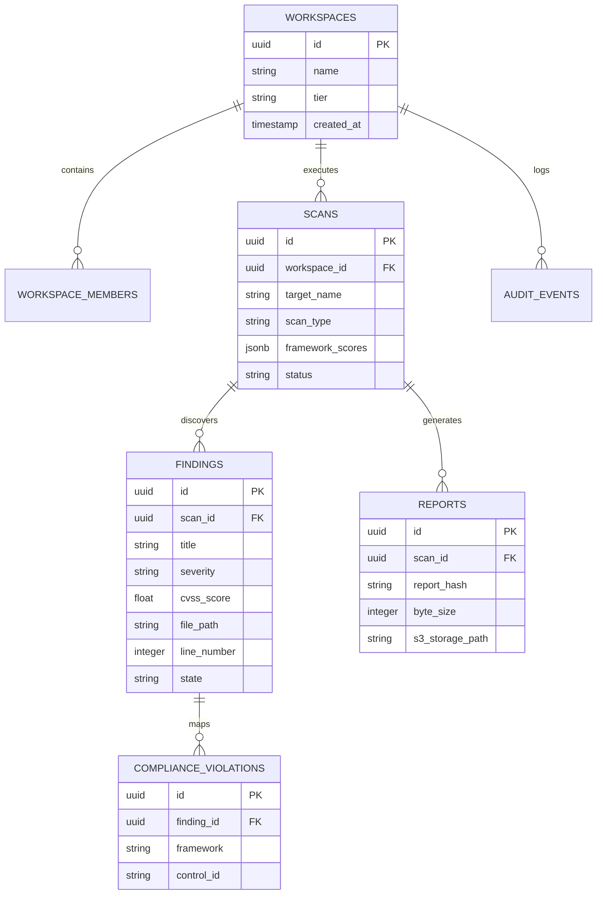

# ThreatLens — Comprehensive Future Scope & Engineering Roadmap

This document provides an end-to-end technical roadmap, architectural specification, and implementation blueprint for expanding **ThreatLens (LLM-Agentic Compliance & Threat Modeling Engine)** from its current local analysis prototype into an enterprise-grade, cloud-native DevSecOps and regulatory compliance platform.

---

## 📋 Table of Contents

1. [Executive Vision & Scope Overview](#1-executive-vision--scope-overview)
2. [Phase 1: Ingestion & CI/CD Pipeline Expansion](#2-phase-1-ingestion--cicd-pipeline-expansion)
   - 2.1 GitHub URL Scanning & Private Repository Authentication
   - 2.2 GitHub Actions & Pull Request Audit Bot
   - 2.3 Docker Container & Infrastructure-as-Code (IaC) Scanning
3. [Phase 2: Expanded Compliance & Regulatory Intelligence](#3-phase-2-expanded-compliance--regulatory-intelligence)
   - 3.1 HIPAA Security Rule (§164.312) Control Engine
   - 3.2 PCI DSS v4.0 Payment Security Framework
   - 3.3 NIST CSF 2.0 & ISO 27001:2022 Deep Mapping
   - 3.4 Automated Compliance Gap Checklist Generation
4. [Phase 3: Multi-Scenario College Viva & Examiner Demo Suite](#4-phase-3-multi-scenario-college-viva--examiner-demo-suite)
   - 4.1 Preset Scenarios (Fintech, Healthcare, E-Commerce)
   - 4.2 1-Click Workspace Demo Switcher Architecture
5. [Phase 4: In-Browser Code Inspector & AI Auto-Fix Engine](#5-phase-4-in-browser-code-inspector--ai-auto-fix-engine)
   - 5.1 Slide-Over Code Drawer with Line Highlighting
   - 5.2 Git-Style Diff Viewer & One-Click Patch Export
6. [Phase 5: Visual Attack Graph & Interactive Threat Modeling](#6-phase-5-visual-attack-graph--interactive-threat-modeling)
   - 6.1 STRIDE & DREAD Automated Threat Classification
   - 6.2 Interactive Node-Link Attack Topology Graph
7. [Phase 6: Enterprise Persistence, RBAC & Multi-Tenancy](#7-phase-6-enterprise-persistence-rbac--multi-tenancy)
   - 7.1 PostgreSQL Schema & Alembic Migration Plan
   - 7.2 Row-Level Security (RLS) & Workspace Isolation
   - 7.3 Finding Lifecycle & False-Positive Reviewer Workflows
8. [Phase 7: Reporting, Attestation & Multi-Format Exports](#8-phase-7-reporting-attestation--multi-format-exports)
   - 8.1 Editorial SaaS PDF Attestation Certificate
   - 8.2 SARIF 2.1.0, CSV, and Machine-Readable JSON Exports
9. [Milestone Timeline & Implementation Matrix](#9-milestone-timeline--implementation-matrix)
10. [College Viva & Examiner Presentation Defense Pack](#10-college-viva--examiner-presentation-defense-pack)
   - 10.1 5-Minute Presentation Speech Structure
   - 10.2 Top 5 Examiner Questions & Winning Technical Answers

---

## 1. Executive Vision & Scope Overview

```
┌─────────────────────────────────────────────────────────────────────────────────────────┐
│                                ThreatLens Core Platform                                 │
├──────────────────────────┬────────────────────────────┬─────────────────────────────────┤
│    Developer Inputs      │     Intelligence Layer     │       Auditor Deliverables      │
├──────────────────────────┼────────────────────────────┼─────────────────────────────────┤
│ • Local ZIP Archives     │ • Deterministic AST Scanners│ • Intercom-Editorial SaaS PDF   │
│ • Public/Private GitHub  │ • Groq LPU LLM Reasoning   │ • Multi-Framework Scorecards    │
│ • CI/CD Pull Requests    │ • Qdrant CyRAG Embeddings  │ • SARIF / VS Code Security Feed │
│ • Terraform / Dockerfile │ • CVSS 3.1 Vector Engine   │ • Verifiable Attestation Token  │
└──────────────────────────┴────────────────────────────┴─────────────────────────────────┘
```

ThreatLens solves the disconnect between **developer security findings** (SQLi, CVEs, hardcoded secrets) and **governance requirements** (GDPR Article 32, SOC 2 Common Criteria, HIPAA Security Rule, PCI DSS v4.0). While existing tools like SonarQube or Snyk report isolated technical bugs, ThreatLens uses **RAG (Retrieval-Augmented Generation) and low-latency Groq LLM agents** to map evidence to statutory controls and produce executive attestation reports.

---

## 2. Phase 1: Ingestion & CI/CD Pipeline Expansion

### 2.1 GitHub URL Scanning & Private Repository Authentication
Currently, ThreatLens accepts uploaded ZIP archives. This phase adds direct repository ingestion via remote Git cloning.

#### Technical Workflow:
1. **API Endpoint:** `POST /api/local/scan/github`
2. **Input Parameters:**
   - `repo_url` (e.g. `https://github.com/org/repo`)
   - `branch` (default: `main` or `master`)
   - `token` (optional Personal Access Token for private repositories)
   - `frameworks` (comma-separated: `gdpr,soc2,iso27001,hipaa,pci_dss`)
3. **Execution Sandbox:**
   ```python
   # Secure shallow clone with timeout & size limits
   cmd = [
       "git", "clone",
       "--depth", "1",
       "--branch", branch,
       authenticated_url,
       sandbox_dir
   ]
   subprocess.run(cmd, timeout=30, check=True)
   ```
4. **Security Controls:**
   - Enforce max repo size (<50 MB uncompressed).
   - Sanitize all input URLs to prevent shell command injection.
   - Purge sandbox credentials and temp directories upon scan completion.

### 2.2 GitHub Actions & Pull Request Audit Bot
- **Workflow Action (`threatlens-action`):** Runs ThreatLens on pull requests.
- **PR Comment Bot:** Automatically posts a markdown summary on the PR highlighting new vulnerabilities, CVSS score deltas, and compliance violations.
- **Merge Blocker Gate:** Fails CI if any new `CRITICAL` or `HIGH` vulnerabilities are introduced that violate selected compliance baselines.

### 2.3 Docker & IaC (Infrastructure-as-Code) Scanning
- **Terraform / CloudFormation Parser:** Detect public S3 buckets, open security groups (0.0.0.0/0 on port 22/3389), and missing encryption-at-rest.
- **Dockerfile Audit:** Check for root user execution (`USER root`), missing base image pinning, and sensitive environment variables (`ENV AWS_KEY=...`).

---

## 3. Phase 2: Expanded Compliance & Regulatory Intelligence

Expanding beyond GDPR, SOC 2, and ISO 27001 into industry-specific regulatory standards:

### 3.1 HIPAA Security Rule (§164.312) Control Engine
Designed for digital health platforms and medical SaaS handling electronic Protected Health Information (ePHI):

| HIPAA Citation | Control Title | Finding Trigger Patterns |
| :--- | :--- | :--- |
| **§164.312(a)(1)** | Access Control | Missing route authentication, JWT validation bypass, IDOR in medical records endpoints |
| **§164.312(a)(2)(iv)** | Encryption & Decryption | Plaintext database passwords, unencrypted ePHI database columns, lack of TLS |
| **§164.312(b)** | Audit Controls | Missing logging on sensitive record access or administrative modifications |
| **§164.312(c)(1)** | Data Integrity | Unsigned state payloads, lack of HMAC/checksum verification on health data |
| **§164.312(e)(1)** | Transmission Security | Insecure cookies (`SameSite=None`, `Secure=False`), HTTP endpoint communications |

### 3.2 PCI DSS v4.0 Payment Security Framework
Targeting financial services, payment processors, and e-commerce platforms handling cardholder data:

| Requirement | Description | Finding Trigger Patterns |
| :--- | :--- | :--- |
| **Req. 3.4** | Render PAN Unreadable | Storage of Primary Account Numbers (PAN) in cleartext logs or unencrypted cache |
| **Req. 6.2.4** | Software Vulnerability Mitigation | SQL Injection, Cross-Site Scripting (XSS), Directory Traversal, Command Injection |
| **Req. 6.3.2** | Third-Party Component CVEs | Outdated open-source libraries with known CVEs in `requirements.txt` or `package.json` |
| **Req. 8.3.1** | Multi-Factor Authentication | Single-factor administrative logins, hardcoded API secret keys in code |
| **Req. 10.2** | Audit Trail Implementation | Unlogged user access, failure to record privileged administrative actions |

### 3.3 NIST CSF 2.0 & ISO 27001:2022 Deep Mapping
- **NIST CSF 2.0:** Map findings across Core Functions: **Govern (GV)**, **Identify (ID)**, **Protect (PR)**, **Detect (DE)**, **Respond (RS)**.
- **ISO 27001:2022:** Updated Annex A controls: A.5 (Organizational), A.8 (Technological: Secure Coding, Configuration Management, Vulnerability Management).

---

## 4. Phase 3: Multi-Scenario College Viva & Examiner Demo Suite

To provide instant, verifiable proof during college viva evaluations and live investor demos, ThreatLens includes a **Multi-Scenario Demo Switcher** with three pre-packaged, offline scenario bundles:

```
┌────────────────────────────────────────────────────────────────────────┐
│                   Multi-Scenario Demo Switcher                         │
├────────────────────┬─────────────────────────┬─────────────────────────┤
│  🏦 Fintech Bank   │   🏥 Healthcare EHR     │  🛒 E-Commerce Cloud    │
├────────────────────┼─────────────────────────┼─────────────────────────┤
│ • SQLi in Ledger   │ • Cleartext ePHI Store  │ • Path Traversal on Inv │
│ • Hardcoded Stripe │ • Missing Access Check  │ • Leaked AWS S3 Secret  │
│ • Cleartext Card   │ • Insecure Session      │ • Vulnerable CVE Pkg    │
│ Target: PCI DSS/SOC│ Target: HIPAA/GDPR      │ Target: GDPR/ISO 27001  │
│ [1-Click Launch]   │ [1-Click Launch]        │ [1-Click Launch]        │
└────────────────────┴─────────────────────────┴─────────────────────────┘
```

### 4.1 Preset Package Specifications
1. **Fintech Banking Core (`fintech-banking.zip`):**
   - Vulnerability 1: SQL Injection in `app/transfer.py` (CVSS 9.8)
   - Vulnerability 2: Exposed Stripe Live Secret Key in `config/payment.py` (CVSS 9.4)
   - Vulnerability 3: Plaintext Credit Card logging in `services/logger.py` (CVSS 7.8)
   - Evaluated Standards: **PCI DSS v4.0**, **SOC 2 Type II**.
2. **Healthcare EHR Patient Portal (`healthcare-ehr.zip`):**
   - Vulnerability 1: Unencrypted patient diagnostic records in `models/patient.py` (CVSS 8.5)
   - Vulnerability 2: Broken Object-Level Authorization (BOLA) in `routes/records.py` (CVSS 8.8)
   - Vulnerability 3: Insecure session cookie missing `Secure; HttpOnly` flags (CVSS 5.3)
   - Evaluated Standards: **HIPAA Security Rule**, **GDPR**.
3. **E-Commerce Cloud SaaS (`ecommerce-cloud.zip`):**
   - Vulnerability 1: Arbitrary File Download / Path Traversal in `controllers/invoice.py` (CVSS 8.1)
   - Vulnerability 2: Leaked AWS S3 Production Keys in `deploy/settings.py` (CVSS 9.4)
   - Vulnerability 3: Outdated `requests==2.19.0` with CVE-2018-18074 (CVSS 7.5)
   - Evaluated Standards: **GDPR**, **ISO 27001:2022**.

---

## 5. Phase 4: In-Browser Code Inspector & AI Auto-Fix Engine

### 5.1 Slide-Over Code Drawer
A right-side sliding panel (`CodeInspectorDrawer.tsx`, width ~540px) allowing developers to inspect source code context without navigating away from the scan dashboard:
- **Line Gutter with Risk Indicators:** Red marker on vulnerable line(s).
- **Metadata Header:** Finding Title, CVSS 3.1 score, CWE classification, and source file path in JetBrains Mono.
- **Syntax Highlighting:** Tokenized presentation of Python, JavaScript, TypeScript, Go, and YAML.

### 5.2 Git-Style Diff Viewer & Auto-Remediation
An interactive tab within the drawer providing:
- **Unified / Split Diff:** Displays `-` Red (vulnerable code) and `+` Green (safe replacement code).
- **Explanation:** Why the fix neutralizes the attack vector.
- **Copy Patch / Download File:** Single-click action to copy the safe code snippet or download the patched file directly.

---

## 6. Phase 5: Visual Attack Graph & Interactive Threat Modeling

### 6.1 Automated STRIDE & DREAD Categorization
- **STRIDE Analysis:**
  - **S**poofing: Missing authentication, forged JWT tokens.
  - **T**ampering: Unvalidated input, SQL injection, unsafe deserialization.
  - **R**epudiation: Missing audit trails, unlogged database alterations.
  - **I**nformation Disclosure: Hardcoded credentials, directory traversal.
  - **D**enial of Service: Unbounded loop operations, memory exhaust vulnerabilities.
  - **E**levation of Privilege: Role check bypass, administrative command injection.

### 6.2 Interactive Attack Graph Visualization
Using **Cytoscape.js** or **D3.js** in the frontend:
- **Nodes:** Client Browser ➔ API Gateway ➔ Microservices ➔ PostgreSQL / Redis / S3 Storage.
- **Edges:** Data flow lines with color-coded risk indicators.
- **Threat Vector Paths:** Highlighted animated pulse lines showing the exact path an external adversary takes from an unauthenticated endpoint to compromised database records.

---

## 7. Phase 6: Enterprise Persistence, RBAC & Multi-Tenancy

### 7.1 Database Architecture (PostgreSQL + Alembic)
Moving from in-memory state to persistent Supabase/PostgreSQL tables:



### 7.2 Finding State & Reviewer Workflows
Support formal compliance audit lifecycle states:
- `DETECTED` ➔ Initial scan detection.
- `IN_REVIEW` ➔ Security engineer investigating.
- `FALSE_POSITIVE` ➔ Documented exception with auditor rationale and digital sign-off.
- `REMEDIATED` ➔ Verified fixed in subsequent scan.

---

## 8. Phase 7: Reporting, Attestation & Multi-Format Exports

### 8.1 Editorial SaaS PDF Attestation Certificate
The primary deliverable, strictly adhering to the Archon editorial design system:
- **Palette:** Warm cream canvas (`#f5f1ec`), white cards (`#ffffff`), charcoal ink (`#111111`), Fin-orange accent (`#ff5600`).
- **Typography:** Inter with tabular figures (`tnum`) and JetBrains Mono for hashes and code blocks.
- **Attestation Signatures:** Digitally sealed with SHA-256 integrity token and multi-agent sign-offs.

### 8.2 Additional Export Standards
1. **SARIF 2.1.0 (`results.sarif`):**
   - OASIS standard format readable by GitHub Code Scanning, VS Code SARIF viewer, and Azure DevOps.
2. **CSV Audit Matrix (`audit_findings.csv`):**
   - Formatted for import into enterprise GRC platforms (Vanta, Drata, OneTrust, ServiceNow).
3. **Machine-Readable JSON (`report.json`):**
   - Full REST API payload with raw AST evidence, CVSS vector strings, and control mapping arrays.

---

## 9. Milestone Timeline & Implementation Matrix

| Milestone | Key Deliverables | Tech Stack | Status |
| :--- | :--- | :--- | :--- |
| **M1: Local Workspace & Static Scanner** | ZIP upload, deterministic static scanners, CVSS assignment | Python, FastAPI, React | ✅ Completed |
| **M2: Groq LLM & CyRAG Intelligence** | Groq LPU acceleration, prompt engineering, rate-limit retries | Groq SDK, LangChain | ✅ Completed |
| **M3: Editorial SaaS PDF Generator** | Archon cream design, Phosphor icons, Inter/JetBrains fonts | Headless Edge/Chrome, Jinja2 | ✅ Completed |
| **M4: GitHub & Remote URL Ingestion** | Shallow clone sandbox, branch selection, private repo token | Git CLI, FastAPI Streaming | ⏳ Next Up |
| **M5: HIPAA & PCI DSS v4.0 Engines** | Regulatory control mapping for healthcare & payment processing | Regex/AST, Groq Prompts | ⏳ Next Up |
| **M6: Multi-Scenario Demo Switcher** | 1-click viva/examiner demos (Fintech, Health, E-Com) | Vite, Bundled ZIP archives | ⏳ Next Up |
| **M7: Slide-Over Code Inspector** | Right drawer with line highlight and AI suggested fix diff | React, Tailwind, Lucide/Phosphor | ⏳ Next Up |
| **M8: Interactive Attack Graph** | STRIDE threat model topology graph with animated pulse paths | Cytoscape.js / D3.js | 🔮 Future Phase |
| **M9: Supabase Persistence & RBAC** | PostgreSQL migration, multi-tenant RLS, finding lifecycle | SQLAlchemy, Alembic, Supabase | 🔮 Future Phase |

---

## 10. College Viva & Examiner Presentation Defense Pack

### 10.1 5-Minute Presentation Speech Structure

| Timestamp | PPT Slide(s) | Topic | Core Focus |
| :--- | :--- | :--- | :--- |
| **0:00 – 0:35** | Slide 1 – 2 | Title & Contents | Introduction of Jignesh Sonewane, Soham Pashine, Bhargav Bawane & Prof. Pankaj Sonewane |
| **0:35 – 1:20** | Slide 3 – 5 | Problem & Literature Survey | Why current SAST tools fail to bridge technical bugs to legal governance; CyRAG research base |
| **1:20 – 2:10** | Slide 6 – 7 | Objectives & 6-Stage Pipeline | Upload ➔ Safe Ingestion ➔ Static Scanner ➔ RAG Retrieval ➔ Groq LLM Reasoning ➔ PDF Report |
| **2:10 – 3:15** | Slide 8 – 10 | System Architecture & Zero-Trust Sandbox | FastAPI, React/TanStack Start, Qdrant Vector DB, Groq LPU, isolated sandbox execution |
| **3:15 – 4:25** | Slide 11 – 12 | Implementation & Live Benchmark | Working local workspace, 7 real vulnerabilities detected, compliance scorecards, 854 KB report |
| **4:25 – 5:00** | Slide 13 | Conclusion & Q&A Opening | Transform weeks of manual audits into automated, verifiable compliance |

---

### 10.2 Top 5 Examiner Questions & Winning Technical Answers

#### Q1: "Why use an LLM? Couldn't you just use SonarQube or Snyk?"
> **Answer:** *"SonarQube and Snyk excel at detecting syntax bugs, but they lack regulatory reasoning. They cannot map a line of code to GDPR Article 32 or explain how an unvalidated download endpoint breaches SOC 2 Common Criteria CC6.1. ThreatLens uses deterministic scanners for detection, and LLM + RAG over statutory texts to bridge the technical gap into actionable audit evidence."*

#### Q2: "How do you prevent the LLM from hallucinating compliance controls?"
> **Answer:** *"We strictly eliminate hallucinations through RAG (Retrieval-Augmented Generation) backed by Qdrant vector database. Official regulatory clauses (ISO 27001 Annex A, GDPR Articles, HIPAA §164.312) are embedded and retrieved via vector search. The LLM is constrained to only cite retrieved, verified control IDs with structured JSON schema outputs."*

#### Q3: "What if an uploaded ZIP file contains a malicious archive or zip-bomb?"
> **Answer:** *"Our safe ingestion module checks zip file depth, total uncompressed byte limits (<50 MB), and sanitizes member filepaths to block Directory Traversal (Zip Slip). The scanner operates inside an isolated sandbox with zero access to infrastructure environment variables or database keys."*

#### Q4: "Why did you choose Groq instead of standard OpenAI?"
> **Answer:** *"Groq runs on specialized LPU (Language Processing Unit) hardware providing token inference speeds under 1 second. This enables real-time Server-Sent Events (SSE) streaming during live scans without making developers or auditors wait minutes for report generation."*

#### Q5: "What are the immediate next steps in your implementation roadmap?"
> **Answer:** *"Expanding ingestion to support direct GitHub URLs, adding HIPAA and PCI DSS v4.0 engines, enabling the multi-scenario demo switcher for offline examiner presentations, and launching the slide-over code inspector with AI auto-fix diffs."*

---

*Authored by the ThreatLens Core Engineering Team · G H Raisoni College of Engineering · Department of Data Science, IoT & Cyber Security.*
