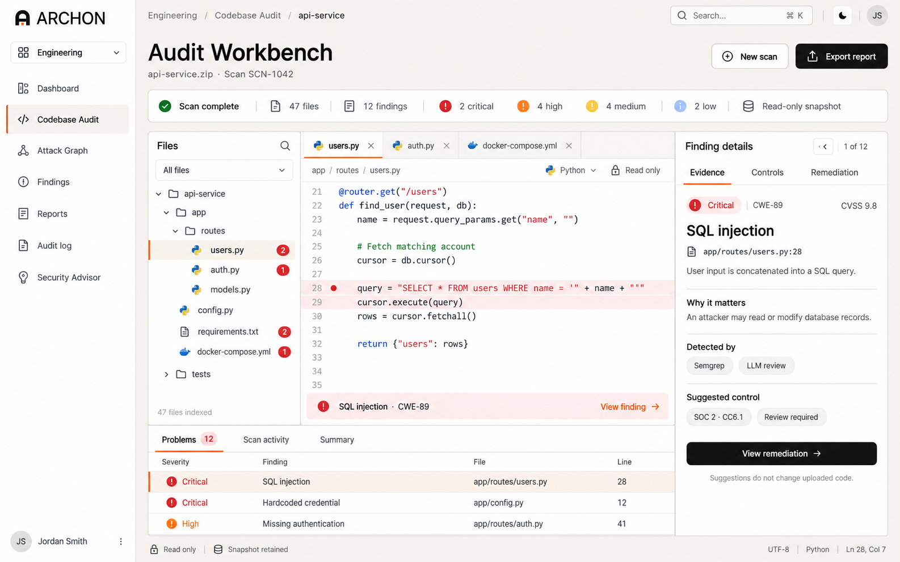
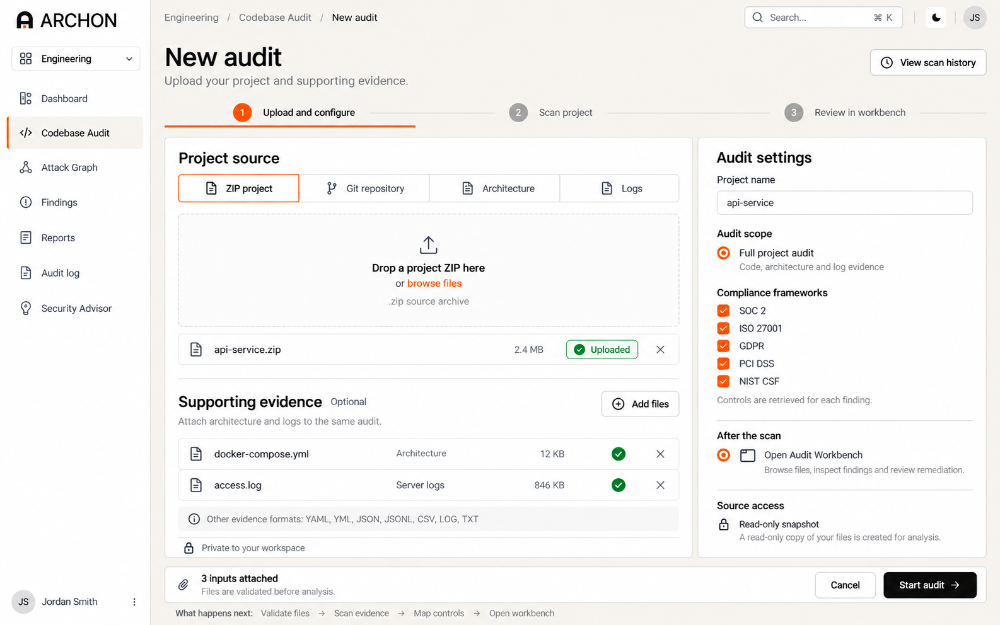
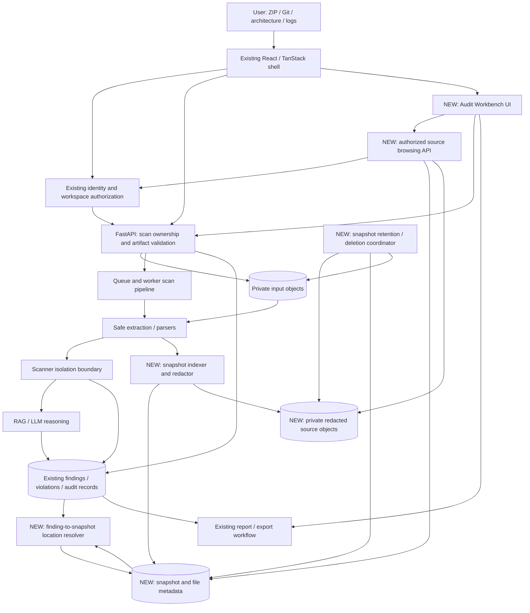
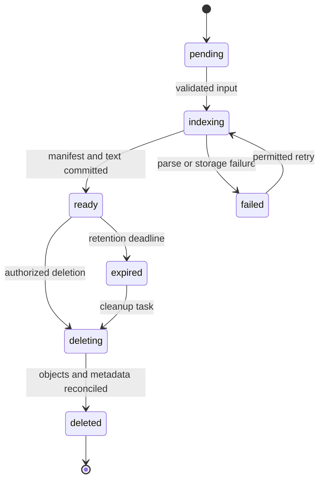
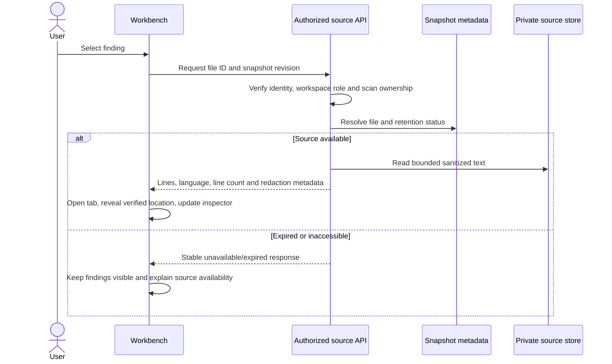

# Archon Audit Workbench

Design and architecture proposal | 17 October 2026

Implementation update, 19 October 2026: ZIP-first progressive workbench is implemented and enabled locally. Hosted additive migration/RLS, real ZIP-to-report and 14-/90-/500-file live timing checks passed. See [performance implementation and measured limitations](./PERFORMANCE_IMPLEMENTATION.md), [implementation plan](./IMPLEMENTATION_PLAN.md) and [validation notes](./VALIDATION.md). The original proposal below records the design intent; supporting formats remain future scope.

## Recommendation

Add a scan-specific Audit Workbench inside Codebase Audit. After uploading a project and scanning it, users should be able to browse the exact scanned files, open findings at their source locations, inspect compliance evidence, and understand remediation in one screen.

The feature should extend Archon's audit workflow. The first release is a read-only review surface, not a hosted development environment. A full terminal, code execution, extension marketplace, repository writes, and automatic fixes are outside this proposal's first release.

The original design task added only assets and planning documents. The subsequent approved implementation adds the ZIP workflow, source-review UI and backend APIs; its readiness gate preserves standard audits until hosted configuration is verified.

## Proposed screen images

### After the scan

The main review page: file explorer, source tabs, line-linked findings, evidence inspector, and a Problems dock. The selected finding, source file, line, and inspector all refer to the same item.

### Before the scan

The setup page: project source, optional supporting evidence, framework selection, and an explicit transition into the workbench.

All names, code, counts, severities, scores, control assignments, scan identifiers, and user identities in these images are illustrative fixtures. They are not results from the user's repository. Code text in generated mockups is visual content, not executable sample code. The written specification below is authoritative if a small label or layout detail differs in the images.

Image creation used the built-in image generator, with the current Archon screen and vector logo as references. [IMAGE_PROMPTS.md](./IMAGE_PROMPTS.md) preserves the generation prompts and reference roles. The design targets a restrained, professional software interface; no claim of human authorship is made.

## 1. What the repository actually has

These observations come from the current source files, rather than assuming all architecture diagrams describe the active UI.

| Area | Observed foundation | Gap for the proposed feature |
| --- | --- | --- |
| Product shell | [AppShell](../../../src/components/brutal/AppShell.tsx) has the workspace sidebar, navigation, theme control, and assistant integration. | A scan-specific workbench layout and entry action are new. |
| Brand | [styles.css](../../../src/styles.css), [ArchonWordmark](../../../src/components/ui/ArchonWordmark.tsx), and the refined SVG identity define the current product theme. | Reuse them instead of introducing a separate IDE brand. |
| Active upload page | [workspace.tsx](../../../src/routes/_app/workspace.tsx) accepts ZIP files and calls uploadLocalScan, then streams progress and stores history/results. | Supporting-file uploads and a retained source tree are new integrations. |
| Local scan transport | [localScan.ts](../../../src/lib/api/localScan.ts) talks to /api/local/scan and its stream/result/report endpoints; its comment describes local-only unauthenticated mode. | Do not turn that local transport into a production source-browsing API. |
| Production-oriented contracts | [scan schemas](../../../threatlens/app/schemas/scan.py) and [upload validation](../../../threatlens/app/ingestion/validation.py) define upload/Git contracts and scan-type-specific formats. | These contracts are broader than the active ZIP-only UI. Multiple supporting inputs under one completed scan need orchestration and contract work. |
| Source extraction | [code_extractor.py](../../../threatlens/app/ingestion/code_extractor.py) has source allowlists, ignored directories, and safe ZIP extraction checks. | Extraction does not by itself provide a durable browser-accessible source snapshot. |
| Findings | [finding schemas](../../../threatlens/app/schemas/finding.py) include file_path, line_number, snippet, source, CWE/CVE, score, and remediation fields. | Resolve findings to stable snapshot file IDs; support missing/unmatched locations. |
| Artifacts | [ScanArtifact](../../../threatlens/app/models/scan_artifact.py) stores metadata about input objects, not an indexed source tree. | Add a snapshot manifest and file metadata contract. |
| Worker lifecycle | [scan_task.py](../../../threatlens/app/tasks/scan_task.py) schedules input cleanup using SOURCE_RETENTION_HOURS. | Snapshot lifetime and expiry must be explicit; never assume extracted files survive. |
| Review state | [scans.py](../../../threatlens/app/api/scans.py) includes a scan-scoped finding-state PATCH with analyst authorization and an audit event. | Reuse this contract after integration; do not create a second status model. |

Current frontend and backend paths have contract differences. Persistence of a completed scan row does not prove the complete source or every result field is retained. Verify the integration before enabling a workbench link.

## 2. Research and technology choice

Research checked on 17 October 2026. Decisions below are recommendations, not installed dependencies.

| Primary source | Relevant finding | Application to Archon |
| --- | --- | --- |
| [Microsoft VS Code user interface](https://code.visualstudio.com/docs/editing/getting-started/userinterface) | Documents the explorer, editor, secondary sidebar, tabs, panel, and status bar. | Use familiar navigation regions; make source and security evidence the central task. |
| [Microsoft Monaco Editor](https://github.com/microsoft/monaco-editor) | Provides browser editor models, URI identities, editors, and disposal concepts. | Recommend Monaco for source viewing; use snapshot-scoped URIs and dispose inactive models. Monaco is the editor component, not the entire workbench. |
| [Monaco ESM integration](https://github.com/microsoft/monaco-editor/blob/main/docs/integrate-esm.md#using-vite) | Includes a Vite integration section using web workers. | Plan a client-only lazy import, locally bundled workers, and a production-build check. No SSR access to browser globals. |
| [Microsoft Workspace Trust](https://code.visualstudio.com/docs/editing/workspaces/workspace-trust) | Explains why unfamiliar projects can trigger unsafe behavior through execution features. | Keep this review surface inert: never run uploaded scripts, project tasks, HTML previews, or extensions. |
| [OWASP File Upload Cheat Sheet](https://cheatsheetseries.owasp.org/cheatsheets/File_Upload_Cheat_Sheet.html) | Recommends allowlisted formats, server validation, safe filenames/storage, access checks, and upload limits. | Extend the existing server-side upload contract and archive checks; a browser accept attribute is not validation. |

Recommendation: Monaco inside the existing React/TanStack shell, with React Query for authorized server state, the existing Phosphor icon library, and CSS grid plus accessible resize handles. Lazy-load the editor only on the workbench route. Use an inert text viewer as a loading/error fallback.

A browser-based editor library does not require installing or hosting all of VS Code. A separate remote IDE or container per viewer would add operating cost and execution scope without helping the initial review task.

## 3. Product entry and workflow

Proposed URL: `/workspace/$workspaceId/scans/$scanId/workbench`.

Keep Codebase Audit selected in the sidebar. Add an **Open workbench** action to a completed scan's existing result/history view. Do not add a competing top-level destination with no selected scan.

1. Select ZIP, Git, architecture, or logs as the primary source.
2. Optionally attach architecture and log evidence to a code/full audit.
3. Set the project name and select applicable frameworks.
4. Validate and upload all inputs; report file-specific errors.
5. Seal the input set when starting the scan. Later changes create a new scan.
6. Extract/index source safely while the analysis pipeline runs.
7. Show pipeline progress and a distinct source-indexing state.
8. Once results and a source manifest are available, open the workbench.
9. Select a finding, navigate to its file and line, inspect evidence/controls/remediation, and export the report.
10. Reopen the same immutable snapshot from history until its configured expiry.

Scan completion and snapshot availability are separate states. If analysis succeeds but indexing fails, keep the existing findings/report experience available and show **Source preview unavailable**, with an index retry action when possible.

## 4. Formats and input model

| Input | Existing contract or current behavior | Proposed workbench behavior |
| --- | --- | --- |
| Project ZIP | Supported by the active local upload flow and backend source-upload validation. | Show extracted allowlisted files and excluded-file reasons. |
| HTTPS Git URL | Present in production scan contracts and ingestion code; not wired through the active ZIP uploader. | Add a source mode after authenticated orchestration; pin and display the scanned commit. |
| Architecture .yaml / .yml / .json | Allowed by architecture-upload validation. | Read-only structured text and architecture findings; preserve document identity. |
| Logs .log / .txt / .json / .jsonl / .csv | Allowed by log-upload validation. | Read-only bounded line/event viewer and log findings; avoid loading an entire large log into the editor. |
| Individual code/config files | Some extensions are supported inside extracted repositories. | Direct individual-source upload is a later extension, not implied by archive support. |
| PDF, DOCX, RAR, 7Z, TAR, executables | Not part of the inspected source-upload contracts. | Do not advertise them as supported. Separate parser and validation work would be required. |

The same .json suffix can mean architecture or logs. Require the input role to disambiguate it. Multiple inputs must have separate artifact IDs and namespaces, so a ZIP's `docker-compose.yml` cannot collide with a supporting file of the same name.

Initial proposed policy: one primary input plus at most ten supporting artifacts. Per-file and total batch size must be server-configured; add a combined byte budget, not only individual limits. Reuse current ingestion settings as the starting point: MAX_FILE_SIZE_MB, MAX_EXTRACTED_SIZE_MB, MAX_SOURCE_FILES, and MAX_SOURCE_FILE_SIZE_MB. The inspected defaults are 50 MB, 500 MB, 1,000 files, and 2 MB respectively; surface effective policy from the server instead of hardcoding those defaults in the UI.

## 5. Page layout and interactions

### Application chrome

Keep ArchonWordmark, workspace selector, the current navigation labels, avatar, theme toggle, and compact buttons. Use one page heading, a project/scan breadcrumb, and a compact summary strip. The image's 47 files and 12 findings are fixture data, not promised capacity or performance.

### File explorer

Expandable folders, filename search, file-type glyphs, finding counts, and **All files / With findings** filters. Selecting a file opens its existing tab or creates one, without rerunning any analysis. Distinguish excluded, unsupported, binary, too-large, redacted, and unavailable files.

Use a maximum-severity indicator plus a count. Do not label every finding red. An explorer badge counts unique findings touching that file; it can differ from a whole-project count because one finding can affect multiple files.

### Source viewer

Read-only text with tabs, breadcrumbs, line numbers, syntax highlighting, current-line feedback, and finding decorations. A finding click selects the right snapshot, artifact, file, and line. Highlight a verified range when available; otherwise highlight the reported line. Never invent an end line or column.

Provide quick-open, in-file search, next/previous finding, copy permitted text, and a plain-text fallback. Default the minimap off to preserve space. Do not show editing/save controls on an immutable snapshot.

### Findings inspector

Evidence, Controls, and Remediation tabs. Include severity, scanner provenance, file reference, CWE/CVE where present, CVSS where actually scored, rationale, and remediation steps.

Control mappings must retain control identifiers, evidence, and available retrieval references. Label provisional model mappings **Review required**. Do not present a model's mapping as certification or verified legal compliance.

Existing finding states are open, accepted_risk, resolved, and false_positive. Analyst actions require authorization and an audit note. A status change alone is not proof that a vulnerability has been fixed.

### Problems and activity dock

A sortable findings table synchronized with the explorer and editor. Include severity, title, file, and line; filter by severity/source/review state. Other dock tabs show scan activity and summary. Activity is pipeline output, not an executable terminal.

### Layout dimensions and responsive behavior

For a 1920 CSS-pixel desktop, start with a 248px application sidebar, a 240px explorer, a 360px inspector, and a flexible editor. The full-width concept images compress these proportions slightly to remain readable as screenshots.

- At 1440px, reduce optional chrome and explorer width before constricting source.
- Below 1280px, make the inspector a drawer; keep editor width usable.
- Below 1024px, collapse application navigation and show a single explorer/source column.
- Below 768px, use Files, Code, and Findings views instead of four simultaneous panes. Fall back to a lightweight text viewer where appropriate.
- Preserve source horizontal scroll within the editor only.
- All splitters need keyboard resizing, collapse buttons, minimum widths, visible focus, and persistent UI preferences.
- Use semantic tree navigation, labeled tabs, descriptive icon buttons, and text plus severity color. Keep touch controls at least 44px on mobile.

## 6. Theme and icons

| Element | Use |
| --- | --- |
| Canvas | Existing background token: #F5F1EC in light mode. |
| Panes | Existing card token: #FFFFFF; one-pixel #D3CEC6 borders. |
| Text | #111111 primary and #626260 secondary. |
| Accent | #FF5600 for selected tabs, focus, and small navigation indicators. |
| Buttons | Charcoal primary, white bordered secondary. |
| Dark mode | Existing tokens: black canvas, #191918 sidebar, #313130 cards, white text; orange remains the accent. |
| Typography | Inter for controls; JetBrains Mono for source and file paths. |
| Shapes | 4px pane corners, 8px buttons; no decorative shadows or atmospheric gradients. |
| Severity | Current critical/high/medium/low tokens, with labels and distinct glyphs. |
| Icons | Reuse @phosphor-icons/react: FolderOpen, FileCode, FileText, MagnifyingGlass, CaretRight, WarningCircle, ShieldCheck, LockSimple, DownloadSimple, and arrows, subject to checking export names when implementing. |

The supplied images show the light theme. Dark and mobile behavior are specified, not supplied as additional rendered mockups. The image generator's language-specific file icons are illustrative; implementation should use the installed icon family consistently.

## 7. Proposed architecture

Solid arrows below represent proposed data/control flow, not a claim that every component already exists. NEW labels identify the main feature additions.

The production-oriented queue path is the target integration. The active local scan path must be bridged or replaced deliberately; it must not silently become the source-of-truth production service.

The indexer reads a bounded extraction result and emits immutable redacted text plus metadata before worker temporary directories are removed. Scanner subprocesses stay separate from storage and database credentials. The worker/indexer manages persistence; uploaded repository code is never executed by the viewer.

Raw inputs, sanitized snapshots, findings, and reports can have different lifetimes. Access to raw uploads must not be implied by access to sanitized preview text.

### Snapshot lifecycle

Publish ready only after the snapshot objects and manifest are consistent. Retries must be idempotent per scan/artifact revision. Failed attempts cannot expose partially indexed source as a complete snapshot.

### Finding selection flow

## 8. Proposed data contracts

These are conceptual entities, not database migrations.

| Entity | Required information |
| --- | --- |
| SourceSnapshot | id, scan_id, revision, state, primary artifact/commit reference, indexing version, file counts, exclusion summary, created_at, expires_at, redaction policy version. |
| SnapshotFile | opaque id, snapshot_id, artifact_id, relative display path, parent ID, kind, language, byte size, line count, encoding, sanitized content hash, private object locator, preview state, redaction indicator. |
| FindingLocation | finding_id, snapshot_file_id, verified start line, optional verified end line/columns, match status, scanner-reported original path; one finding can have several locations. |
| AuditInput | existing artifact reference plus proposed primary/supporting role and input-set revision. Preserve upload status, content hash and validation outcome per artifact. |
| FuturePatchProposal | later phase only: finding ID, snapshot/content hash, patch body, provenance, validation state, expiry, reviewer state. |

Store text in private objects, not large database text columns or localStorage. Snapshot and file records must be scoped through the owning scan/workspace. Do not trust a client-supplied workspace ID alone.

Normalize paths before assigning opaque file IDs; do not merge same-named files across artifacts. Treat reported locations as unverified until resolved against the scanned snapshot. If there is no exact location, retain the finding as unlocated evidence.

Use a snapshot-scoped editor URI concept such as `archon://workspace-id/scan-id/revision/file-id`. The server still authorizes every content request; a URI is not an access credential.

## 9. Proposed API surface

All /source and /artifacts additions below are NEW. Existing endpoint reuse still requires verifying request/response compatibility.

| Endpoint or operation | Intended behavior |
| --- | --- |
| Existing scan creation/start contracts | Extend with a versioned input manifest. Reuse verified upload reservations and completion hashes where available. |
| NEW POST /api/v1/scans/{scan_id}/artifacts | Reserve a supporting artifact while the scan is still draft/pending; validate role, scan type and batch limits. Freeze membership at start. |
| NEW GET /api/v1/scans/{scan_id}/source | Snapshot state, revision, counts, exclusions, expiry and supported viewer capabilities. |
| NEW GET /api/v1/scans/{scan_id}/source/files | Lazy folder listing, cursor pagination, filename filter and with-findings filter. |
| NEW GET /api/v1/scans/{scan_id}/source/files/{file_id} | Bounded sanitized source window with start/end line, total line count and revision. |
| NEW GET /api/v1/scans/{scan_id}/source/search | Bounded search over sanitized content, scoped to one scan; rate-limit and cancel stale queries. |
| Existing GET /api/v1/scans/{scan_id}/findings | Extend or adapt the response for location references and filter support; check current pagination. |
| Existing PATCH /api/v1/scans/{scan_id}/findings/{finding_id} | Reuse analyst-gated triage and existing audit-event behavior. |
| Existing progress/result/report integrations | Adapt to the workbench; specify durable reconnect behavior rather than relying solely on a browser stream. |
| Later POST /api/v1/scans/{scan_id}/patch-proposals | Optional bounded model request that produces a reviewable proposal; never mutates the snapshot. |

Return non-leaking errors for unauthorized IDs, a distinct expired response for authorized viewers, and explicit skipped/binary/oversized states. Source responses should use no-store caching and avoid URLs that expose storage keys.

Proposed viewer budgets: at most 1,000 lines or 256 KiB per response; default file preview cap of 2 MiB; at most eight retained editor models per tab session. These are design starting points to validate with real repositories, separate from source-ingestion limits.

## 10. Model and evidence boundary

Use scanner findings and stored analysis first. Opening a file, switching a tab, or selecting a finding must not trigger another paid model call.

Display scanner provenance separately from model interpretation. A future context question or patch request should send only the selected finding, bounded redacted lines, and relevant retrieved controls. Treat repository text as untrusted data rather than instructions. The model receives no infrastructure secrets or execution tools.

Preserve lines during redaction. Compute visible ranges against the redacted model so Unicode and masked spans cannot shift highlights incorrectly. A secret finding can describe a redacted credential without revealing it in the editor, evidence snippet, logs, export preview, clipboard action, or model request.

Any future patch must be tied to the exact snapshot hash, checked for valid target paths and syntax as applicable, and labeled unverified until independently tested. A generated suggestion is not a confirmed fix.

## 11. Storage, retention and access

Default source access should be read-only sanitized previews. Apply workspace/scan authorization to the manifest, tree, source, search, findings and exports. Preserve the existing distinction between viewer access and analyst triage. Remove in-memory editor models and cached source when changing workspace or signing out.

Do not store source bodies in localStorage or persist the query cache to disk. UI preferences may be stored separately without file contents. Render source as text; do not execute uploaded HTML, Markdown scripts, SVG scripts, package scripts or project settings.

Retain path traversal, absolute-path, symlink, archive-bomb, decoded-size and file-count protections. Reject encrypted/unsupported archives with a clear message. Check MIME, extension and parsed content together. Apply parser depth/size limits to structured inputs and cap log records.

The inspected SOURCE_RETENTION_HOURS default is 24 hours, configurable up to 720. Use the effective expiry returned by the server; the UI must not promise permanent source access. Coordinate new snapshot cleanup with existing input cleanup and scan deletion, handle partial storage failures with retries, and show findings/report history even when source previews expire.

## 12. Page states and edge cases

| State | UI behavior |
| --- | --- |
| Empty | Show the New audit source form and its format rules. |
| Uploading | Per-file progress and cancel/remove where allowed; prevent duplicate starts. |
| Validation failed | Name the affected input and the actionable reason. |
| Scanning | Show stage, available progress and bounded activity; no fabricated ETA. |
| Results ready, snapshot indexing | Findings/report accessible; source pane shows indexing status. |
| Complete, no findings | Browse files and show no findings for the selected scan scope; do not imply proven security. |
| Partial scanner failure | Identify missing analysis coverage while retaining usable results. |
| Missing file/line | Keep finding details visible and show Location unavailable. |
| Expired source | Replace source pane with the expiry message; preserve available findings/report actions. |
| Binary/oversized/unsupported file | Show metadata and reason instead of a blank editor. |
| Access changed | Clear source state immediately and show a scoped access error. |
| Connection lost | Reconnect progress or retrieve durable status; do not start a second scan. |

## 13. What to add and in what order

### Phase 1A: dependable code review

1. Authenticated scan-to-workbench routing and a retained, sanitized ZIP snapshot.
2. File tree, tabs, source viewer, filename search and exact file/line navigation.
3. Problems table, evidence/controls/remediation tabs and existing report actions.
4. Scan activity, expiry handling, loading/error/empty states and existing finding triage.
5. Theme matching, keyboard access, responsive panes and real-source performance checks.

This is the smallest useful release. An attractive editor without reliable source retention is not sufficient.

### Phase 1B: full evidence workspace

1. Wire architecture/log/Git source modes to the authorized backend.
2. Add multi-artifact upload reservations, combined quotas and immutable input manifests.
3. Give supporting files distinct namespaces, role-specific parsers and finding locations.
4. Extend the workbench for large logs and structured documents.
5. Preserve all cross-artifact evidence in the report and audit trail.

The upload image depicts this combined target; it does not imply Phase 1A already supports the full input set.

### Phase 2: reviewed remediation

Add explicit context questions, a read-only original/proposed diff, downloadable patches, and later scan-to-scan comparison. Require separate user actions and visible model provenance. Keep source originals immutable.

### Defer

An executable terminal, remote containers per viewer, arbitrary extensions, automatic apply/commit/push, live deployments, unsupported document formats, and a second generic chat panel. Existing Security Advisor can be reused later instead of duplicating it.

## 14. Future implementation map

Names are suggested work items only; none of these proposed files were created.

| Location | Planned responsibility |
| --- | --- |
| src/routes/workspace/$workspaceId/scans/$scanId/workbench.tsx | Authenticated scan-specific page, following the repository's route generation conventions. |
| src/components/audit-workbench/ | Layout, explorer, source viewer, tabs, finding inspector, Problems dock and status bar. |
| src/hooks/useSourceSnapshot.ts | Query keys, availability, cancellation and scoped source reads. |
| src/lib/api/sourceSnapshot.ts | Typed source API requests and normalized errors. |
| threatlens/app/api/source_snapshots.py | Authorized metadata/tree/content/search endpoints. |
| threatlens/app/schemas/source_snapshot.py | Validated source and manifest response contracts. |
| threatlens/app/ingestion/source_indexer.py | Safe relative paths, redaction, immutable object generation and location matching. |
| Existing scan tasks and storage lifecycle | Invoke indexing before temporary cleanup and reconcile retention/deletion. |
| Future reviewed migrations | Snapshot/file/location metadata and associated access policies, after schema design review. |

Reconcile path conventions, migration ownership and the generated route tree at implementation time. Do not hand-edit generated route files as part of planning.

## 15. Acceptance criteria

- Uploaded ZIP scans can be reopened from history with the exact retained revision.
- Selecting a located finding opens the correct artifact, file and line; unmatched locations never jump to an unrelated file.
- All source browsing/search requests enforce workspace and scan access; cross-workspace IDs cannot expose metadata or contents.
- No source text is executed or stored in browser persistence.
- Secrets remain masked in all new viewer and model-request surfaces.
- Unsupported files, invalid uploads, partial scans and expired snapshots have useful states.
- Supporting input types are only enabled after their backend contracts and parsers are wired and tested.
- Finding review actions preserve the existing authorization and audit trail.
- The reader works in both themes, supports keyboard navigation and remains usable at narrow widths.
- The editor is lazy-loaded; large projects use bounded reads rather than loading the full repository into the browser.
- Opening/reviewing files generates no model calls.
- Performance targets should be measured on agreed fixtures before release; this design does not claim benchmark results.

## 16. Deliverables and boundaries

Files added for this proposal:

- audit-workbench-desktop.png
- new-audit-upload-desktop.png
- README.md, this complete product and architecture plan
- IMAGE_PROMPTS.md, exact mockup generation briefs

All are under .github/future-scope/audit-workbench. No feature implementation is included. The next step is review of these concrete screens and phased scope before development.

