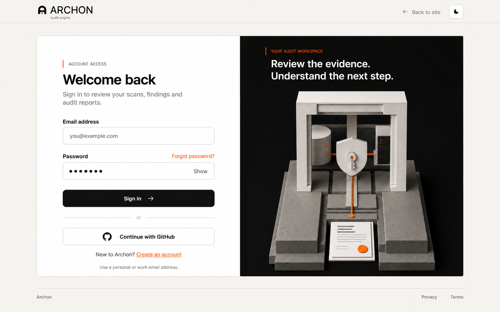

# Login page design concept



Design preview for Archon. Generated with the built-in image tool on 24 October 2026. No application code was changed.

## Design decisions

- Preserve the existing gateway illustration from `public/assets/archon-auth-gateway.webp`, with proportional scaling and all major objects visible.
- Retain the logo, warm cream, charcoal, orange accents and restrained borders.
- Give the form a clear heading, short purpose statement and consistent input/button sizes.
- Keep email sign-in as the primary action and GitHub as a separate option below a divider.
- Place password recovery beside its label, and use an explicit Show control.
- Replace the large mode tabs with a Create an account link below the form.
- Keep the illustration separate from the form and place its caption above the artwork.
- Place Privacy and Terms links in a quiet footer.

## Research

[GOV.UK text input guidance](https://design-system.service.gov.uk/components/text-input/) supports visible labels above inputs and appropriate autocomplete.

[GOV.UK password input guidance](https://design-system.service.gov.uk/components/password-input/) supports an explicit show/hide control, password-manager autocomplete and paste.

The screenshot communicates layout and visual hierarchy. Keyboard, autofill, responsive layout and error behavior require implementation and verification if this concept is approved.

## Proposed mobile adaptation

Show the form first, reduce outer padding, keep controls full width and hide the decorative illustration at narrow widths. Keep Back to site, theme switching, password recovery and account creation accessible.

## Generation prompt

```text
Use case: ui-mockup, precise layout edit and compositing.
Asset type: high fidelity desktop login-page design concept for the existing Archon security audit application.
Input image 1: current login screenshot, brand/logo and existing UI reference. Input image 2: EXISTING AUTH ILLUSTRATION TO PRESERVE. Redesign the login-page UI around the illustration, preserving this exact architectural gateway / shield and key / database / server / orange cable / report image. Do not invent replacement artwork. Keep all original objects, geometry, materials, black background, ivory stone and orange accents. Scale it proportionally and fit it fully inside the right panel without cropping the architecture or bottom report.
Output: one straight-on crisp, realistic web-page screenshot, landscape approximately 1600x1000. No device frames, perspective, presentation board, explanatory annotations or watermark. The entire page is visible.
Design: thoughtful contemporary product interface matching Archon's warm cream #F5F1EC, white, deep charcoal #111111, quiet border #D3CEC6 and restrained orange #FF5600. Precise typographic hierarchy using clean sans serif similar to Inter. Calm, balanced, spacious, polished as a production product. No neon, gradient blobs, glass effects, sparkle icons, AI branding, fake trust badges, invented claims, unnecessary decorations or tiny unreadable text.
Composition:
- Warm cream page background.
- A slim header at top with original Archon logo and wordmark on left, from screenshot; on right a restrained arrow and 'Back to site' plus small bordered moon theme button. Header inset about 80px; thin bottom divider.
- Main container approximately x120 y130 width1360 height750, white, subtle 1px border, about12px corner radius, minimal shadow. Two columns: left 52 percent, right48 percent. Right is full-height charcoal/black illustration panel.
- Left column: vertically centered form with a maximum width of 420px, consistent 48px field/button heights, 8px radii. No segmented sign-in/sign-up tab bar and no decorative lock tile. Generous whitespace around form.
- Small uppercase eyebrow 'ACCOUNT ACCESS' in quiet gray with subtle orange rule.
- Large headline 'Welcome back' around36px, medium-semibold, not oversized. Supporting text two short lines: 'Sign in to review your scans, findings and audit reports.'
- About28px gap then visible label 'Email address'. White outlined input with example 'you@example.com' in muted gray. Labels always outside fields.
- About20px below: a row with 'Password' on left and understated orange text 'Forgot password?' on right. Password field with 8 neutral black dots and a clearly legible 'Show' text control on right.
- About24px below: solid charcoal full-width button 'Sign in' with a small simple arrow-right.
- About24px below: quiet horizontal line divider with 'or' centered.
- Outlined full-width button same48px height, simple GitHub brand mark and 'Continue with GitHub'. Render logo cleanly and recognizably.
- Below24px: 'New to Archon? Create an account' with last portion orange or dark underlined. No redundant signup links elsewhere.
- Small quiet copy below: 'Use a personal or work email address.'
Right column:
- Preserve the exact supplied existing image. Black background fills panel. Existing architectural object is the hero, fully visible, no overlays on the shield or report.
- In the natural black negative space at top add small orange uppercase 'YOUR AUDIT WORKSPACE' then restrained white heading 'Review the evidence.\nUnderstand the next step.' around24px. Keep enough clearance above architecture; if needed shrink illustration proportionally slightly to fit rather than crop it.
- No additional feature cards, badges, scores, testimonial or status pills.
Page footer below card aligned cleanly: left 'Archon' and right 'Privacy' and 'Terms', quiet readable gray. No copyright date or invented certifications.
Everything aligns on a disciplined grid; use a restrained product-design look. Keep text exact, clean and legible. Do not change the brand wordmark or illustration. This is an image concept only.
```

