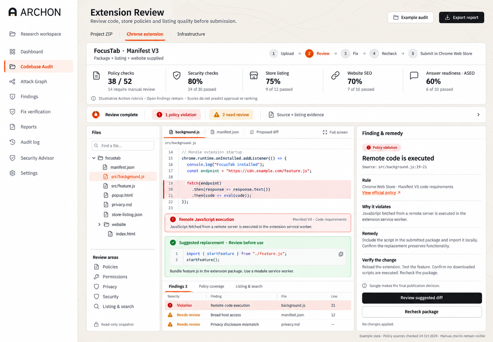
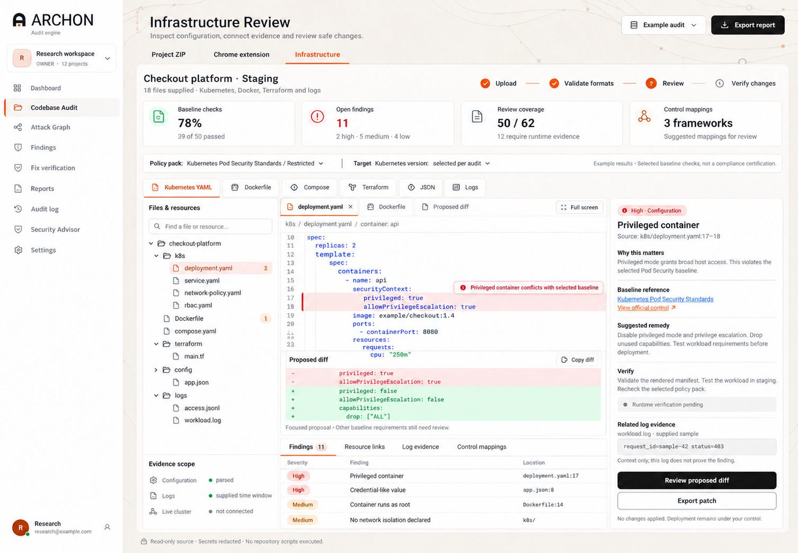

# Future review workbenches

Design exploration dated 24 October 2026. These are illustrative UI concepts, not implemented features or real scan results. The application was not changed. Both images use Archon's current workbench as a visual reference: cream background, white panels, charcoal type, orange accents and a three-pane source review layout.

## 1. Chrome Extension Review

Placement: Codebase Audit → Chrome extension. Keep the existing project upload alongside it.

Workflow: upload the extension ZIP or select its repository → identify manifest version and entrypoints → supply listing details, privacy declarations and optional website → review applicable policy and security checks → open a finding at its source line → review a suggested diff → test and recheck → submit through the Chrome Web Store Developer Dashboard. Submission and Google's decision remain distinct from Archon's review.

Include manifest, scripts, HTML, dependencies, declared permissions, host permissions, content security policy and packaged assets. Listing inputs should include title, description, screenshots, single purpose, permission justifications and privacy/data-use declarations. Developer-account and real runtime behavior checks need separate evidence; missing evidence must remain visible.

Policy coverage should track applicable Chrome Web Store requirements across permissions, privacy and Limited Use, disclosures, secure handling, remote code and obfuscation, single purpose, misleading behavior, listing accuracy, spam/manipulation, content restrictions, monetization/affiliate disclosures, intellectual property and publisher-account requirements. This is a policy inventory to maintain against current official sources, not a claim that static analysis can verify every Google rule or applicable law. Use outcomes Passed, Violation, Needs review, Not assessed and Not applicable, with reasons.

Each finding needs a stable internal rule ID, policy title and official link, policy revision/check date, file/line or listing field, evidence, explanation, confidence, suggested remedy and verification steps. Potential excessive permissions require feature context; broad permissions alone must not automatically become a confirmed violation. The example of downloading and evaluating JavaScript in a service worker illustrates a Manifest V3 code-policy violation. Relevant documented exceptions must be considered by the actual rule implementation.

### Scores

All numbers in the image are synthetic examples, not benchmarks measured from the project. The proposed v1 score is `passed assessed checks / applicable assessed checks × 100`, separately per category. Show numerator, denominator, rubric version, failed checks and unassessed checks. No observations means Not assessed. Do not let a high score hide a blocking policy finding.

- Policy coverage: 38 of 52 checklist items assessed; 14 still need manual review. This is coverage, not approval probability.
- Security checks: 80%, illustrated as 24/30 passed. Security testing scope must be explicit; code inspection does not establish complete runtime safety.
- Store listing quality: 75%, illustrated as 9/12 passed. This is an internal ASO/listing checklist, not Google's search score.
- Website SEO: 70%, illustrated as 7/10 passed. Requires a supplied, authorized website and its own crawl/content evidence. A ZIP alone cannot produce this score. Mark unavailable inputs Not assessed.
- Answer readiness (ASEO): 60%, illustrated as 6/10 passed. ASEO is interpreted here as readiness of website content for search-answer experiences. Use inspectable criteria such as accessible text, clear purpose and explanations, factual consistency and structured-data consistency. It is an experimental editorial rubric, not a Google metric or predicted citation probability.

Google's guidance says ordinary SEO practices remain relevant to its search AI features; it does not prescribe a special optimization score. Avoid keyword stuffing, fake reviews and fabricated search-rank promises.

## 2. Infrastructure Review

Placement: Codebase Audit → Infrastructure. Upload a bundle, select a repository, or provide supported individual files. Ask for environment and target platform/version before applying version-dependent controls.

Suggested formats and meaning:

| Input | Review scope |
| --- | --- |
| Kubernetes YAML/JSON | Workload security contexts, RBAC, declared network policies, resource requests/limits, probes and image references |
| Helm and Kustomize | Rendered manifests and source-to-output mappings; chart/overlay context must be explicit |
| Dockerfile and Compose YAML | User privileges, build secrets, exposed services, mounts, capabilities and image pinning |
| Terraform `.tf` / `.tf.json`, redacted plan JSON | Supported provider resource rules, IAM, public exposure and encryption configuration; no apply operation |
| CloudFormation YAML/JSON | Supported resource and access-control checks with template context |
| OpenAPI YAML/JSON and application configuration | Schema-aware authentication/transport declarations and configuration checks |
| `.log`, `.jsonl`, `.ndjson` | Redacted, timestamped evidence in a declared time window; no assumption that absence of an event proves compliance |
| Optional SBOM or image-scan results | Dependency/image evidence; Dockerfiles alone cannot establish image vulnerability status |

Generic YAML/JSON is a serialization format, not an architecture or compliance standard. Detect supported schemas and show unsupported files explicitly. Do not request unredacted Terraform state, credentials or sensitive logs as routine inputs.

Workflow: ingest and redact → detect schemas and versions → validate/normalize → run selected policy packs → map each result to a resource and source location → review proposed diff → validate resulting configuration → test in staging → recheck and compare. Rendering templates must use controlled tooling and resource limits; do not execute arbitrary repository plugins or scripts.

The central editor highlights the affected source and shows a separate proposed diff. The right pane gives the selected baseline reference, reason, remedy and verification. Logs stay contextual and separate from configuration facts. The depicted `status=403` record does not prove the privileged-container finding.

The sample baseline score is 39/50 passed = 78%, with 12 additional checks awaiting runtime evidence. The 11 open findings and three suggested framework mappings are illustrative. Specify the actual policy-pack version and target Kubernetes version in production; the image's version field is a concept placeholder. Pod Security Standards define workload controls, not a complete infrastructure compliance assessment. The displayed patch addresses two settings and capabilities; other Restricted requirements still need checking.

Track source evidence, supported controls, unmapped findings, human-review state and runtime verification separately. Runtime authorization, cluster enforcement, CNI support and deployed state cannot be inferred reliably from submitted manifests. Benchmark names/versions and any licenses must be verified before adding packs. A SOC 2 or ISO mapping is a suggested connection to a control, not a certification.

## Shared product behavior

- Use authorized workspace scope and existing read-only workbench conventions; preserve file paths and resource identity.
- Show preprocessing, analysis and persistence progress separately. Support invalid files, partial coverage, expired evidence and request failures.
- Provide full-screen source/diff viewing, keyboard navigation, severity and policy filters, paginated findings, and desktop/mobile layouts.
- Keep original evidence read-only. Suggested changes require review; validation outcomes and unsupported checks remain visible. Provide patch export and explicit recheck actions.
- Show no improvement in scores until a subsequent assessment completes. Export the same evidence, scope, rule references and limitations to the report.
- Use plain labels and existing outline icons, without model/provider badges or decorative generation indicators.

## Research sources

Official documentation consulted on 24 October 2026:

- [Chrome Web Store Program Policies](https://developer.chrome.com/docs/webstore/program-policies/policies/)
- [Manifest V3 code requirements and exceptions](https://developer.chrome.com/docs/webstore/program-policies/mv3-requirements)
- [Chrome Web Store discovery and listing relevance](https://developer.chrome.com/docs/webstore/discovery)
- [Google Search: AI features and your website](https://developers.google.com/search/docs/appearance/ai-features)
- [Kubernetes security checklist](https://kubernetes.io/docs/concepts/security/security-checklist/)
- [Kubernetes Pod Security Standards](https://kubernetes.io/docs/concepts/security/pod-security-standards/)
- [Docker build best practices](https://docs.docker.com/build/building/best-practices/)
- [Docker build secrets](https://docs.docker.com/build/building/secrets/)

The PNGs are design references, not executable code or final specification. Generated screenshot text and code must be implemented from validated source, not copied from raster glyphs. Images were produced with the built-in image-generation tool; the prompts are recorded alongside this note.
