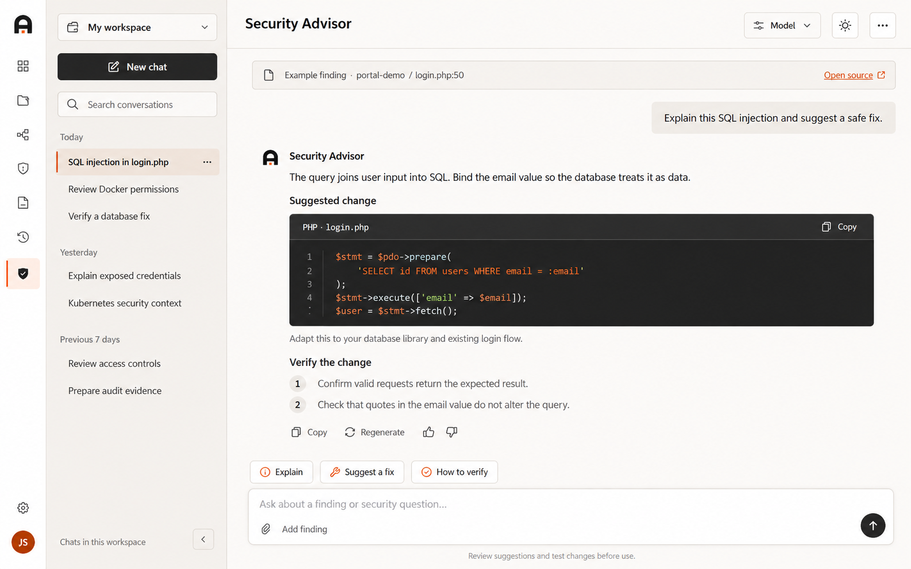

# Security Advisor conversation design



Design concept created on 24 October 2026 using the built-in image generator. The application has not been changed. Conversations and finding evidence shown in the image are illustrative.

## Layout

- A compact app-navigation rail keeps the main product destinations accessible.
- A conversation sidebar contains the workspace selector, New chat, search and date-grouped history.
- The selected conversation has a warm highlight and an overflow menu.
- The main header contains Security Advisor, Model, theme and conversation actions.
- A compact context strip identifies the selected finding and opens its source.
- Responses use readable prose, code blocks with Copy, suggested changes and verification steps.
- The message composer stays at the bottom, with Explain, Suggest a fix and How to verify nearby.
- A review-and-test reminder stays visible without dominating the screen.

## Proposed history behavior for later implementation

- Keep conversations scoped to the signed-in account and active workspace.
- New chat starts a separate conversation. Users can rename or delete it through its menu.
- Search matches conversation titles first; message-content search can be added if supported by the storage design.
- Group entries by Today, Yesterday and Previous 7 days; load older conversations progressively.
- Reopening a conversation restores its messages and authorized finding context. Unavailable findings need an explicit explanation.
- Workspace switching and logout cancel active responses and clear the previous scope from view.
- History needs loading, empty, unavailable and retry states. Failed saves should be visible.
- Persist conversation history only after defining account/workspace permissions and retention. This image does not establish an implemented storage policy.
- Review existing shared full-page/panel conversation behavior before adding independent chat threads.

## Mobile adaptation

Collapse app navigation and conversation history behind separate labeled menu controls. History opens in a full-height sheet with search, New chat and dated entries. Keep the conversation and bottom composer as the default view. Allow horizontal scrolling inside code blocks rather than across the page.

## Generation prompt

```text
Use case: ui-mockup.
Asset type: polished desktop Security Advisor redesign image for the existing Archon app.
Input image 1: current Archon Security Advisor screenshot, reference for authentic brand logo, cream charcoal orange palette, and existing product navigation. Remove all test-fixture banners and diagnostics from the design.
Primary request: Design a simple modern conversational workspace with familiar ChatGPT-like interaction layout, conversation history, and comfortably readable security guidance, while preserving Archon's own identity. This is a design image, not implementation. Create one straight-on full desktop screenshot, landscape 1728x1080 or similar, all edges visible, sharp typography, excellent alignment.
Visual language: warm cream #F5F1EC, off-white white main chat surface, charcoal #111111 text, muted warm gray borders #D3CEC6, small orange #FF5600 active accents. Inter-style sans serif. Subtle 8px corner radii, 1px dividers, generous whitespace. Professional product screenshot, restrained and believable. No sparkle symbols, robot avatars, AI labels, fake live status, promotional text, neon gradients, oversized hero copy, heavy shadows, floating decorative cards or decorative illustration.
Layout:
1. Far-left thin app rail, width72px, warm white background, subtle right border. Original recognizable Archon A logo at top, then simple consistent monochrome outline icons for Dashboard, Codebase Audit, Attack Graph, Findings, Reports, Fix verification, Audit log, and Security Advisor. Security Advisor shield icon has warm pale orange selected background and narrow orange indicator. Only icons in rail, no tiny navigation labels. Bottom settings icon and account circle initials 'JS'. This rail allows full Archon navigation without taking over the chat.
2. Conversation sidebar width264px, very light warm gray, subtle right border. Top workspace dropdown 'My workspace' with small outlined workspace icon and chevron. Under it clear full-width 44px charcoal button with compose icon and text 'New chat'. Then compact outlined search field with magnifier 'Search conversations'. A quiet section label 'Today', then selected chat 'SQL injection in login.php' with pale neutral active highlight, small ellipsis at right, NO red badges. Two more chats 'Review Docker permissions' and 'Verify a database fix'. Next section 'Yesterday' with 'Explain exposed credentials' and 'Kubernetes security context'. Next 'Previous 7 days' with 'Review access controls' and 'Prepare audit evidence'. Use restrained readable one-line labels and tasteful truncation if required. Bottom sidebar contains subtle text 'Chats in this workspace' and simple collapse-sidebar button. No fake message counts.
3. Main content fills remaining width, off-white background. Compact header height72 with 'Security Advisor' on left and quiet outlined 'Model' dropdown, theme icon button, and conversation ellipsis on right; equal36-40px heights. Thin bottom divider. No duplicate subtitle bar or stacked introduction cards.
4. Main conversation centered max-width790px with substantial left/right margins. Conversation scroll region begins around y120. At top a compact single-line context strip with simple file icon: 'Example finding · portal-demo / login.php:50' and orange 'Open source' link at far right. This clearly marks illustrative content rather than claiming a real saved scan. Strip pale warmgray with thin border, not a large card.
5. A small right-aligned warmgray user bubble saying 'Explain this SQL injection and suggest a safe fix.' No avatar needed.
6. Below left-aligned assistant response, plain flowing text directly on chat background, not boxed. Small original Archon mark followed by 'Security Advisor' in semibold. Main reply:
'The query joins user input into SQL. Bind the email value so the database treats it as data.'
A clear short subsection title 'Suggested change'.
A high-quality code block: header 'PHP · login.php' left, copy icon and 'Copy' right. Charcoal editor surface, line numbers, crisp syntax colored understated ivory/orange/green. Exact valid readable code:
$stmt = $pdo->prepare(
    'SELECT id FROM users WHERE email = :email'
);
$stmt->execute(['email' => $email]);
$user = $stmt->fetch();
No broken syntax, no fake line highlighting. Keep codeblock about200px height.
Below block a small gray sentence 'Adapt this to your database library and existing login flow.'
Then small heading 'Verify the change' and two concise lines with neutral numbered markers:
'1. Confirm valid requests return the expected result.'
'2. Check that quotes in the email value do not alter the query.'
Below response small gray actions copy, regenerate and simple thumbs up/down line icons, nothing oversized.
7. Bottom composer pinned visually to bottom inside main content with same max-width790px. Three small outline action chips ABOVE composer, labels 'Explain', 'Suggest a fix', 'How to verify'. Composer is a single spacious rounded rectangle with thin warm-gray border, off-whitewhite fill and discreet shadow, about108px height. Placeholder top-left 'Ask about a finding or security question…'. Bottom left paperclip icon followed by small text 'Add finding'; bottom right a charcoal circle button with white up-arrow. No upload claims or voice features. Under composer single small centered line 'Review suggestions and test changes before use.' All comfortable readable sizes.
Keep overall UI calm and usable, resembling a real polished conversation product with practical history navigation. History labels, code, and text must be exactly readable. No browser chrome, no phone frame, no explanatory arrows, no watermark, no unrequested illustration. Avoid dense three-column inspector panels or dashboards. The main focus is conversation.
```

