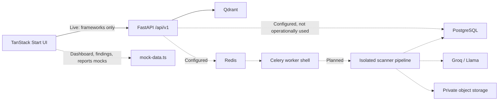

# ThreatLens Architecture Review

**Review mode:** `MODE: ARCHITECTURE_REVIEW`  
**Status:** Foundation hardening required  
**Reviewed:** July 20, 2026

## Executive Summary

ThreatLens has a sound target architecture, but it is not yet an integrated full-stack system.
The TanStack Start frontend is largely complete as a user interface, while the FastAPI backend
currently contains the Part 1 foundation and most of the Part 2 RAG implementation. Parts 3
through 8 are primarily documented plans or empty package placeholders.

Only the framework catalog is connected from the frontend to the live backend. Dashboard data,
findings, reports, coverage, and most scan behavior still come from `src/lib/mock-data.ts`.

Before implementing the remaining scanner pipeline, the project should address four structural
risks:

1. Revoke the exposed API credential currently present in the tracked example environment file.
2. Design a sandbox boundary for scanning untrusted repositories and uploaded files.
3. Add workspace-level tenant isolation and authorization.
4. Fix data-contract gaps that prevent scan requests and audit evidence from being persisted.

## Current Architecture

### Implemented Now

- TanStack Start, React, TypeScript, Tailwind CSS, React Query, and file-based routes.
- Landing page, dashboard, new scan, findings, reports, and report-detail interfaces.
- FastAPI application with `/health` and versioned `/api/v1/frameworks` endpoints.
- Pydantic settings with production-secret validation.
- Async SQLAlchemy engine, five ORM models, and the initial Alembic migration.
- PostgreSQL, Redis, Qdrant, API, and Celery worker definitions in Docker Compose.
- Celery configuration with JSON serialization, late acknowledgements, and time limits.
- Compliance chunkers, embedding wrapper, Qdrant storage client, retriever, seed script, and NVD sync script.
- React Query framework hook connected to the New Scan page.

### Not Yet Implemented

- Authentication endpoints, refresh flow, role-based authorization, and protected routes.
- Workspace or organization tenancy.
- ZIP/Git/architecture/log ingestion.
- Scanner execution and result normalization.
- LangChain compliance mapping, CVSS scoring, remediation, and summary chains.
- Scan orchestration tasks and persisted progress state.
- Findings, scans, reports, exports, WebSocket, and authentication APIs.
- PDF generation and object-storage upload.
- End-to-end frontend migration away from mock data.
- Production deployment, CI quality gates, metrics, tracing, and operational runbooks.

## Critical Risks

### P0: Exposed API Credential

[`threatlens/.env.example`](../threatlens/.env.example) contains a tracked value that resembles a
real Groq API key. The value is intentionally not repeated in this review.

Required response:

1. Revoke and rotate the credential immediately.
2. Replace the example value with an empty placeholder.
3. Search Git history and any remote forks for the exposed value.
4. Purge it from shared history when practical.
5. Add automated secret scanning to CI and pre-commit checks.

### P0: Untrusted Scanner Execution

The planned worker will process attacker-controlled ZIP files, Git repositories, manifests, and
logs. Running scanners in the same long-lived worker that has database, LLM, Redis, and storage
credentials creates an unacceptable blast radius.

Each scan should execute in a disposable sandbox with:

- Read-only source input and a separate writable scratch directory.
- No Docker socket, host mounts, or privileged capabilities.
- Network egress disabled by default and allowlisted only when required.
- CPU, memory, disk, process-count, and wall-clock limits.
- ZIP traversal, symlink, archive-bomb, and decompression-ratio protections.
- Explicit cleanup after success, failure, timeout, or worker restart.
- No customer credentials or service-role keys inside the scanner container.

### P0: Missing Tenant Boundary

The UI presents a workspace model, but the database only links scans directly to users. Before
real customer data is stored, introduce:

- `organizations` or `workspaces`.
- `memberships` with role and status.
- Workspace ownership on scans, artifacts, findings, violations, and reports.
- Tenant-scoped repository functions and authorization policies.
- Tests proving that one tenant cannot access another tenant's resources.

### P0: Scan Contract Cannot Be Persisted

[`ScanCreate`](../threatlens/app/schemas/scan.py) accepts `frameworks` and `git_url`, but the
[`Scan`](../threatlens/app/models/scan.py) model cannot persist either value. It also lacks the
artifact reference and operational state required by Celery.

Recommended additions include:

- Selected framework IDs.
- Input source type and normalized source reference.
- Private object-storage artifact key.
- Celery task ID and current phase.
- Failure code and safe failure message.
- Retry count, cancellation state, and heartbeat timestamps.
- Scanner configuration/version snapshot.

## High-Priority Findings

### Framework Taxonomy Drift

The frontend catalog in [`src/lib/mock-data.ts`](../src/lib/mock-data.ts) contains HIPAA and NIST
800-53. The live API in [`threatlens/app/api/frameworks.py`](../threatlens/app/api/frameworks.py)
contains NIST CSF and does not contain HIPAA. The RAG corpus also includes OWASP and NVD content.

Create one canonical framework registry containing stable IDs, display names, versions, source
references, control counts, RAG collection identifiers, and enabled capabilities. API responses,
chunkers, database records, UI labels, reports, and documentation should all derive from it.

### Incorrect Control Count Semantics

The backend returns `chunks_indexed`, while the frontend maps that number to `controls`. Because a
single control produces several RAG facet chunks, the UI can display an inflated control count.
Return separate `control_count` and `chunk_count` fields.

### Authentication Architecture

[`src/lib/api/client.ts`](../src/lib/api/client.ts) reads a bearer token from `localStorage`. This
is vulnerable to token theft through XSS and cannot support authenticated server rendering.

Prefer one of these approaches:

- Secure, HttpOnly, SameSite cookies managed by the FastAPI authentication layer.
- Supabase Auth with cookie-based sessions and JWT verification in FastAPI.

The route layout in [`src/routes/_app.tsx`](../src/routes/_app.tsx) currently has no authentication
guard. Route protection and server-side authorization must both be implemented; frontend guards
alone are not a security boundary.

### CORS and Environment Drift

The frontend is currently being served from `127.0.0.1:8082`, but this origin is not present in
the default backend or Docker Compose CORS allowlists. Development origins should be configured
through environment values, while production should allow only the deployed frontend origin.

### Audit Reproducibility

Storing only mutable Qdrant chunk IDs is insufficient for an audit product. Each compliance
mapping should retain:

- Framework and control version.
- Official source URI and source-document hash.
- Retrieved text snapshot and retrieval score.
- Embedding model, LLM model, prompt, and chain versions.
- Scanner version and normalized finding fingerprint.
- Mapping confidence and reviewer status.

This allows a generated report to be reproduced after the vector collection or prompts change.

### Findings and Report Data Models

Findings need deterministic fingerprints and uniqueness rules to deduplicate overlapping scanner
results. Reports should persist an object key, checksum, generation status, template version, and
failure information. Expiring signed URLs should be generated on demand rather than stored as the
primary report location.

### Application Layer

The framework route currently imports the Qdrant client directly. This is acceptable for the
current endpoint but will create tightly coupled routes as scan workflows grow. Add an application
service layer between API routes and infrastructure clients. API routes should validate requests,
call a use-case service, and translate domain errors into HTTP responses.

## Scalability Review

### Celery Queues

Use separate queues for workloads with different resource and rate-limit profiles:

| Queue         | Workload                             | Primary Constraint       |
| ------------- | ------------------------------------ | ------------------------ |
| `ingestion`   | ZIP extraction, Git clone, parsing   | Disk and network         |
| `static_scan` | Semgrep, Bandit, dependency scanning | CPU and process limits   |
| `llm`         | Groq review and compliance mapping   | API rate limits and cost |
| `report`      | Charts, HTML, WeasyPrint             | CPU and memory           |

Tasks should be idempotent and safe to retry. Persist state transitions in PostgreSQL rather than
using Celery result state as the product source of truth.

### Database Connections

The current SQLAlchemy pool allows up to 30 connections per process. Multiple API and worker
processes could exhaust a small PostgreSQL instance. Make pool settings role-aware and configurable,
then size them against the actual database connection limit.

### RAG Performance

Add Qdrant payload indexes for frequently filtered fields such as `framework`, `control_id`, and
`chunk_type`. Framework counts should be cached or stored as catalog metadata rather than issuing
sequential exact count requests for every UI request.

Embedding and retrieval should remain in background workers. Loading sentence-transformer models
inside API processes would increase API memory use and startup latency.

### Deployment

Do not run Alembic migrations in every API replica startup command. Use a single release or
migration job, then start API replicas only after the migration succeeds.

Avoid exposing PostgreSQL, Redis, and Qdrant ports publicly in production. Use private networking,
TLS where supported, authentication, and environment-specific Compose or deployment manifests.

## Security Architecture

### LLM Data Handling

Customer code and logs may contain credentials, personal data, or regulated information. Before
sending content to Groq:

- Define tenant consent and retention policies.
- Redact secrets and unnecessary personal data.
- Send the smallest relevant code context.
- Record which model/provider processed each scan.
- Treat repository content as untrusted data, not instructions.
- Require structured output validation and never let model text directly invoke tools.

### Input and Network Validation

- Reject private, loopback, link-local, and metadata-service targets for remote Git or URL ingestion.
- Limit redirect counts and validate every redirect destination.
- Validate file type by content as well as extension.
- Enforce upload size both at the reverse proxy and application boundary.
- Never execute package scripts or customer binaries during dependency analysis.

### Storage

Use private buckets and store only object keys in PostgreSQL. API users should receive short-lived
signed upload or download URLs after authorization checks. The storage implementation should sit
behind a small interface so S3, Cloudflare R2, or Supabase Storage can be selected by configuration.

## Observability

The `structlog` dependency is present but not integrated. Introduce structured logs with:

- `request_id`, `workspace_id`, `user_id`, `scan_id`, and `task_id`.
- Phase name, scanner name, duration, retry count, and result counts.
- Secret and source-code redaction.
- Consistent error codes safe for frontend display.

Split health checks into:

- Liveness: the process event loop is responsive.
- Readiness: required PostgreSQL and Redis connections are available.
- Dependency status: Qdrant, object storage, and Groq availability reported separately.

Recommended metrics include queue depth, scan duration by phase, task failures, scanner timeouts,
LLM latency/token usage, Qdrant latency, report-generation time, and active scans per tenant.

## Strengths

- Clear frontend/backend directory separation and versioned `/api/v1` routing.
- Async SQLAlchemy foundation and an explicit Alembic migration.
- Pydantic configuration with production-secret validation.
- Deterministic Qdrant IDs, bounded upsert batches, and normalized embeddings.
- Graceful framework endpoint behavior when Qdrant is unavailable.
- Celery JSON-only serialization, late acknowledgements, and task time limits.
- React Query and typed API modules support progressive mock-to-live migration.
- Docker Compose includes dependency health checks and validates successfully.
- The production frontend bundle builds successfully.

## Recommended Migration Path

### Phase 0: Security Containment

- Revoke the exposed key and clean the repository.
- Add secret scanning and dependency scanning.
- Correct CORS configuration for the current development origin.
- Enforce production-safe configuration and private service networking.

### Phase 1: Domain and Contract Alignment

- Create the canonical framework registry.
- Add workspace tenancy and role-based authorization.
- Extend scan, artifact, finding, compliance, and report persistence.
- Generate TypeScript API contracts from OpenAPI instead of maintaining duplicate interfaces.

### Phase 2: Safe Ingestion and Scanner Core

- Add private object-storage upload and artifact lifecycle handling.
- Implement safe ZIP/Git/YAML/log ingestion.
- Create disposable scanner sandboxes and normalized scanner adapters.
- Add deterministic finding fingerprints and scanner fixtures.

### Phase 3: Durable Orchestration

- Implement dedicated Celery queues and idempotent task stages.
- Persist every scan state transition in PostgreSQL.
- Add retries, cancellation, heartbeat detection, and recovery from worker loss.
- Expose authenticated progress through polling first, then SSE or WebSocket if required.

### Phase 4: RAG and Agent Reliability

- Add official-source provenance and versioned catalog ingestion.
- Add retrieval thresholds, framework filters, payload indexes, and evaluation fixtures.
- Implement structured agent outputs, retry policies, redaction, and prompt-injection defenses.
- Store immutable evidence snapshots for report reproducibility.

### Phase 5: Frontend Integration

- Replace mocks route by route with query and mutation hooks.
- Implement cookie-based authentication and protected loaders.
- Add loading, empty, partial-failure, retry, and cancellation states.
- Remove `mock-data.ts` only after all routes pass integration tests.

### Phase 6: Operations and Release Readiness

- Add CI for formatting, linting, type checks, backend tests, frontend tests, and secret scanning.
- Add isolated integration tests for PostgreSQL, Redis, Qdrant, and Celery.
- Add request tracing, metrics, readiness checks, backups, and recovery documentation.
- Run migrations as a release job and deploy API and worker roles independently.

## Platform Recommendation

For a college-scale deployment, Supabase can consolidate PostgreSQL, authentication, object
storage, and vector search through `pgvector`. Redis and Celery would remain responsible for
background scan execution.

This reduces the number of independently operated services. Keep Qdrant only when demonstrating a
dedicated vector database is an explicit project requirement or when its filtering and retrieval
features provide measurable value over `pgvector`.

## Verification Results

| Check                     | Result  | Notes                                                                     |
| ------------------------- | ------- | ------------------------------------------------------------------------- |
| `npm run build`           | Pass    | Client and SSR bundles generated successfully.                            |
| `npx tsc --noEmit`        | Fail    | `dashboard.tsx` imports a missing `SeverityLevel` export.                 |
| `npm run lint`            | Fail    | 4,791 issues, mostly CRLF/Prettier drift plus several real lint errors.   |
| Docker Compose validation | Pass    | Configuration is valid; local Docker config access emitted a warning.     |
| Backend tests             | Blocked | Active Python 3.14 environment lacks the Python 3.11 pinned dependencies. |

## Immediate Decision Checklist

- [ ] Revoke the exposed Groq credential.
- [ ] Choose the canonical supported framework list.
- [ ] Decide between the current service stack and Supabase consolidation.
- [ ] Approve the workspace/tenant data model before adding scan APIs.
- [ ] Approve the scanner sandbox design before processing untrusted repositories.
- [ ] Fix formatting, type-checking, and reproducible Python environment gates.
- [ ] Start Part 3 only after the security and persistence prerequisites are resolved.
