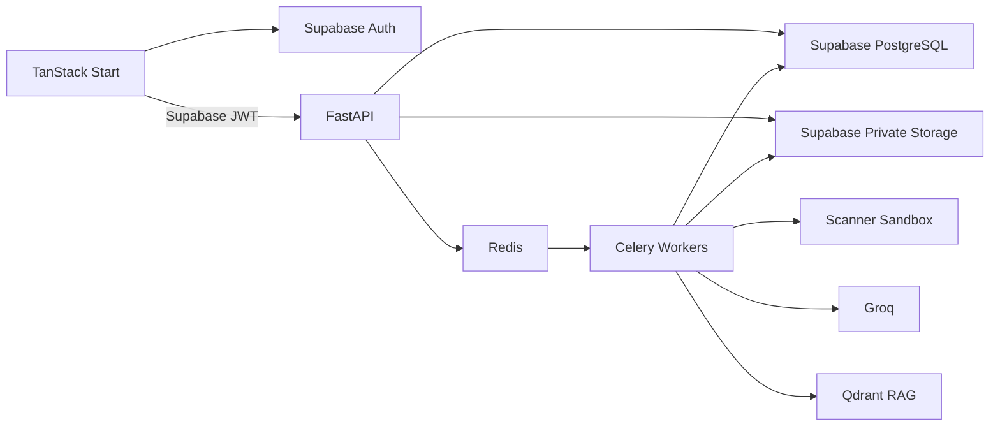

# ThreatLens Supabase Architecture Plan

**Review mode:** `MODE: ARCHITECTURE_REVIEW`  
**Decision:** Approved with boundaries  
**Updated:** July 21, 2026

## Summary

Supabase is a good choice for ThreatLens, especially for a beginner. It can replace hosted
PostgreSQL, custom authentication, and AWS S3 or Cloudflare R2 report storage. It should not
replace FastAPI, Celery, Redis, Groq, Qdrant, or the isolated scanner runtime.

This design keeps Supabase responsible for managed infrastructure while FastAPI remains the only
business API and authorization boundary for ThreatLens.

## Recommended Architecture



## Service Responsibilities

| Component           | Responsibility                                                         |
| ------------------- | ---------------------------------------------------------------------- |
| Supabase Auth       | Registration, login, sessions, email verification and password reset   |
| Supabase PostgreSQL | Profiles, workspaces, scans, findings, compliance mappings and reports |
| Supabase Storage    | Uploaded repositories, architecture files, logs and generated PDFs     |
| FastAPI             | Business logic, validation, authorization and signed URL generation    |
| Celery and Redis    | Background scan and report workflows                                   |
| Qdrant              | Existing compliance RAG knowledge base                                 |
| Groq                | LLM analysis and compliance agents                                     |
| Scanner containers  | Isolated Semgrep, Bandit, Trufflehog and dependency scanning           |

## What Supabase Replaces

| Current or Planned Component           | Supabase Replacement                         |
| -------------------------------------- | -------------------------------------------- |
| Local or separately hosted PostgreSQL  | Supabase PostgreSQL                          |
| Custom password and JWT authentication | Supabase Auth                                |
| AWS S3 or Cloudflare R2 report storage | Supabase Storage                             |
| Public or permanent report URLs        | Private objects with short-lived signed URLs |

Supabase does not replace the scan queue, scanner execution, LLM processing, application API, or
security sandbox.

## Database Design

Do not keep the current password-based `users` table. Supabase Auth stores identities in
`auth.users`. Create a public application profile linked to the Supabase user ID.

Recommended tables:

- `profiles`
- `workspaces`
- `workspace_members`
- `scans`
- `scan_artifacts`
- `findings`
- `compliance_violations`
- `reports`

Every business record should contain `workspace_id` where appropriate. This is required for tenant
isolation and future team access.

Enable Row Level Security on all exposed tables. Supabase recommends RLS for tables in exposed
schemas: [Supabase RLS documentation](https://supabase.com/docs/guides/database/postgres/row-level-security).

### Profiles

The `profiles` table should use the Supabase Auth user ID as its primary key:

```text
profiles.id -> auth.users.id
```

Do not store password hashes in the application schema.

### Workspaces

Use `workspaces` and `workspace_members` to represent the workspace already shown in the dashboard.
Membership should include at least:

- `workspace_id`
- `user_id`
- `role`
- `status`
- `created_at`

Every FastAPI resource query must verify the authenticated user is a member of the requested
workspace.

### Scan Persistence

Extend the current scan model to persist:

- Selected framework IDs.
- Input source type.
- Git repository reference or private storage object path.
- Celery task ID.
- Current phase and progress.
- Failure code and safe failure message.
- Retry count and cancellation state.
- Scanner and configuration version.

### Report Persistence

Replace permanent `pdf_url` and stored signed URLs with:

```text
storage_bucket
storage_path
sha256
size_bytes
status
generated_at
template_version
```

Signed URLs should be generated only after FastAPI verifies report ownership.

## Database Connectivity

Keep SQLAlchemy and Alembic. FastAPI can use the existing async SQLAlchemy layer with a Supabase
PostgreSQL connection string.

For a persistent FastAPI or Celery service:

- Use the direct PostgreSQL connection when the deployment supports IPv6.
- Use Supavisor session mode when the deployment is IPv4-only.
- Use a direct connection for Alembic migrations, backups and administration.
- Require SSL for database connections.
- Keep API and worker connection pools small enough for the selected Supabase tier.

See the [Supabase database connection guide](https://supabase.com/docs/guides/database/connecting-to-postgres).

## Authentication Flow

1. React signs the user in through Supabase Auth.
2. Supabase manages the session and issues an access-token JWT.
3. React sends the JWT to FastAPI as `Authorization: Bearer <token>`.
4. FastAPI verifies the JWT through the Supabase JWKS endpoint.
5. FastAPI extracts the user ID and validates workspace membership.
6. Every database operation is scoped to the authorized workspace.

Use the Supabase SDK for session management. Remove the manually managed `auth_token` value from
the frontend API client.

Supabase documents verified JWT claim retrieval through its JWKS endpoint:
[Supabase Python JWT verification](https://supabase.com/docs/reference/python/auth-getclaims).

Frontend route guards improve the user experience, but FastAPI authorization is the real security
boundary. Every scan, finding, report and download endpoint must independently verify ownership.

## Supabase Storage Design

Create two private buckets:

```text
scan-inputs
audit-reports
```

Do not create public buckets for repositories, logs, architecture files or reports.

### Scan Input Paths

```text
scan-inputs/{workspace_id}/{scan_id}/source.zip
scan-inputs/{workspace_id}/{scan_id}/architecture.yaml
scan-inputs/{workspace_id}/{scan_id}/server.log
```

The Celery worker downloads the artifact, scans it in an isolated container, stores normalized
results in PostgreSQL and removes local temporary files.

ThreatLens accepts inputs up to 50 MB. Supabase recommends resumable TUS uploads for files larger
than 6 MB: [Supabase upload documentation](https://supabase.com/docs/guides/storage/uploads/standard-uploads).

### Report Paths

```text
audit-reports/{workspace_id}/{scan_id}/{report_id}.pdf
```

When a user downloads a report:

1. React requests a download from FastAPI.
2. FastAPI verifies workspace membership and report ownership.
3. FastAPI creates a short-lived signed URL.
4. React opens or downloads the PDF through that URL.

Private buckets support RLS and time-limited signed URLs:
[Supabase private bucket documentation](https://supabase.com/docs/guides/storage/buckets/fundamentals).

## Storage Security Rules

- Never expose `SUPABASE_SERVICE_ROLE_KEY` in React or any `VITE_` variable.
- Keep the service-role key only in FastAPI and Celery secrets.
- Remember that service-role access bypasses RLS.
- Perform explicit workspace authorization before every backend storage operation.
- Store object paths in PostgreSQL, not public URLs.
- Generate short-lived signed URLs on demand.
- Use immutable object names instead of overwriting reports.
- Restrict upload content types and maximum sizes at the bucket and API boundaries.

See [Supabase Storage access control](https://supabase.com/docs/guides/storage/security/access-control).

## Qdrant Decision

Keep Qdrant for the current implementation because Part 2 is already built around it. Replacing it
now would create avoidable rework and reduce the value of the existing RAG implementation.

Supabase `pgvector` can be considered later if reducing the number of services becomes more
important than preserving Qdrant. The existing `all-MiniLM-L6-v2` model generates 384-dimensional
vectors, which PostgreSQL with `pgvector` supports directly.

See [Supabase vector columns](https://supabase.com/docs/guides/ai/vector-columns).

## Scanner Security Boundary

Supabase does not make scanner execution safe. Uploaded repositories remain untrusted input.

Each scanner job should execute in a disposable container with:

- No Supabase service-role key.
- No database password.
- No Groq key unless a narrowly scoped LLM phase requires it.
- Read-only source input.
- Restricted network access.
- CPU, memory, disk, process and time limits.
- ZIP traversal, symlink and archive-bomb protection.
- Guaranteed cleanup after completion or failure.

The Celery orchestration worker should pass only the minimum data required by each isolated phase.

## Environment Variables

### Frontend

```env
VITE_SUPABASE_URL=
VITE_SUPABASE_ANON_KEY=
VITE_API_URL=http://localhost:8000
```

The Supabase publishable or anonymous key is intended for frontend use, but security still depends
on correct RLS policies and backend authorization.

### Backend Only

```env
SUPABASE_URL=
SUPABASE_SERVICE_ROLE_KEY=
SUPABASE_JWKS_URL=
DATABASE_URL=
REDIS_URL=
QDRANT_HOST=
QDRANT_API_KEY=
GROQ_API_KEY=
```

Never prefix backend secrets with `VITE_` because Vite exposes those values to browser bundles.

## Migration Plan

### Phase 0: Credential Safety

- Revoke the exposed Groq credential.
- Replace real values in `.env.example` with empty placeholders.
- Add secret scanning to CI.

### Phase 1: Supabase Project

- Create a Supabase project in the nearest suitable region.
- Record the project URL, publishable key, service-role key and database connection details.
- Configure local and production redirect URLs for authentication.

### Phase 2: Database Migration

- Point Alembic at Supabase PostgreSQL.
- Replace the custom user table with `profiles` linked to `auth.users`.
- Add workspaces and memberships.
- Extend scans, artifacts, findings, violations and reports.
- Add indexes and RLS policies.
- Run migrations through the direct database connection.

### Phase 3: Authentication

- Add Supabase Auth to the TanStack frontend.
- Add registration, login, logout and password-reset flows.
- Send the Supabase JWT to FastAPI.
- Add FastAPI JWT verification and workspace authorization dependencies.
- Protect all application routes and API endpoints.

### Phase 4: Storage

- Create private `scan-inputs` and `audit-reports` buckets.
- Add upload restrictions and RLS policies.
- Implement scan artifact upload and worker download.
- Implement report upload and authorized signed downloads.
- Persist storage paths and checksums in PostgreSQL.

### Phase 5: Infrastructure Cleanup

- Remove the local PostgreSQL service from production Docker configuration.
- Remove unused S3 and R2 variables and dependencies.
- Keep local Redis, Celery and Qdrant services.
- Update README and backend implementation guides.
- Add integration tests for authentication, RLS, uploads and report downloads.

## Recommended Beginner Scope

Implement Supabase in this order:

1. PostgreSQL connection.
2. Email and password authentication.
3. Profiles and workspaces.
4. Private report storage.
5. Private scan input storage.
6. Route and endpoint protection.
7. RLS and tenant-isolation tests.

Do not add social login, Supabase Realtime, Edge Functions or a pgvector migration during the
first pass. FastAPI polling is sufficient for initial scan progress, and the existing Qdrant RAG
implementation should remain stable.

## Acceptance Criteria

- [ ] Users register and sign in through Supabase Auth.
- [ ] FastAPI rejects missing, expired or invalid Supabase JWTs.
- [ ] Authenticated users can access only their workspaces.
- [ ] Cross-workspace scan, finding and report requests return `403` or `404`.
- [ ] Source files and reports are stored only in private buckets.
- [ ] The frontend never receives the service-role key or database password.
- [ ] Report downloads use short-lived signed URLs created after authorization.
- [ ] Signed URLs are not persisted as report identifiers.
- [ ] Alembic migrations run successfully against Supabase PostgreSQL.
- [ ] Redis, Celery and Qdrant continue to operate independently.
- [ ] Scanner containers do not receive Supabase or database administrator credentials.

## Final Recommendation

Use Supabase for authentication, PostgreSQL and private file storage. Keep FastAPI as the only
business API, keep Redis and Celery for background processing, retain Qdrant for the completed RAG
work, and run security scanners in isolated containers.

This is the best balance for ThreatLens: Supabase removes infrastructure that would be difficult
for a beginner to operate, while the security-sensitive compliance and scanner logic remains under
the control of the FastAPI backend.
