<div align="center">
  
  <p>Security audits and threat modeling for project code.</p>
</div>

Archon lets a workspace upload a project ZIP, review recorded findings beside source files, explore their relationships, and prepare reports for human review. A configured GitHub integration can also scan an authorized repository and support reviewed fix proposals. Findings and framework mappings are assessment signals, not proof of compliance.

## Explore the product

The screenshots below follow the main workflow. Captures containing sample projects or findings use isolated demonstration data; they do not show a live user's audit. Screenshots are stored in [docs/screenshots](docs/screenshots).

### 1. Start and sign in

The landing page introduces the workflow and opens the console. Sign in with email and password, or use GitHub sign-in when the Supabase provider is configured. A GitHub login identity is separate from permission to access repositories through the GitHub App.

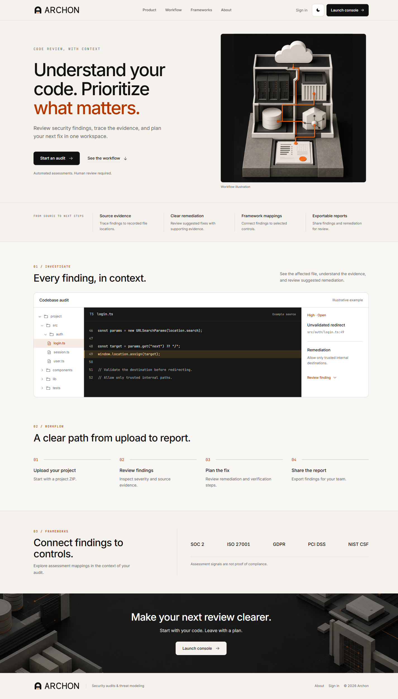

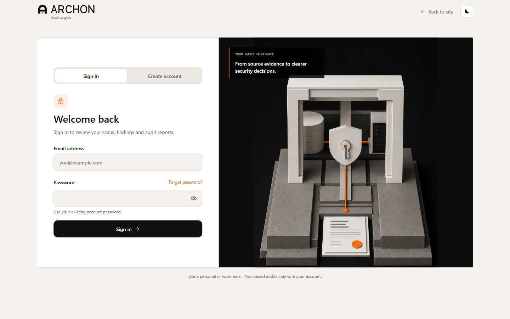

### 2. Choose a source and run an audit

Codebase Audit accepts ZIP projects. If the GitHub App is configured, a user can connect GitHub, choose an authorized repository and branch, and start a repository scan. The History button reopens saved scans. Owners and admins can delete completed or failed scans there.

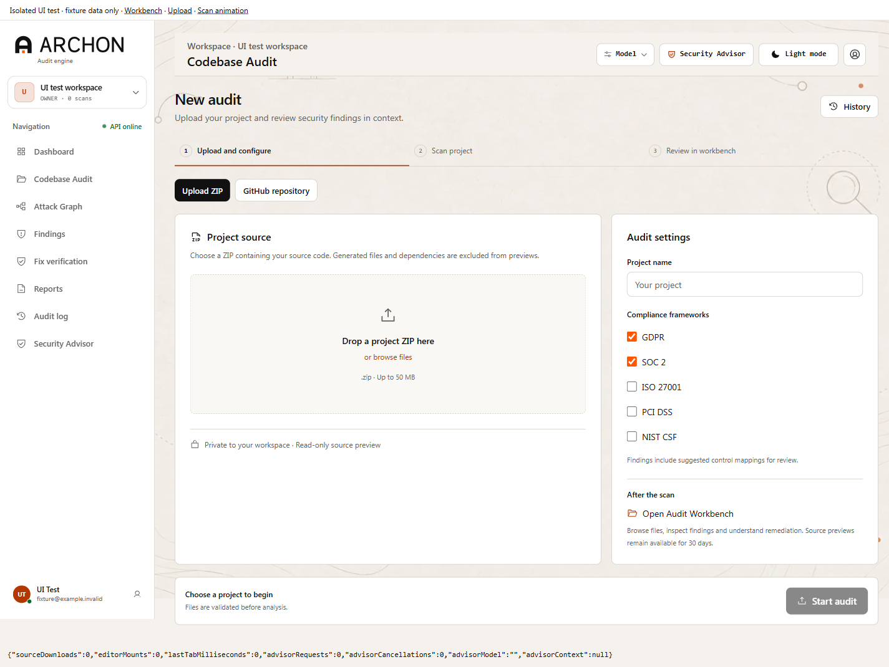

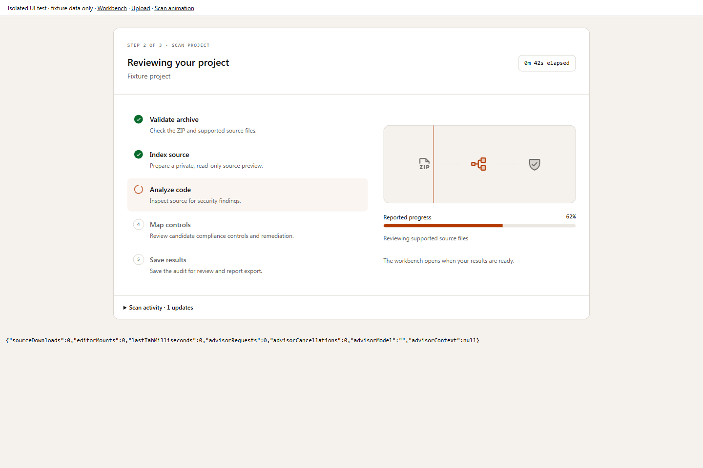

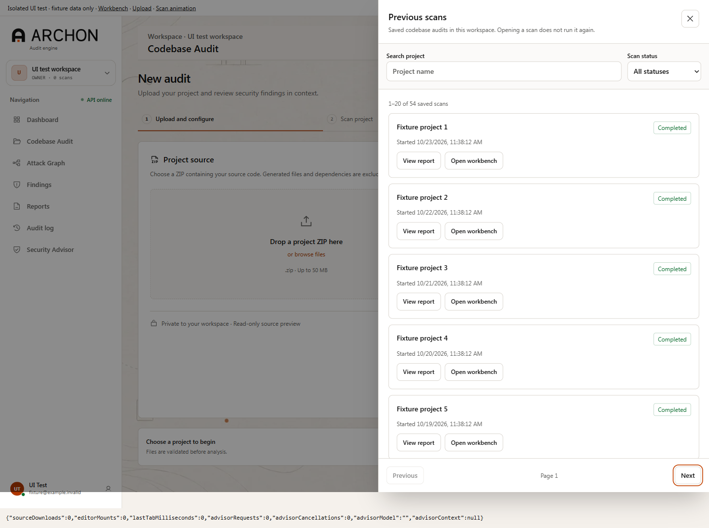

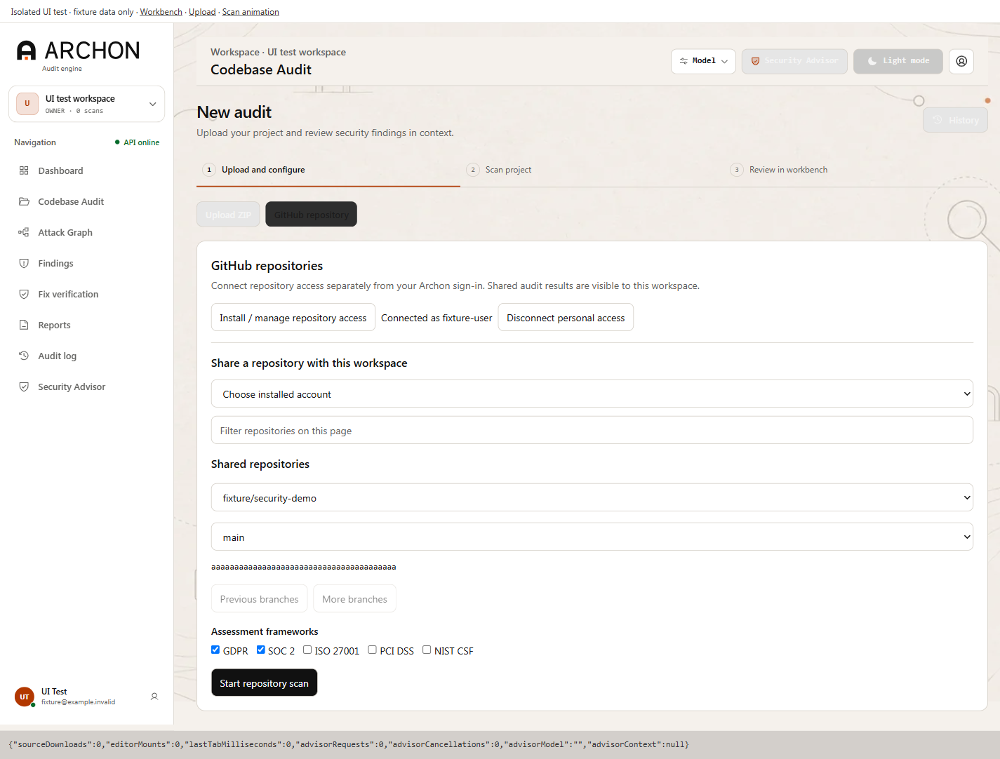

### 3. Investigate the result

The workbench presents a file tree, source preview, findings, and framework context after a scan is accepted. The Findings page filters saved results and opens full evidence on selection. Attack Graph relates saved finding locations; its modeled examples are marked as examples.


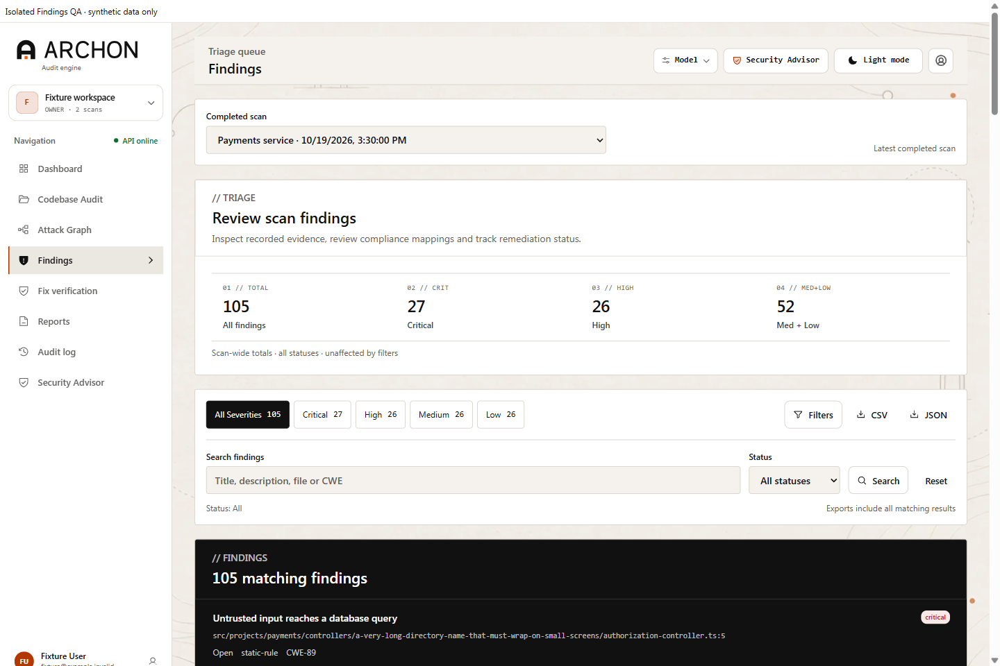

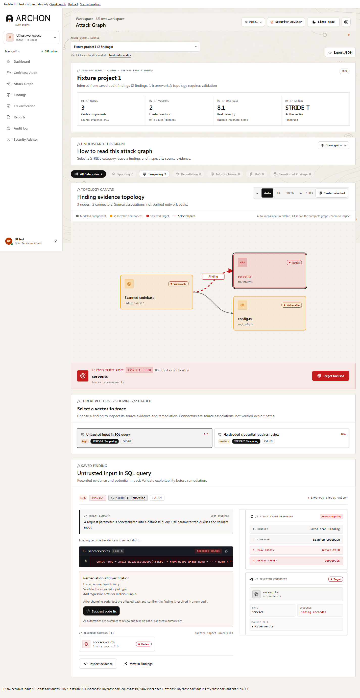

### 4. Review a fix and share a report

For eligible repository findings, Fix Verification displays a proposed diff and validation state. Publishing requires review and appropriate workspace and GitHub permissions; it creates a branch and pull request. Reports lists completed saved audits, with on-demand PDF downloads and selected-report ZIP export.

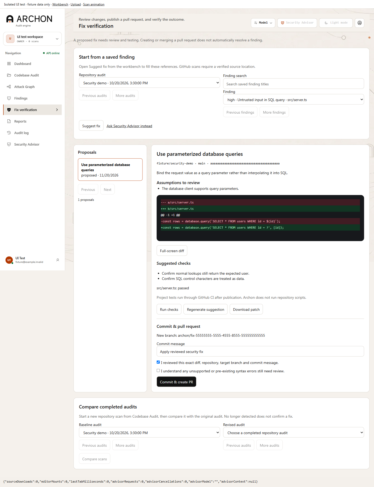

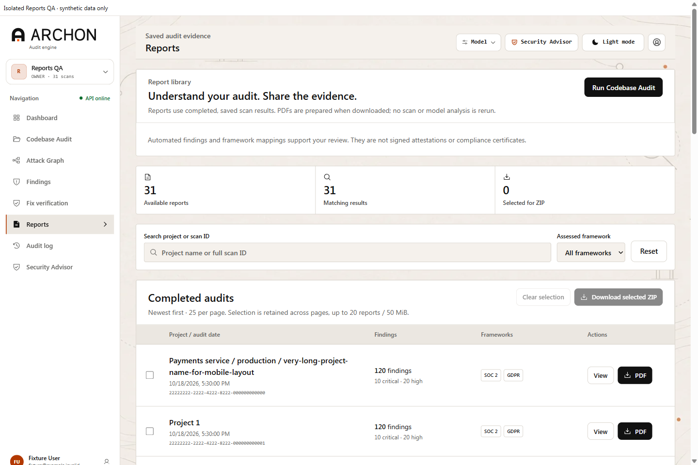


### 5. Get guidance and manage the workspace

Security Advisor answers general questions and can explain an authorized finding. Workspace Settings manages defaults, members, invitations, and integrations according to role. Profile holds account and session controls.

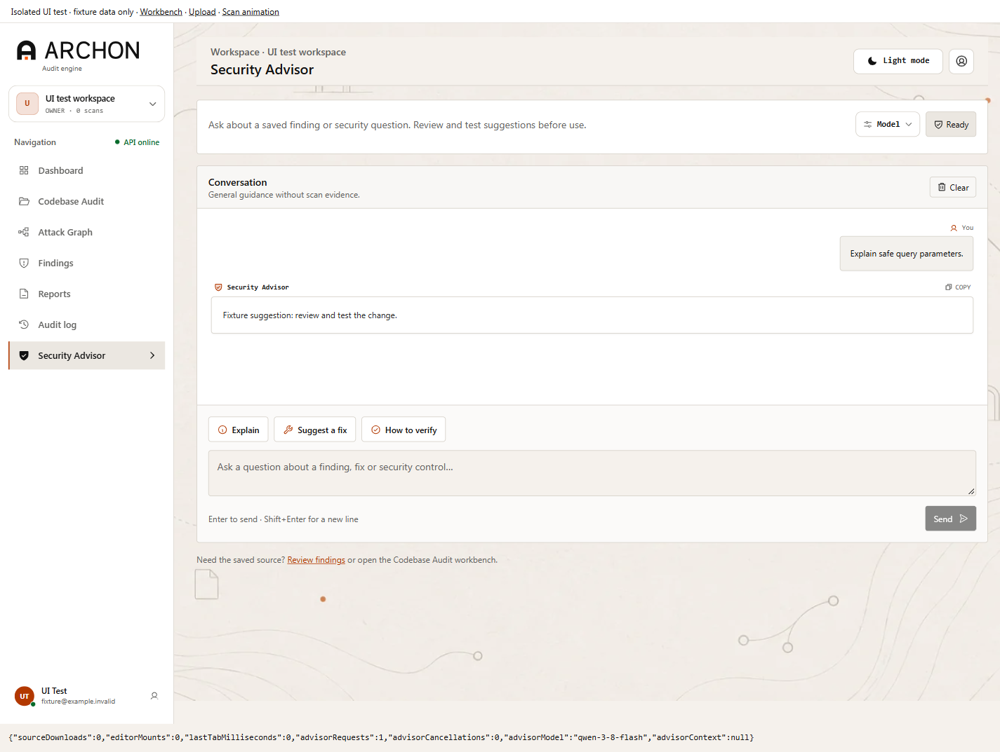

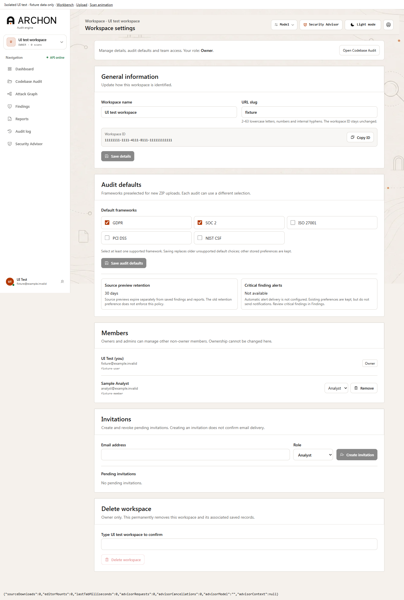

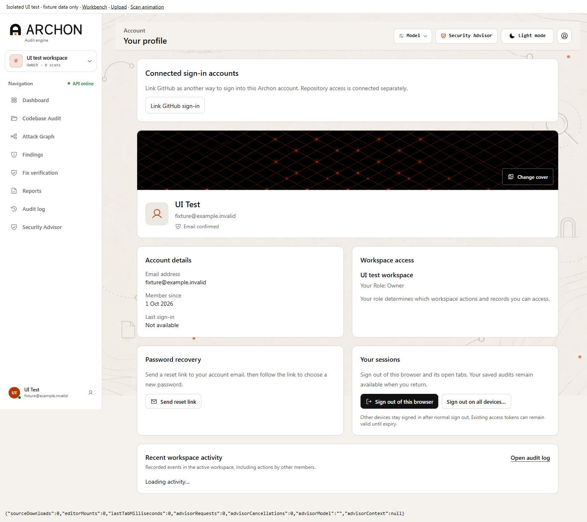

### Page guide

| Page                     | Route                                             | Purpose                                                        |
| ------------------------ | ------------------------------------------------- | -------------------------------------------------------------- |
| Landing                  | `/`                                               | Product overview and entry point                               |
| About                    | `/about`                                          | Product background                                             |
| Sign in / create account | `/login`, `/register`                             | Account access                                                 |
| Password recovery        | `/reset-password`                                 | Set a new password from a recovery link                        |
| Dashboard                | `/dashboard`                                      | Latest completed audit, attention items, recent scans          |
| Codebase Audit           | `/workspace`                                      | Upload, repository selection, progress, History                |
| Audit Workbench          | `/workspace/:workspaceId/scans/:scanId/workbench` | Source and finding review                                      |
| Attack Graph             | `/attack-graph`                                   | Finding topology and threat vectors                            |
| Findings                 | `/findings`                                       | Filter, inspect, triage, and export saved findings             |
| Fix Verification         | `/fix-verification`                               | Review proposals, validation, pull requests, comparison        |
| Reports / detail         | `/reports`, `/reports/:reportId`                  | Saved reports and PDF access                                   |
| Audit Log                | `/audit-log`                                      | Recorded workspace events and scan history; owner/admin access |
| Security Advisor         | `/advisor`                                        | General or finding-specific guidance                           |
| Workspace Settings       | `/workspace/:workspaceId/settings`                | Workspace configuration and members                            |
| Profile                  | `/profile`                                        | Account, connected accounts, session controls                  |

Privacy and Terms are available at `/privacy` and `/terms`.

## How a project moves through Archon

```text
Sign in → Select workspace → Upload ZIP or select authorized GitHub repository
        → Scan accepted → Source preparation and analysis
        → Workbench → Findings and Attack Graph
        → Optional reviewed fix → Verification and pull request
        → Report and export
```

Scanning and source preparation are distinct stages. A pending source preview is not a clean result; saved findings remain visible if a preview cannot be prepared. Repository changes are not applied automatically.

## Architecture

- **Frontend:** React 19, TypeScript, TanStack Router and Query, Tailwind CSS, and Monaco for source viewing.
- **API:** FastAPI handles scan intake, workbench reads, report generation, guidance, and GitHub operations.
- **Data and identity:** Supabase Auth, Postgres with workspace-scoped row-level security, and private Storage for source previews. Backend-only credentials stay server-side.
- **Reports:** Saved audit data is rendered into PDF on demand. Source previews expire after 30 days; saved audit history follows its own retention behavior.

See [supabase/migrations](supabase/migrations) for database changes and [threatlens/app](threatlens/app) for API implementation. Optional GitHub features require separate GitHub App configuration; email sign-in and ZIP audits remain available without it.

## Local setup

Requirements: Node.js, npm, Python, and access to a Supabase project with the repository's migrations applied. Use the versions supported by [package.json](package.json) and [threatlens/requirements.txt](threatlens/requirements.txt).

1. Install frontend dependencies: `npm install`.
2. Copy [`.env.example`](.env.example) to `.env`. Set the public API URL, Supabase URL, and Supabase publishable key for your project.
3. Create `threatlens/.env` from [`threatlens/.env.example`](threatlens/.env.example). Set the matching Supabase project URL, issuer, JWKS URL, publishable key, and server-only service role key. Configure the other services you use. Never commit either local environment file.
4. Install Python packages with `pip install -r threatlens/requirements.txt` in a virtual environment.
5. Apply the additive migrations in [supabase/migrations](supabase/migrations) to your own Supabase project before using saved audits. Follow your team's Supabase CLI linking and migration process.
6. Run `npm run dev`, then open `http://127.0.0.1:5173`. The API is served at `http://127.0.0.1:8000`; its health endpoint is `/health`.

The frontend and API must point to the same Supabase project. Set a frontend origin allowed by the backend if you use a different local port. GitHub login additionally needs the GitHub provider enabled in Supabase; repository scanning and publishing need the GitHub App settings from the backend example file.

## Development checks

```text
npm run typecheck       TypeScript
npm run lint            ESLint
npm run build           Production frontend and server build
npm run test:rls        Isolated database policy checks
python -m pytest threatlens/tests -q
```

The tests use isolated fixtures where possible. Do not use a production repository for patch publishing or deletion checks.

## Screenshot notes

The gallery uses desktop light-mode captures for a consistent reading path. Most captured pages also have mobile and dark-mode QA images under `output/playwright`. Fixture captures are labeled in their UI when sample data is shown. Screenshots may show a particular configured capability, such as GitHub repository access; availability depends on deployment settings and user permissions.
