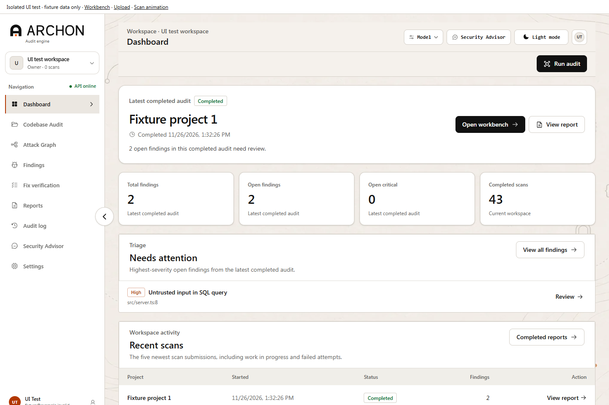
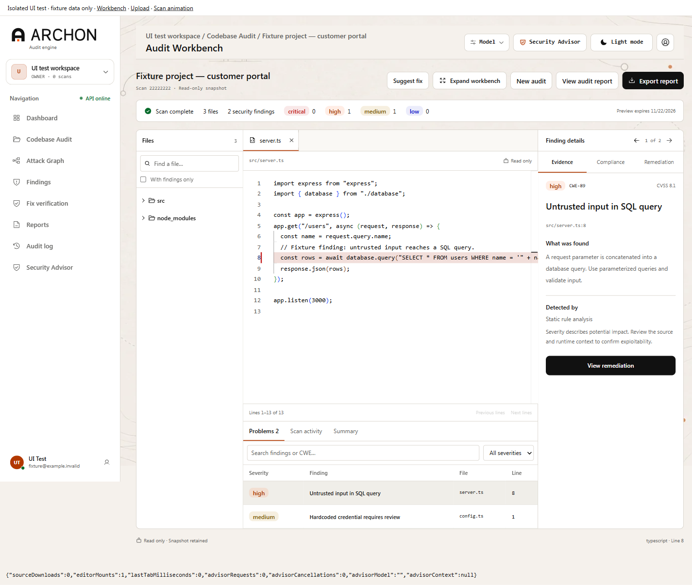
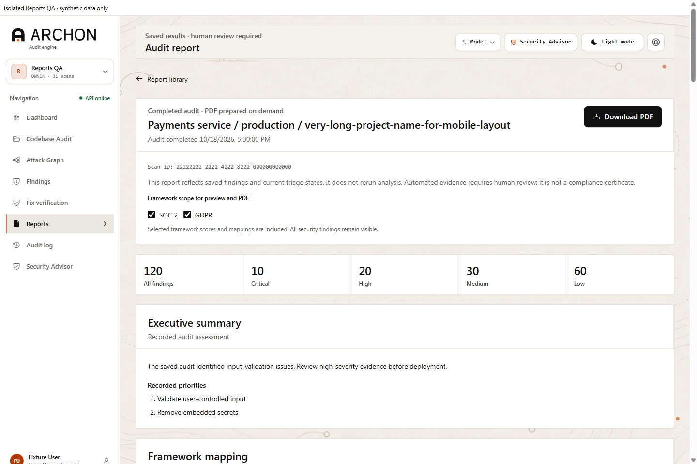
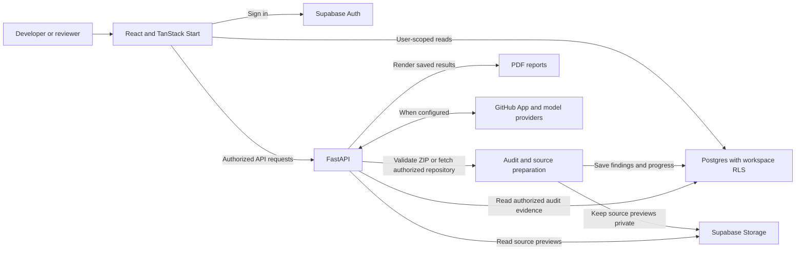
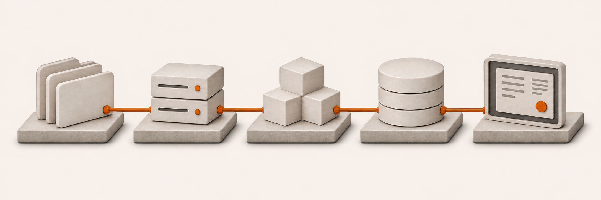

<div align="center">
  <picture>
    <source media="(prefers-color-scheme: dark)" srcset="public/brand/archon-wordmark-inverse.svg" />
    
  </picture>
  <p>Security audits and threat modeling for project code.</p>
</div>

Archon lets a workspace upload a project ZIP, review recorded findings beside source files, explore their relationships, and prepare reports for human review. A configured GitHub integration can also scan an authorized repository and support reviewed fix proposals. Findings and framework mappings are assessment signals, not proof of compliance.

## Explore the product

The screenshots below follow the main workflow. See the [page-by-page screenshot gallery](docs/screenshots/README.md) for the public pages, account flows, and workspace console. Sample audits are demonstrations, not live customer data.

### 1. Start and sign in

The landing page introduces the workflow and opens the console. Sign in with email and password, or use GitHub sign-in when the Supabase provider is configured. A GitHub login identity is separate from permission to access repositories through the GitHub App.


### 2. Choose a source and run an audit

Codebase Audit accepts ZIP projects. If the GitHub App is configured, a user can connect GitHub, choose an authorized repository and branch, and start a repository scan. Returning to Codebase Audit shows a resume card for the last opened audit. The History button reopens saved scans. Owners and admins can delete completed or failed scans there.

**Browser extension** reviews the built ZIP intended for Chrome Web Store, Microsoft Edge Add-ons, or both. Supply listing/privacy declarations and optional screenshots, inspect policy evidence and remedies in the workbench, open clearly labelled notice examples, and recheck a corrected package. Policy coverage includes explicit manual and unassessed checks; store approval remains with Google or Microsoft. Setup and verification are documented in [Extension Review](.github/implementation-notes/EXTENSION_REVIEW.md).



### 3. Investigate the result

The workbench presents a file tree, source preview, findings, and framework context after a scan is accepted. Remediation includes written steps and an on-demand code solution with copyable snippets and verification guidance. The Findings page filters saved results and opens full evidence on selection. Attack Graph relates saved finding locations; its modeled examples are marked as examples.



### 4. Review a fix and share a report

For eligible repository findings, Fix Verification displays a proposed diff and validation state. Publishing requires review and appropriate workspace and GitHub permissions; it creates a branch and pull request. Reports lists completed saved audits, with on-demand PDF downloads and selected-report ZIP export.



### 5. Get guidance and manage the workspace

Security Advisor answers general questions and can explain an authorized finding. Its private, searchable conversation history is saved per account and workspace when `ADVISOR_HISTORY_ENABLED=true` is enabled after the chat migration. Chats expire after 30 days, or earlier when their linked source window ends. Workspace Settings manages defaults, members, invitations, and integrations according to role. Profile holds account and session controls.

Settings, below Security Advisor in navigation, brings account controls, appearance, workspace management, GitHub connections, privacy/data notices, proposed pricing and help into one place. Personal settings remain available without a workspace. Pricing is informational; billing is not enabled. Existing Profile and workspace-settings links remain supported.

### Page guide

| Page                     | Route                                             | Purpose                                                        |
| ------------------------ | ------------------------------------------------- | -------------------------------------------------------------- |
| Landing                  | `/`                                               | Product overview and entry point                               |
| About                    | `/about`                                          | Product background                                             |
| Team                     | `/team`                                           | Project and credits                                            |
| Sign in / create account | `/login`, `/register`                             | Account access                                                 |
| Password recovery        | `/reset-password`                                 | Set a new password from a recovery link                        |
| Dashboard                | `/dashboard`                                      | Latest completed audit, attention items, recent scans          |
| Create workspace         | `/workspace/new`                                  | Start a new workspace                                          |
| Codebase Audit           | `/workspace`                                      | Upload, repository selection, progress, History                |
| Audit Workbench          | `/workspace/:workspaceId/scans/:scanId/workbench` | Source and finding review                                      |
| Attack Graph             | `/attack-graph`                                   | Finding topology and threat vectors                            |
| Findings                 | `/findings`                                       | Filter, inspect, triage, and export saved findings             |
| Fix Verification         | `/fix-verification`                               | Review proposals, validation, pull requests, comparison        |
| Reports / detail         | `/reports`, `/reports/:reportId`                  | Saved reports and PDF access                                   |
| Audit Log                | `/audit-log`                                      | Recorded workspace events and scan history; owner/admin access |
| Security Advisor         | `/advisor`                                        | General or finding-specific guidance                           |
| Settings                 | `/settings`                                       | Account, appearance, workspace, integrations, privacy and help |
| Workspace Settings       | `/workspace/:workspaceId/settings`                | Workspace configuration and members                            |
| Profile                  | `/profile`                                        | Account, connected accounts, session controls                  |

Privacy and Terms are available at `/privacy` and `/terms`.

## How a project moves through Archon

```text
Sign in → Select workspace → Upload ZIP or select authorized GitHub repository
        → Scan accepted → Source preparation and analysis
        → Workbench → Findings and Attack Graph
        → Optional reviewed fix → Verification and pull request
        → Report and export
```

Scanning and source preparation are distinct stages. A pending source preview is not a clean result; saved findings remain visible if a preview cannot be prepared. Repository changes are not applied automatically.

## Architecture





- **Frontend:** React 19, TypeScript, TanStack Router and Query, Tailwind CSS, and Monaco for source viewing.
- **API:** FastAPI handles scan intake, workbench reads, report generation, guidance, and GitHub operations.
- **Data and identity:** Supabase Auth, Postgres with workspace-scoped row-level security, and private Storage for source previews. Backend-only credentials stay server-side.
- **Reports:** Saved audit data is rendered into PDF on demand. Source previews expire after 30 days; saved audit history follows its own retention behavior.

See [supabase/migrations](supabase/migrations) for database changes and [threatlens/app](threatlens/app) for API implementation. Optional GitHub features require separate GitHub App configuration; email sign-in and ZIP audits remain available without it.

## Local setup

Requirements: Node.js, npm, Python, and access to a Supabase project with the repository's migrations applied. Use the versions supported by [package.json](package.json) and [threatlens/requirements.txt](threatlens/requirements.txt).

1. Install the locked frontend dependencies: `npm ci`.
2. Copy [`.env.example`](.env.example) to `.env`. Set the public API URL, Supabase URL, and Supabase publishable key for your project.
3. Create `threatlens/.env` from [`threatlens/.env.example`](threatlens/.env.example). Set the matching Supabase project URL, issuer, JWKS URL, publishable key, and server-only service role key. Configure the other services you use. Never commit either local environment file.
4. Follow [Python installation profiles](threatlens/INSTALLATION.md). Install `threatlens/requirements-api.txt` in an activated virtual environment for the local API/workbench, or the full `threatlens/requirements.txt` for the separate scanner-worker deployment. The test profile adds regression-test dependencies. These profiles are not interchangeable.
5. Apply the additive migrations in [supabase/migrations](supabase/migrations) to your own Supabase project before using saved audits. Follow your team's Supabase CLI linking and migration process.
6. Run `npm run dev`, then open `http://127.0.0.1:5173`. The API is served at `http://127.0.0.1:8000`; its health endpoint is `/health`.

The frontend and API must point to the same Supabase project. Set a frontend origin allowed by the backend if you use a different local port. GitHub login additionally needs the GitHub provider enabled in Supabase; repository scanning and publishing need the GitHub App settings from the backend example file.

Use the signed-in Codebase Audit workflow normally. The unauthenticated legacy `/api/local` compatibility routes are disabled by default and in production. Local development requires all three settings: `LOCAL_SCAN_ENABLED=true`, `DEBUG=true`, and `ENVIRONMENT=development`, plus a loopback connection, loopback Host and an allowed loopback Origin. Do not expose this compatibility mode through a reverse proxy. No saved history is deleted by disabling it.

## Development checks

### Standalone production frontend

The frontend builds as a standalone Node SSR server, independent of a hosting provider. Use Node.js 22.12 or newer supported by Vite (Node.js 24 LTS recommended).

```text
npm ci
npm run build
node scripts/check-client-secrets.mjs
npm start
```

Build output is `.output/server/index.mjs` with public assets in `.output/public`. The production server defaults to port 3000; set `HOST` and `PORT` for your environment. Keep the FastAPI service running separately and configure the frontend API URL and backend's exact CORS origin for the deployment. Build-time `VITE_*` values are public and require rebuilding when changed; never place server secrets in them. The development commands and Supabase configuration are unchanged.

```text
npm run typecheck       TypeScript
npm run lint            ESLint
npm run build           Production frontend and server build
npm run test:rls        Isolated database policy checks
python -m pytest threatlens/tests -q
```

The tests use isolated fixtures where possible. Do not use a production repository for patch publishing or deletion checks.

## Repository layout

- [`src/`](src/): frontend, routes, and application components.
- [`threatlens/`](threatlens/): FastAPI backend, scanners, report templates, and backend tests.
- [`supabase/`](supabase/): database migrations and access policies.
- [`public/`](public/) and [`docs/screenshots/`](docs/screenshots/): application assets, logo variants, and curated product captures.
- [`tests/`](tests/) and [`scripts/`](scripts/): regression checks and development tools.

Generated browser captures, temporary test files, build output, and local thesis files are not tracked. Add reviewed screenshots to `docs/screenshots/`, not `output/`.
