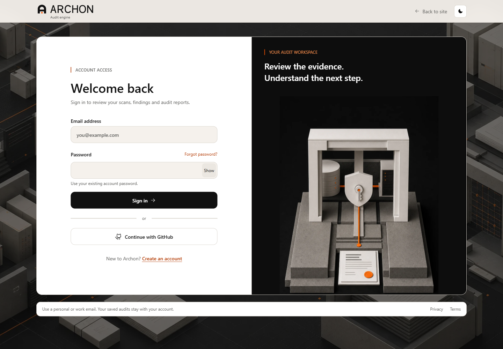
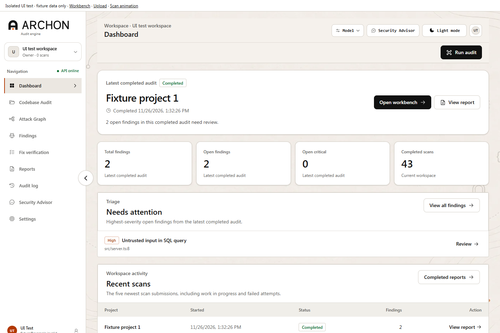
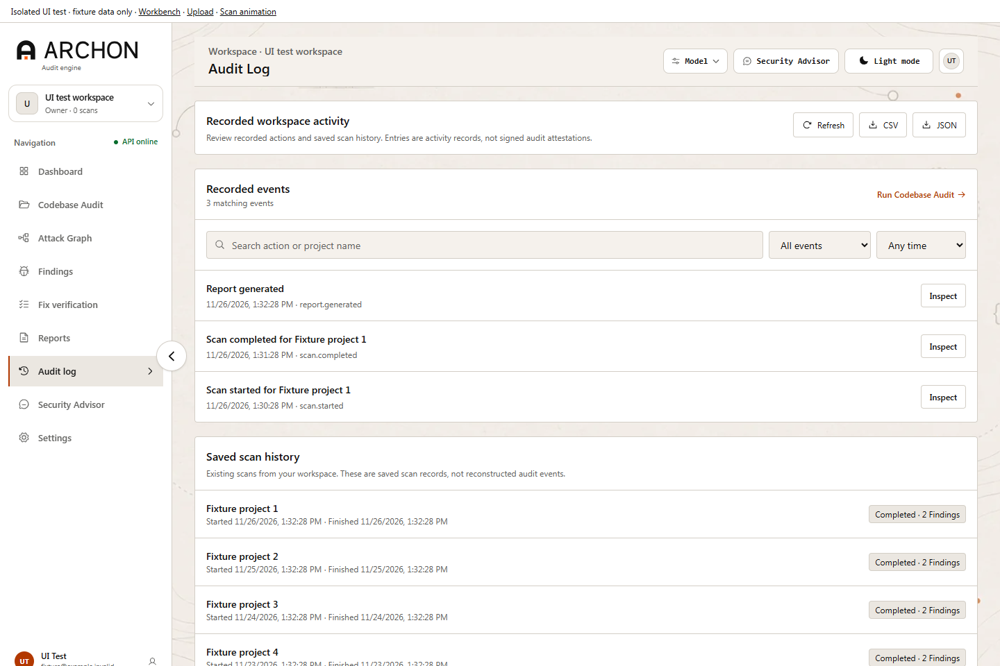

# Archon screenshot gallery

These are captures of the application. Signed-in workflows use demonstration data; GitHub and browser-extension options depend on configuration and permission.

## Public site and account access

- [Landing page](landing.png) · [About](about.jpg) · [Team](team.jpg) · [Privacy](privacy.jpg) · [Terms](terms.jpg)
- [Sign in](login.png) · [Create an account](register.png) · [Reset password](password-recovery.png)

## Run and review an audit

- [Dashboard](dashboard.png) · [Create a workspace](create-workspace.png)
- [Codebase Audit](codebase-audit.png) · [GitHub repository selection](github-repository.png) · [Scan progress](scan-progress.png) · [Audit history](audit-history.png)
- [Audit Workbench](workbench.png) · [Findings](findings.png) · [Attack Graph](attack-graph.png)

## Reports, guidance and workspace management

- [Fix Verification](fix-verification.png) · [Reports library](reports.png) · [Report detail](report-detail.png)
- [Audit Log](audit-log.png) · [Security Advisor](advisor.png)
- [Settings](settings.png) · [Workspace settings](workspace-settings.png) · [Profile](profile.png)

