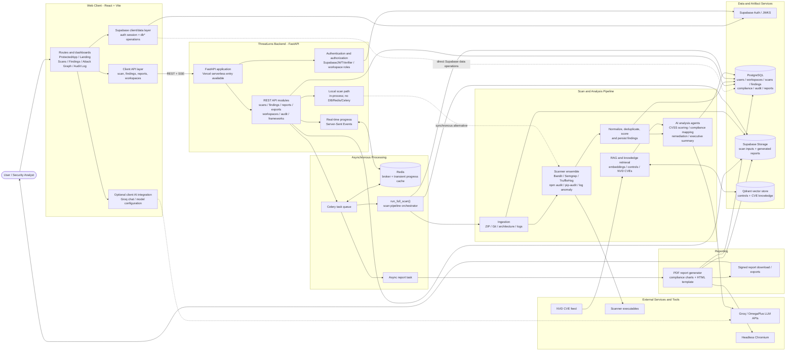
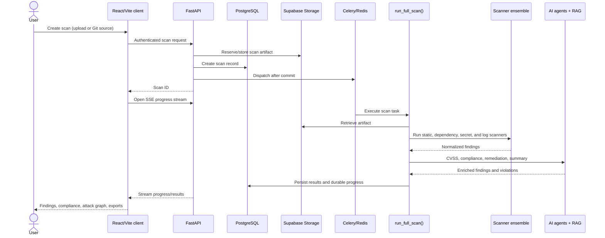

# ThreatLens / Arch Detective Architecture

> Generated only from `graphify-out/graph.json` and `graphify-out/GRAPH_REPORT.md`.
> Solid arrows represent relationships directly supported by graph nodes or extracted edges.
> Dashed arrows summarize higher-level flow inferred from those relationships.

## Primary runtime flow

## Graph evidence used

- Frontend nodes come from `src/routes`, `src/lib/api`, `src/hooks`, and `src/lib/supabase.ts` represented in the graph.
- Backend entry, API, authentication, ingestion, scanner, agent, RAG, task, storage, and report nodes come from `threatlens/app` graph records.
- `run_full_scan()` is the principal cross-community bridge and connects ingestion, scanners, persistence, storage, compliance, and scoring concerns.
- The graph explicitly describes PostgreSQL as durable progress storage and Redis as a transient cache; Celery uses Redis.
- The graph includes Qdrant connectivity and NVD-to-vector-store synchronization.
- `SupabaseStorage`, `Scan`, `ScanStatus`, `AuthenticatedUser`, and `Finding` are among the most connected domain abstractions.

## Confidence note

The source graph contains 1,227 nodes and 2,777 edges: 59% extracted and 41% inferred. Component existence and named function calls above are grounded in graph records; dashed architecture arrows are intentionally marked as summarized or inferred flows. The graph reports no ambiguous edges, but several high-degree domain-model connections remain candidates for source-level verification.
