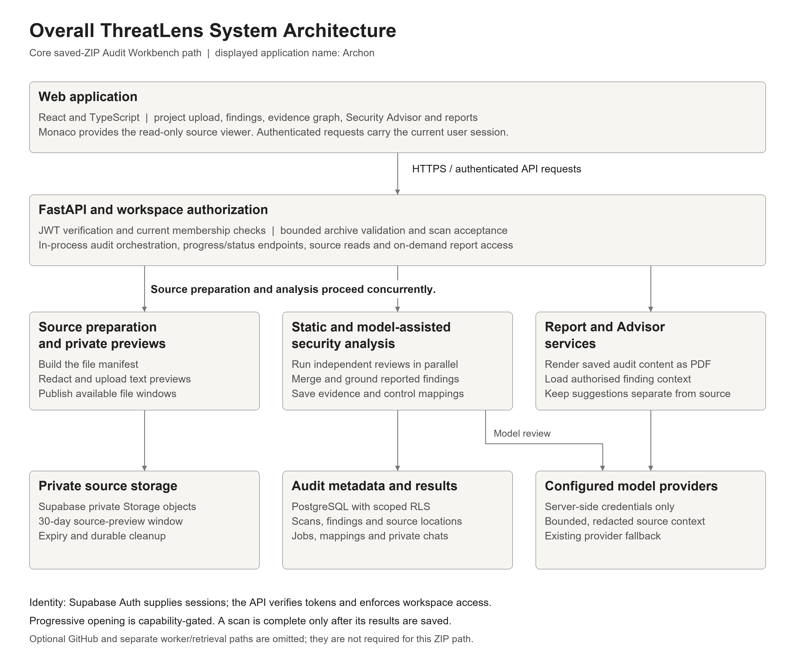
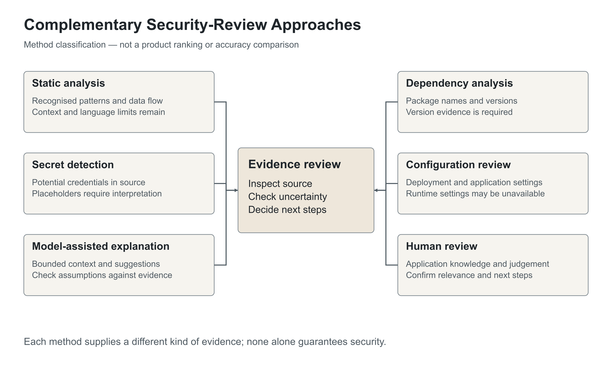
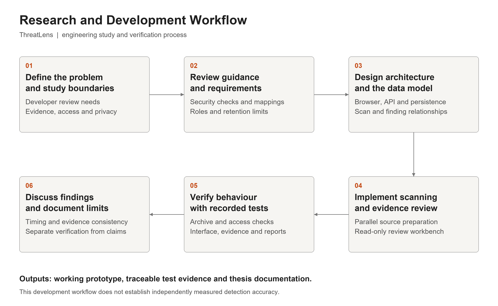
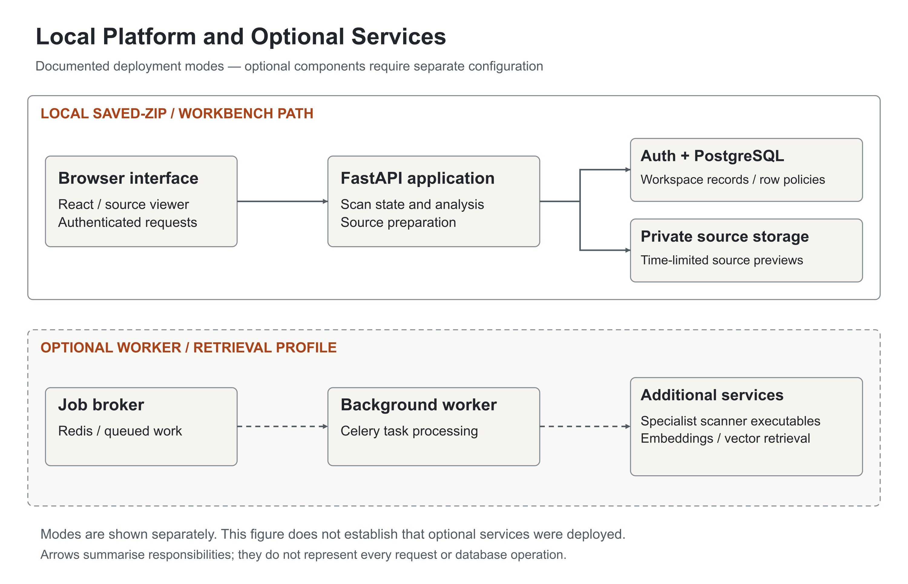
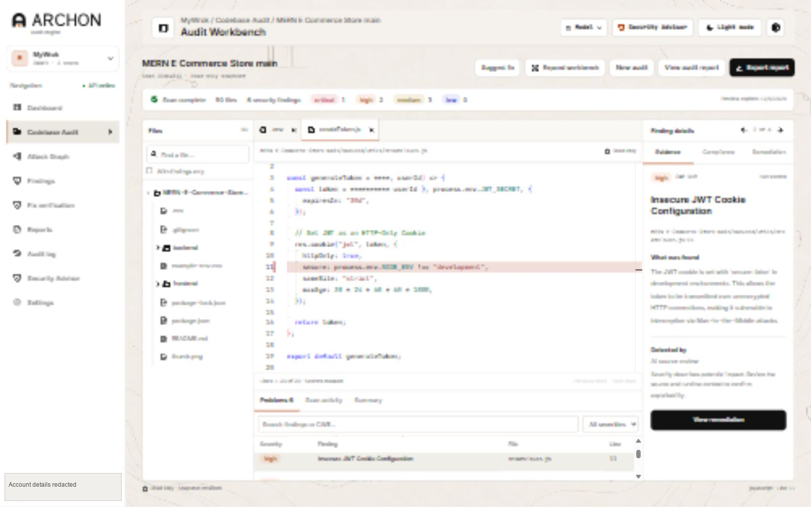
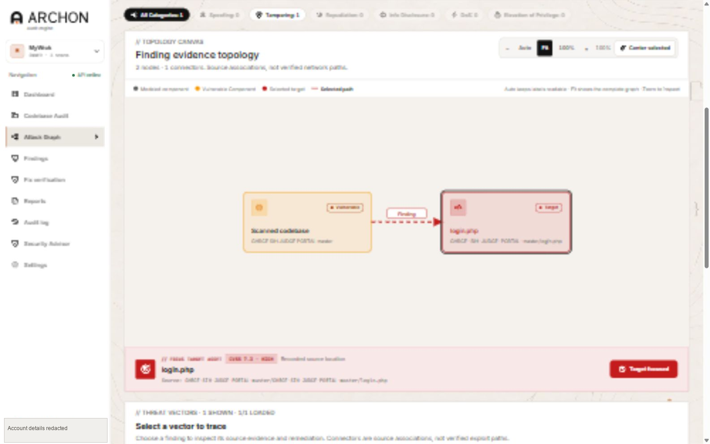
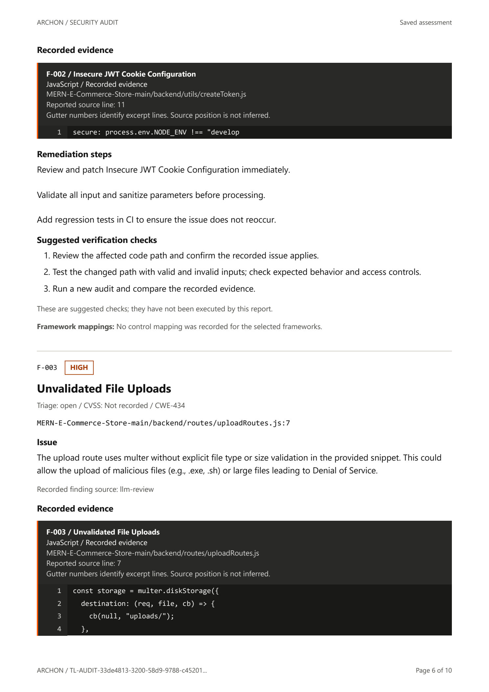
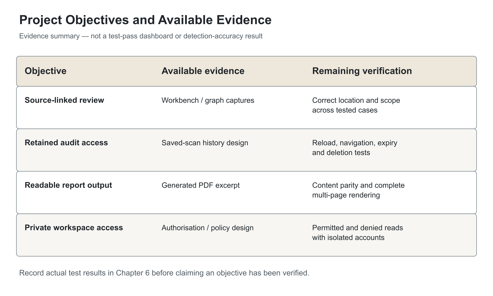
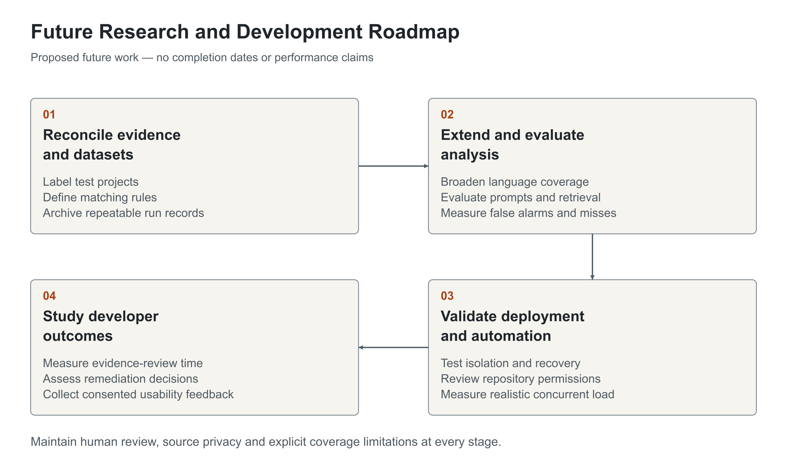

# Thesis figures in order

## Figure 1.1: Overall Architecture of ThreatLens

Placement: Section 1.8 Main Contributions.

## Figure 2.1: Classification of Security-Review Approaches

Placement: Section 2.8 Comparison with Existing Security Assessment Tools.

## Figure 3.1: Research and Development Workflow

Placement: Section 3.1 Research Design and Workflow.

## Figure 4.1: Local Platform and Optional Worker Services

Placement: Section 4.6 Background Processing and Deployment Modes.

## Figure 5.1: Audit Workbench with Source Code and Finding Details

Placement: Section 5.10 Scan Visualization and Attack Graph.

## Figure 5.2: Evidence-Based Graph of Security Findings

Placement: Section 5.10 Scan Visualization and Attack Graph.

## Figure 6.1: Generated Report with Recorded Evidence and Remedies

Placement: Section 6.4 Vulnerability Detection Results.

## Figure 7.1: Project Objectives and Available Evidence

Placement: Section 7.2 Key Findings and Contributions.

## Figure 8.1: Proposed Future Research and Development Roadmap

Placement: Section 8.5 Extended Validation and User Studies.

Existing screenshots are unchanged; Figures 5.1 and 5.2 need sharper recaptures for print. Four new diagrams are conceptual explanatory figures, not validation results. The platform diagram distinguishes optional deployment components. RLS reference: https://supabase.com/docs/guides/database/postgres/row-level-security
